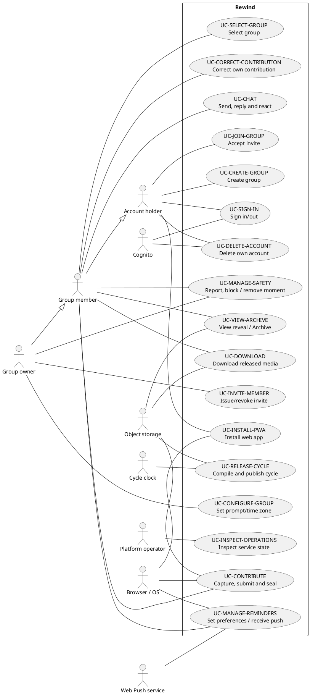

# Current product baseline

As of 15 October 2026. Source baseline: `dev` commit
`40ebeb5673d103b4b6950d095192aae744980769`.

This is reusable product and requirements documentation, not a release acceptance
record. It preserves the [submitted proposal](proposals/proposal-rewind.md) as
history. The root working agreement supplied for this batch takes precedence over
the proposal's September pilot note: real accounts are the product; web/PWA uses
Cognito Managed Login; developer password sign-in is for local/dev; iOS delivery
is the PWA; reminders use web push. Historical `demo` infrastructure names do not
mean the synthetic Demo remains available.

## Evidence and interpretation

**Observed** below means read in source at the revision above. Test references
identify executable specifications that exist; this document's author did not run
them or establish that they currently pass. **Historical** means retained evidence
from an earlier revision, with its original limits. **Unverified** means no fresh
runtime, hosted, physical-device or provider observation was made in this slice.
Implementation presence does not prove deployment or end-to-end acceptance.

The retained parity analysis at
`.local-data/sprint-prep-20261011/sprint-2-working-files/evidence/parity-analysis.txt`
was a discovery aid, based on `7bab4027bd4b19425fd4bfbe8e9a0d99d2f2a913`.
It is local historical evidence, not a portable repository dependency or a current
passing result. Requirement dispositions here were refreshed against the source
baseline. No team ownership, hours, ceremonies or measured completion percentage
is inferred from the proposal's placeholder assignments.

## Business need and stakeholders

The proposal addresses friend groups losing everyday contact after graduation,
relocation or separation. Immediate, polished social posting can make sharing
feel performative. Rewind offers a small private group a low-pressure ritual:
contribute a bounded everyday moment, wait together, then rediscover the group's
chronological film. Retro treatments support that memory aesthetic. This is a
proof of concept; user demand and usability are hypotheses rather than measured
pilot outcomes in this document.

| Stakeholder                                 | Need and product responsibility                                                                                                                 |
| ------------------------------------------- | ----------------------------------------------------------------------------------------------------------------------------------------------- |
| Invited friend/member                       | Join privately, capture within a clear allowance, understand sealing, chat and revisit released memories.                                       |
| Group owner (also a member)                 | Create/name the group, invite people, choose prompt/time zone and use bounded safety controls. Ownership does not grant early media access.     |
| Platform operator                           | Keep identity, private storage, jobs and reminders working; inspect safe operational signals and recover without routine private-media viewing. |
| Lecturer/reviewer                           | Trace proposal requirements to implemented behavior and distinguish code, fixtures and actual device/deployment evidence.                       |
| Identity, object-storage and push providers | Supply external authentication, hosted storage and notification delivery. They are supporting systems, not group members.                       |

No external sponsor or named member allocation is established here. An authorized
recipient can redistribute a downloaded film; application access control cannot
promise control over copies outside Rewind.

## Product boundary and requirement disposition

The default group cycle is 28 days. A group is initially owner-only while inviting;
its configured capacity is 2–10, not a rule requiring two people before creation.
Members can belong to/select different groups. Server membership and selected
group checks govern private operations. Accelerated local cycles exercise the
same lifecycle but do not prove a four-week real-world run.

“Retained” means the core outcome exists in source, not that every proposed
acceptance condition has been verified. IDs FR-01–FR-10 retain their proposal
meaning. New semantic use-case IDs below split the proposal's five broad bundles
so other model packages can link to precise behavior.

| Proposal requirement                        | Current disposition and limits                                                                                                                                                                                                                                                                                                               | Use cases                                        |
| ------------------------------------------- | -------------------------------------------------------------------------------------------------------------------------------------------------------------------------------------------------------------------------------------------------------------------------------------------------------------------------------------------- | ------------------------------------------------ |
| FR-01 Identity/private groups               | Retained with environment distinction: Cognito authorization code + PKCE and server exchange for web/PWA; local/dev developer password sessions remain. Release config rejects password sign-in. Native clients use developer sign-in only against local/dev; no release-native Cognito claim.                                               | UC-SIGN-IN, UC-CREATE-GROUP, UC-SELECT-GROUP     |
| FR-02 Group/invites                         | Retained: owner creation, expiring/revocable invitation, capacity and replay checks; pending invite can survive managed sign-in.                                                                                                                                                                                                             | UC-CREATE-GROUP, UC-INVITE-MEMBER, UC-JOIN-GROUP |
| FR-03 Capture                               | Extended to photos and video. Four looks (Disposable Flash, CCD, 8mm, VHS); video review/trim; photo becomes a three-second segment. Capable web paths treat before upload; native/incapable browser paths rely on server treatment. Do not claim universal pre-upload processing.                                                           | UC-CONTRIBUTE                                    |
| FR-04 Contribution lifecycle                | Retained with shared photo/video quota: at most five contributions and 30 seconds per member per cycle-relative seven-day window, maximum 15 seconds each; one eligible correction in that original window; sealed metadata before publication.                                                                                              | UC-CONTRIBUTE, UC-CORRECT-CONTRIBUTION           |
| FR-05 Prompts/reminders                     | Changed: owner prompt/time zone; Sunday 19:00 in group time zone (UTC default), member snooze/disable, durable outbox. Web push only; native Expo/FCM path paused. iPhone web push requires Home Screen installation and permission.                                                                                                         | UC-CONFIGURE-GROUP, UC-MANAGE-REMINDERS          |
| FR-06 Chat                                  | Retained: group text, replies and supported reaction; bounded message/reply rules, live updates and history.                                                                                                                                                                                                                                 | UC-CHAT                                          |
| FR-07 Automatic film                        | Retained: closure, chronological accepted ready inputs, FFmpeg processing/audio normalization, verified publication and successor cycle. Target film output is vertical 720p.                                                                                                                                                                | UC-RELEASE-CYCLE, UC-VIEW-ARCHIVE                |
| FR-08 Recovery/filler                       | Bounded: durable jobs/retries and delayed state. A one-clip cycle may add one eligible same-group archive clip labelled “From the archive”; not a general duration target or arbitrary empty-cycle filler.                                                                                                                                   | UC-RELEASE-CYCLE                                 |
| FR-09 Archive/download                      | Retained: 24-hour premiere from actual publication, continued authorized Archive, film and own processed-clip downloads after release.                                                                                                                                                                                                       | UC-VIEW-ARCHIVE, UC-DOWNLOAD                     |
| FR-10 Safe operations                       | Retained/changed: health, safe logs and persisted job/reminder/transition records plus operator tooling. No claim of a full dashboard, paging service or independent privacy audit.                                                                                                                                                          | UC-INSPECT-OPERATIONS                            |
| Proposal platform/storage choices           | Shared Expo/React Native Android configuration plus installable web/PWA. iOS is PWA only. Disk local and S3 hosted; PostgreSQL adapter/operations source exists alongside local SQLite. Current live environment configuration is unverified here. EventBridge/SQS were candidates, not evidence of the actual durable queue implementation. | All; UC-INSTALL-PWA                              |
| Previously excluded account/safety controls | Added in source: account deletion, reporting/blocking and owner contribution removal; do not describe all original membership exclusions as still true. No commercial moderation/compliance assurance follows.                                                                                                                               | UC-MANAGE-SAFETY, UC-DELETE-ACCOUNT              |

Current exclusions: public discovery/profiles/feed, follower graphs, advertising,
normal gallery import (fixtures are not a user import feature), long-form video,
live streaming, licensed music, complex editing/AI edits, full messaging features
such as attachments and read receipts, and commercial moderation. Independent
image-only social posts remain excluded; photo **time-capsule contributions** are
included. Do not infer owner transfer or general membership administration from
safety/account controls. Multi-region scale, billing/subscriptions, compiled native
iOS, App Store delivery and native push expansion are outside current scope.
Existing legacy/native configuration is not a promise of supported release flows.

## UML use-case map

The following PlantUML is the editable UML use-case model (rendering is not
required to read the flows). The rectangle is the Rewind boundary. Owner
specializes Member; an authenticated prospective member can join without already
belonging to the target group. Associations show participation, not execution
order. Authentication is a precondition for private use cases, not a repeated
login step on every operation. The scheduler/worker is internal; the clock is an
external trigger. No implementation worker is misrepresented as a human actor.

## Use-case contracts

These explicit anchors are stable links for later model packages. Keep semantic
IDs when renaming headings. All private flows require a valid session; target-group
flows require accepted membership and appropriate selected-group context. Failure
must not expose another group's data. “Success” is a source-defined postcondition,
not a record of a newly executed journey.

### UC-SIGN-IN — Sign in and out

Account holder starts managed sign-in on web/PWA; Rewind stores a short-lived
transaction, redirects to Cognito with state/nonce/PKCE, validates the callback,
exchanges the code server-side and creates an application session. A retained
invite return path resumes joining. Sign-out ends the application session and,
for managed sessions, supplies the provider logout path. Invalid/replayed/expired
state, denied consent, invalid identity or exchange failure returns a safe sign-in
failure. Developer password entry is enabled only by local/dev configuration;
release rejects that configuration. Sources: [Cognito service](../../server/src/auth/cognito.ts),
[HTTP auth handlers](../../server/src/http.ts), [auth configuration](../../server/src/config.ts),
[client provider](../../src/auth/RealAccountProvider.tsx).

### UC-CREATE-GROUP — Create a private group

Authenticated account supplies name, prompt, capacity and time zone. Server
validates and atomically creates group, owner membership, collecting cycle and
selection. Success may have only the owner present. Blank/oversize fields,
capacity outside 2–10 or invalid zone fail without partial group creation.
Source: [real groups](../../server/src/groups/real.ts).

### UC-SELECT-GROUP — Switch group context

Member chooses an accepted group; server persists selection and client loads that
group's Home, chat and Archive context. Unknown/non-member selection is rejected;
old media grants are checked against current selected membership, avoiding a
stale-group bypass. Sources: [groups](../../server/src/groups/real.ts),
[group experience](../../src/groups/RealAccountGroupExperience.tsx),
[media capabilities](../../server/src/archive/capabilities.ts).

### UC-INVITE-MEMBER — Issue or revoke an invitation

Owner requests an invitation and shares its code/link; server records a bounded
expiry. Owner can revoke an active invitation. Non-owner creation/revocation,
invalid expiry or unavailable target is denied. An invitation is not membership
until acceptance; sharing it outside Rewind is the owner's action.
Source: [invitations](../../server/src/groups/invites.ts).

### UC-JOIN-GROUP — Accept an invitation

Account holder opens/enters an invite, signs in if needed, and accepts it. Server
checks format, active expiry, replay state and capacity, then creates/selects
membership transactionally. Malformed, expired, revoked, replayed, full-group or
throttled attempts do not grant access. Sources: [invitations](../../server/src/groups/invites.ts),
[deep links](../../src/invites/deep-links.ts).

### UC-CONFIGURE-GROUP — Choose prompt and time zone

Owner selects a library/custom prompt and valid IANA time zone in group Settings;
server validates and persists settings. Reminder scheduling uses that zone;
changing it does not move contribution/cycle deadlines. Non-owner updates and
invalid/oversize values fail. Sources: [settings](../../server/src/groups/settings.ts),
[Settings UI](../../src/reminders/RealGroupSettings.tsx),
[schedule](../../server/src/reminders/schedule.ts).

### UC-CONTRIBUTE — Capture, submit, process and seal

During collection, member permits camera (and microphone for video), selects a
look, captures photo/video, reviews and trims video, then submits. Server validates
membership, cycle, duration and remaining allowance; upload intent/direct transfer
and processing create a durable contribution/job. Photo consumes one slot and
three seconds; video consumes its accepted duration. Processing validates and
normalizes the output, applies treatment where needed, verifies it and cleans up
temporary source. Accepted contribution status is visible as metadata; submission
does not grant pre-release playback/thumbnail access. This sealing boundary does
not prohibit the member's local review **before** submission.

Permission denial, unavailable recorder, interruption, unsupported/oversize media,
expired upload intent, transfer failure, quota exhaustion and processing failure
produce bounded failure/pending states, not a playable partial release. Do not
assume durable background upload after the app closes. Sources:
[photo capture](../../src/capture/CameraCaptureScreen.tsx),
[video capture](../../src/capture/VideoCaptureScreen.tsx),
[quota policy](../../server/src/contributions/index.ts),
[ledger](../../server/src/contributions/ledger.ts),
[upload intents](../../server/src/media/upload-intents.ts),
[jobs](../../server/src/jobs/index.ts).

### UC-CORRECT-CONTRIBUTION — Correct one own contribution

Member selects an eligible own contribution in its original current seven-day
window, deletes it, and may recapture through UC-CONTRIBUTE. A transaction records
the tombstone, consumes the one deletion allowance and restores its reserved
count/seconds. A second deletion, previous-window item, processing item,
already-deleted item, non-owned item or closed cycle fails safely. Correction is
not unlimited editing or early replay. Source: [deletion policy](../../server/src/contributions/index.ts).

### UC-RELEASE-CYCLE — Compile and publish the time capsule

At the cycle boundary, internal scheduling closes collection and ensures a
successor cycle from the boundary. Durable jobs use eligible processed inputs in
contribution-time order, normalize audio and compile the film. A one-clip cycle
can append one eligible same-group archived clip with an explicit label. Verified
output is published; the 24-hour premiere begins at publication, even if compilation
was delayed. Later lifecycle advancement archives the release. Retries and
idempotent transitions avoid treating partial work as publication. Missing ready
inputs, no eligible filler, empty cycles, processing errors or exhausted retries
must be represented by the appropriate empty/waiting/delayed state rather than a
fabricated film. The next collection does not wait for a delayed premiere.
Sources: [lifecycle](../../server/src/cycles/lifecycle.ts),
[scheduler](../../server/src/cycles/scheduler.ts), [jobs](../../server/src/jobs/index.ts),
[FFmpeg](../../server/src/ffmpeg.ts).

### UC-VIEW-ARCHIVE — Watch reveal and revisit Archive

Member opens the released film from Home/reveal or browses Archive; server returns
published authorized entries and short-lived media access. Premiere ends after
24 hours; published films continue in Archive, subject to account/content controls.
Unpublished, empty or delayed releases show their state. Non-member, stale session,
changed selection or invalid/unverified asset does not produce media access.
Sources: [Archive UI](../../src/archive/ArchiveScreen.tsx),
[capabilities](../../server/src/archive/capabilities.ts), [HTTP](../../server/src/http.ts).

### UC-DOWNLOAD — Download a film or own processed clip

After publication, member selects film download or their own processed clip.
Server rechecks membership/session, publication and output integrity and issues
bounded access. Client saves/shares through platform download behavior. Expired
access requires a fresh authorized request; another member's individual clip,
unpublished output, revoked session or missing asset is denied. Downloads are
copies outside Rewind's subsequent control. Sources:
[download client](../../src/archive/archive-download.ts),
[capabilities](../../server/src/archive/capabilities.ts), [HTTP](../../server/src/http.ts).

### UC-CHAT — Send, reply and react within the group

Member opens group history, sends text, replies to an eligible group message or
toggles the supported reaction; server persists and distributes group updates.
Reconnect/history handling restores context. Blank/oversize text (maximum 2,000
characters), cross-group/missing reply, nested reply, unsupported reaction and
non-membership fail validation. No attachment or general-purpose messaging claim.
Sources: [chat service](../../server/src/chat/index.ts),
[chat UI](../../src/chat/RealAccountChatScreen.tsx).

### UC-MANAGE-REMINDERS — Set preferences and receive web push

Member enables reminders and grants platform permission; client registers a web
push subscription. Group-zone Sunday 19:00 scheduling and the durable outbox
respect member disable/snooze and attempt provider delivery. Invalid destinations
are retired; transient failures retry within bounds. Permission denial,
unsupported browser, missing iPhone Home Screen installation, invalid subscription
or provider failure leaves useful in-app status. Provider acceptance is not proof
that a device displayed a notification. Native push adapter code is retained but
not the active product path. Sources: [platform selection](../../src/reminders/push-platform.ts),
[subscription UI](../../src/reminders/PrivateReminderSubscription.tsx),
[schedule](../../server/src/reminders/schedule.ts), [outbox](../../server/src/reminders/outbox.ts),
[providers](../../server/src/reminders/providers.ts).

### UC-INSTALL-PWA — Install the web app

Account holder opens the HTTPS web app and uses the browser/OS installation or
Add to Home Screen flow. Manifest and service worker support standalone launch
and offline fallback. Unsupported installation/browser capabilities explain why
the browser route remains necessary. Installation is not a promise of offline
private account data, offline media submission or native iOS delivery. Sources:
[manifest](../../public/manifest.json), [service worker](../../public/sw.js),
[offline fallback](../../public/offline.html).

### UC-MANAGE-SAFETY — Report, block and remove a moment

Member reports an eligible group item/member or blocks another account; owner may
remove a group contribution. Server checks membership, role and target scope;
reporting alone does not establish a moderation verdict. Invalid/self/foreign
targets and non-owner removal are rejected. Owner removal does not restore the
author's quota or spend the author's correction allowance. Content controls can
affect Archive availability; no guarantee extends to previously downloaded copies.
Source: [safety service](../../server/src/groups/safety.ts).

### UC-DELETE-ACCOUNT — Delete own account

Authenticated account holder confirms deletion; server coordinates account/data
cleanup and managed identity deletion where applicable, then ends access. Provider
unavailability can return a retryable failure rather than claim success; revoked
or missing sessions cannot delete another account. This is an added bounded
feature, not evidence of independently assessed legal compliance. Sources:
[deletion service](../../server/src/auth/deletion.ts), [HTTP handlers](../../server/src/http.ts).

### UC-INSPECT-OPERATIONS — Inspect service state

Operator uses authorized health/diagnostic and operational snapshot tooling to
inspect jobs, cycle transitions and reminder outcomes. Safe errors and redacted
signals support diagnosis without a normal private-media viewing flow. Missing
configuration or unavailable database/provider is an operational failure to
resolve, not evidence of a healthy deployment. Sources:
[operational signals](operations/operational-signals.md),
[snapshot script](../../scripts/server-operational-metrics.mjs).

## Quality attributes and verification limits

| Attribute                             | Current mechanism / check location                                                                                                                                                                                                                                            | What remains unverified here                                                                                                                                             |
| ------------------------------------- | ----------------------------------------------------------------------------------------------------------------------------------------------------------------------------------------------------------------------------------------------------------------------------- | ------------------------------------------------------------------------------------------------------------------------------------------------------------------------ |
| Privacy and access control            | Membership/session/selection checks, unpublished-media denial, bounded asset capabilities and output integrity. Specifications: `server/tests/real-archive.test.mjs`, `real-group-invites.test.mjs`, `cognito-auth.test.mjs`.                                                 | Fresh negative live S3/Cognito checks or independent security audit.                                                                                                     |
| Reliability and data integrity        | Transactional quota/correction, persisted jobs, bounded retry, idempotent closure/publication, staged cleanup. Specifications: `contribution-policy.test.mjs`, `contribution-ledger.test.mjs`, `compilation-jobs.test.mjs`, `cycle-scheduler.test.mjs` under `server/tests/`. | Long-duration field operation, live fault/recovery or lossless environment rollback.                                                                                     |
| Performance                           | Bounded media/quota and asynchronous processing. Proposal target remains metadata/chat API p95 below two seconds on five-user fixtures; compilation needs a stated fixture/output profile and bound.                                                                          | No current timing result. Earlier 180×320 film benchmark is not a 720p performance result.                                                                               |
| Platform compatibility                | Shared Expo/React Native source; Android build profiles; web manifest/service worker; capability-based capture/push. Specifications: `tests/native-build.test.mjs`, `tests/capture-platform.test.ts`, `tests/private-reminder-subscription.test.tsx`.                         | A configured APK is not delivered/physically accepted. Fresh Android and iPhone Home Screen end-to-end journeys, HTTPS capture and displayed web push remain unverified. |
| Usability and accessibility           | Explicit locked/delayed/empty states, allowance feedback, permission/error paths; accessibility/browser checks exist in `tests/responsive/`.                                                                                                                                  | No fresh pilot usability result, assistive-technology assessment or measured accessibility conformance.                                                                  |
| Maintainability                       | Typed modules, policy/worker tests and architecture checks. Proposal's 70% application coverage is a target, not a result inferred from test presence.                                                                                                                        | Current test/coverage results are owned by the batch verification worker/CI, not established by this prose change.                                                       |
| Observability and repeatable delivery | Safe operational signals, deployment workflows and versioned configuration; local disk and hosted S3 choices are explicit.                                                                                                                                                    | No AWS action, deployment or current environment configuration inspection was performed here.                                                                            |

At documentation review time, release Cognito deployment (#515), release managed
PostgreSQL/backups (#504), release isolation (#230) and hosted Safari/Home Screen
integration verification (#527) were still open GitHub records. These are
follow-up tracking facts, not proof that source features are absent or that a
live deployment has failed. Refresh their state before using this baseline for a
release decision. Closed historical #505/#521–#526/#528 are not newly outstanding
work. The parent batch owns current application checks, CI integration and merge.
