# Capture, review, and sealed contribution upload

## Scope and use cases

Issue #538; source revision `40ebeb5673d103b4b6950d095192aae744980769`. This is a reusable developer model derived from static source inspection. Analysis names describe responsibilities; design names identify actual code. Diagram IDs (`CAP-A*`, `CAP-D*`, `CAP-B*`) are stable within this document. The actor is a signed-in member contributing to the selected group's collecting cycle. Capture and preview are local; registration and processing are separate server outcomes. Here **sealed** means a processed job is `ready`, as projected by the contribution ledger; an upload-intent state of `completed` means registered, not yet sealed.

| UC                                 | Normal interaction and postcondition                                                                                                                                                                 | Major exceptions and alternatives                                                                                                                                                                                                                                                                    |
| ---------------------------------- | ---------------------------------------------------------------------------------------------------------------------------------------------------------------------------------------------------- | ---------------------------------------------------------------------------------------------------------------------------------------------------------------------------------------------------------------------------------------------------------------------------------------------------- |
| UC-1 Capture a photo               | Open capture; check camera access; take a still or choose a labelled image file; verify an app-managed copy; preview it. Retake/discard releases the owned preview.                                  | Unsupported/denied/blocked/temporarily unavailable access offers fallback, retry or Settings as applicable. File-picker cancellation creates no contribution. Copy/verification failure cannot expose an unverified preview; stale completion cannot replace a newer selection.                      |
| UC-2 Capture a video               | Obtain camera and microphone access; record with a 15-second cap (or stop earlier); validate MP4/audio/dimensions; review the owned clip. A selected file remains identified as a file contribution. | Missing audio, unusable metadata/container, overlong input, recording/player failure or permission denial keeps recovery/retake actionable. Cancellation invalidates late recording results.                                                                                                         |
| UC-3 Edit and preview              | Choose a look; for video, set a trim window of at least 0.5 seconds within the clip and preview with audio and bounded playback. Keep review metadata separate from source bytes.                    | Invalid trim leaves prior bounds intact. Failed/cancelled browser grading retains the original for another attempt. A changed video edit signature creates a new upload input/key; a client-graded photo key includes its look.                                                                      |
| UC-4 Seal a contribution           | Retain input, negotiate transport, transfer and register once, then process the job; show sealed status after `ready`. A photo contributes three seconds and becomes a silent MP4.                   | Server rejects invalid actual media, wrong identity/group, closed cycle, exhausted quota or conflicting replacement. Storage/processing failure is distinct from registration. A concurrent processor is polled for bounded status recovery.                                                         |
| UC-5 Recover or abandon a transfer | Retry the same accepted input/key when safe; reconcile uncertain direct PUT/completion outcomes before further action. Cancel/background invalidates live work; foreground reconciles status.        | Video session allows three upload attempts total; terminal rejection/exhaustion requires corrective action or retake. Route exit/reload loses video ownership, so no byte resume is promised. Submitted photos retain managed bytes for restoration. Sign-out/reset follows explicit cleanup policy. |

Photo UI and server probe enforce 10 MiB; video uses 50 MiB and at most 15 seconds. Generic transfer metadata validation has a 50 MiB ceiling even for photos; it is not the final photo validator. Server allowance is shared across photo/video: configured cycle limits capped by five contributions and 30 seconds per member quota window. Registration reserves allowance before sealing; do not infer quota usage from a success panel. Replacement ID propagation is included; the broader delete/Archive workflow is outside scope.

## Analysis model

**CAP-A1 — boundary/control/entity class model (conceptual responsibilities).**
Multiplicity describes ownership, not an ORM or proposed implementation classes.

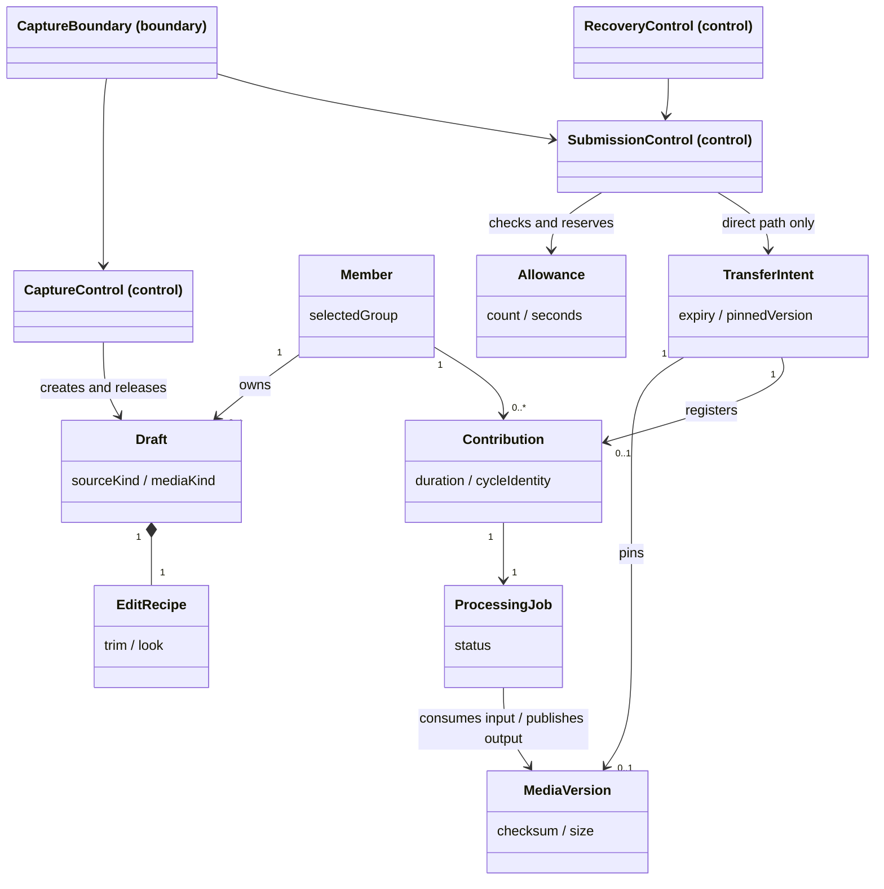

**CAP-A2 — UC-1/UC-2 acquisition and ownership.**

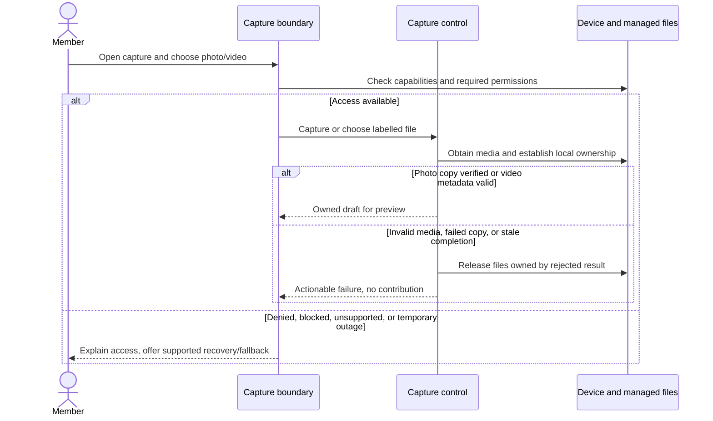

**CAP-A3 — UC-3 edit/preview.**

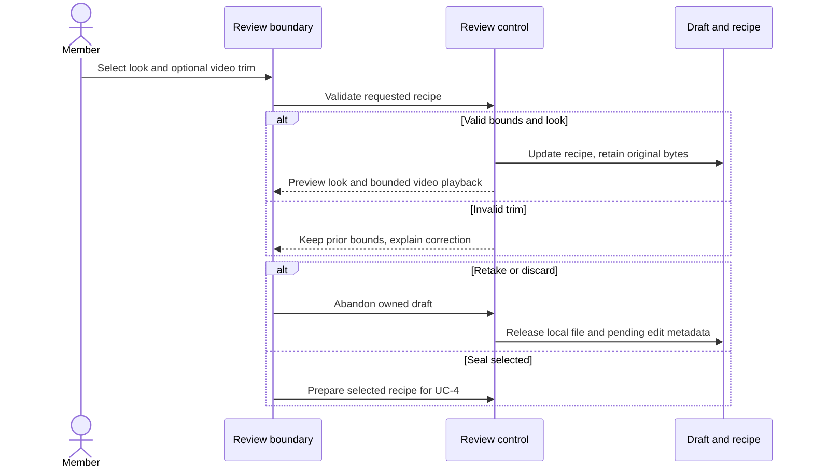

**CAP-A4 — UC-4 transfer, registration, and sealing.**

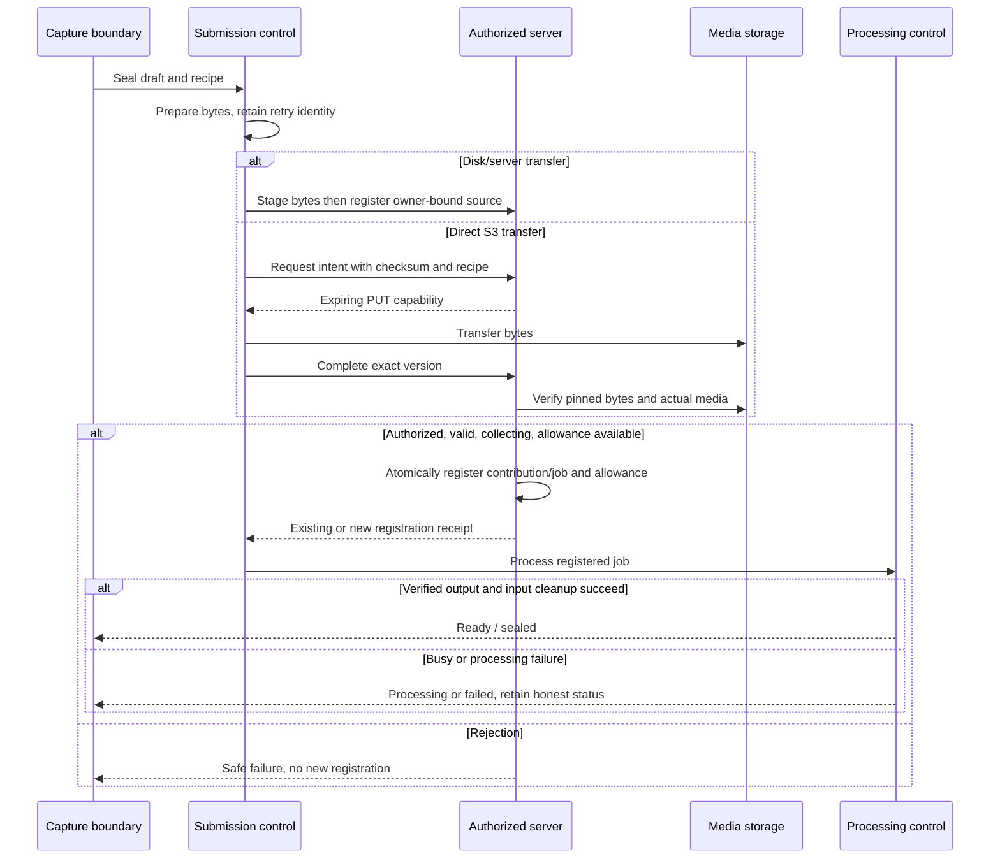

**CAP-A5 — UC-5 recovery, including uncertain acceptance.**

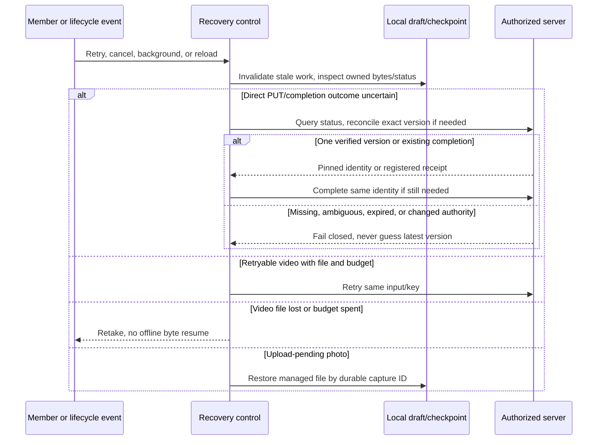

## Design model and flow mapping

Diagram labels distinguish functional modules, React components and TypeScript contracts; other named session/store nodes below are actual classes. Module nodes list real functions and do not assert runtime class instances.

**CAP-D1 — client design class model.**

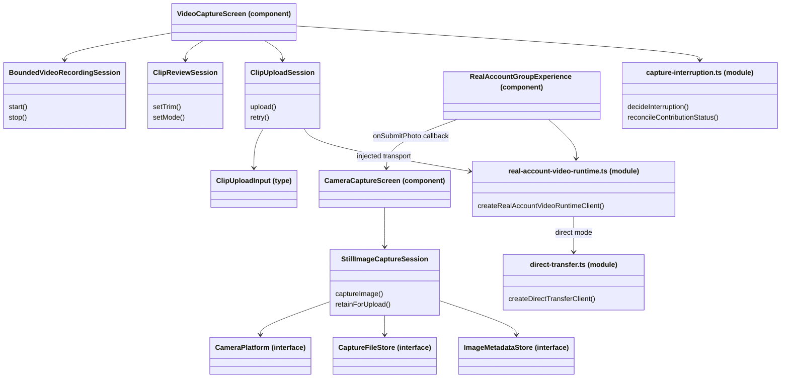

**CAP-D2 — UC-1/UC-2 implementation acquisition sequence.**

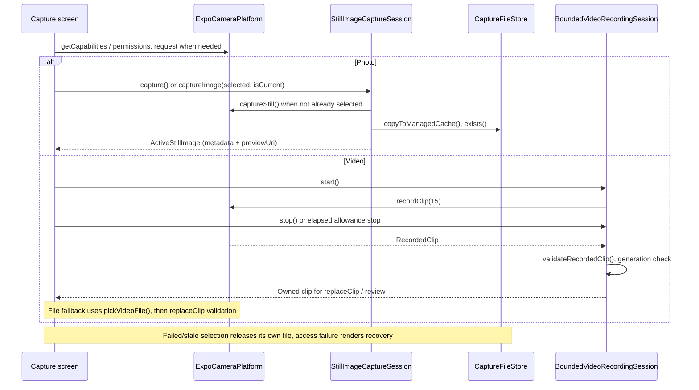

**CAP-D3 — UC-3 implementation edit/prepare sequence.**

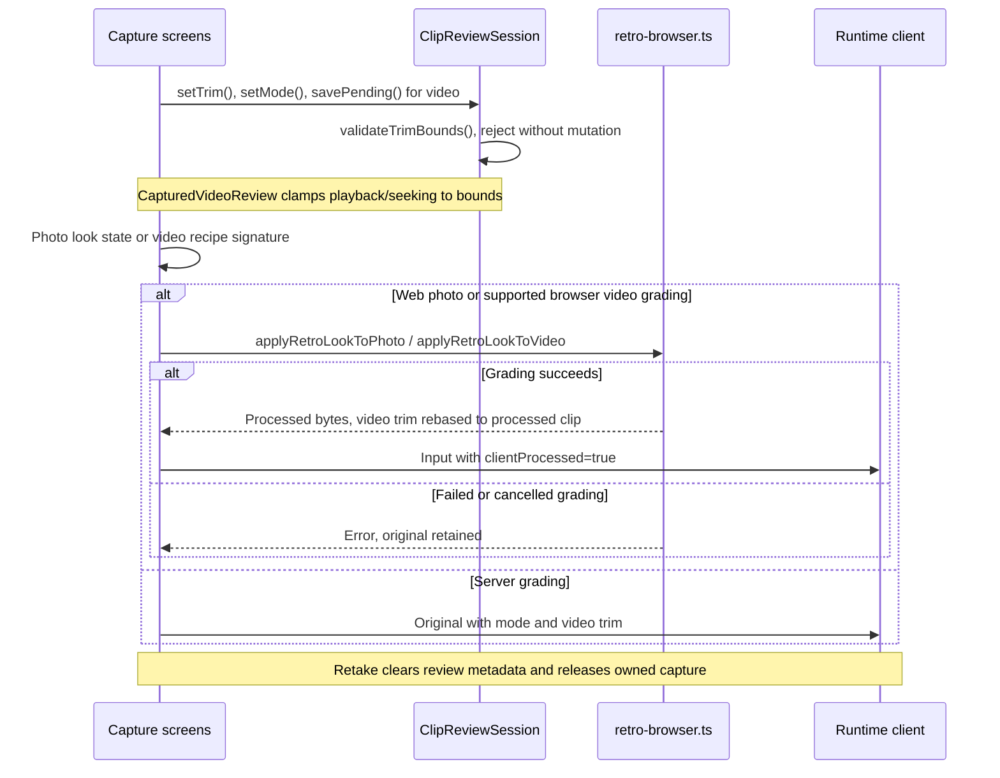

**CAP-D4 — UC-4 server staging/registration and shared processing.**
Photo submission is the `onSubmitPhoto` callback in `RealAccountGroupExperience`;
video uses `ClipUploadSession`. Both call the runtime client's upload/process methods.

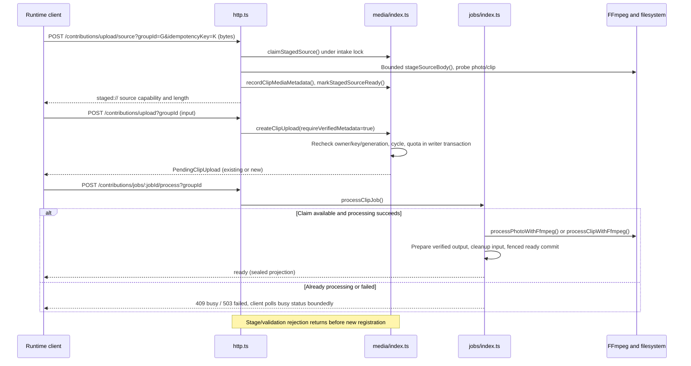

**CAP-D5 — UC-4 direct transfer AFTER sequence; shared processing follows CAP-D4.**

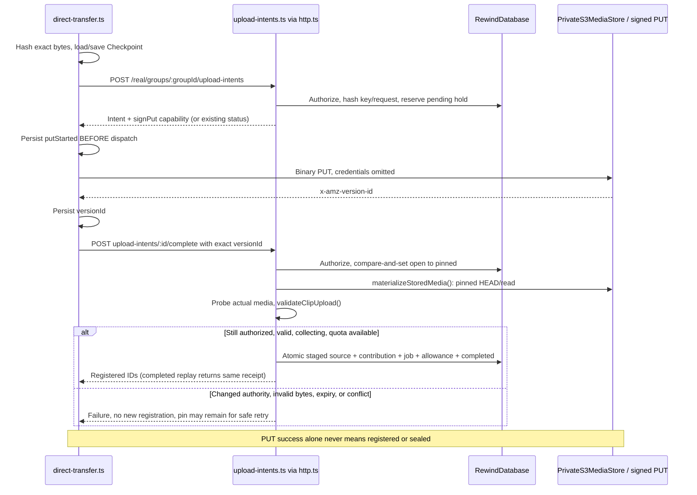

**CAP-D6 — UC-5 implementation recovery/cancellation AFTER sequence.**

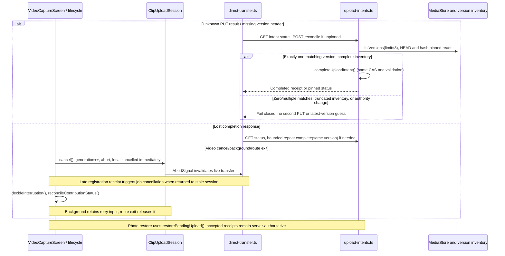

**CAP-D7 — server design class model and runtime adapter boundary (AFTER).**

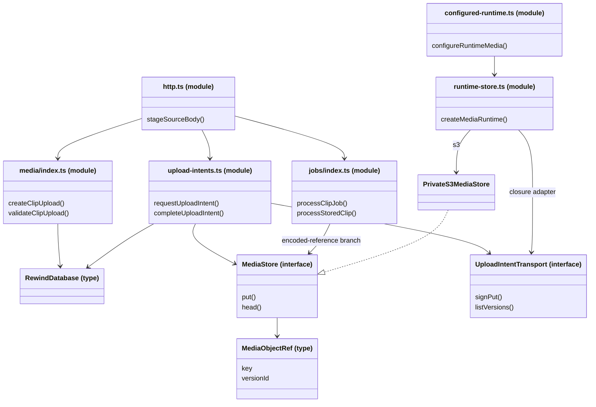

Disk is deliberately **not** depicted as a `DiskMediaStore` class. `parseMediaConfig` returns null for `disk`; `configureRuntimeMedia` returns empty options, and HTTP/jobs use filesystem paths. S3 supplies one shared store to HTTP/worker/lifecycle and an intent transport. `LocalMediaStore` is an existing explicit opt-in adapter/test seam; it is distinct from the product's `disk` mode and is not an extension target.

**Traceability.** Links are relative to this document; symbol names are exact source
identifiers (callbacks are identified by enclosing component). Test links reference
existing checks; no test execution is implied.

| UC / flow                     | Analysis → design                                           | Source file / symbols                                                                                                                                                                                                                                                                                                                                                                                                                                                                                                                                                                                                                                                                       | Existing tests and focus                                                                                                                                                                                                                                                                                                                                                                                                                                                              |
| ----------------------------- | ----------------------------------------------------------- | ------------------------------------------------------------------------------------------------------------------------------------------------------------------------------------------------------------------------------------------------------------------------------------------------------------------------------------------------------------------------------------------------------------------------------------------------------------------------------------------------------------------------------------------------------------------------------------------------------------------------------------------------------------------------------------------- | ------------------------------------------------------------------------------------------------------------------------------------------------------------------------------------------------------------------------------------------------------------------------------------------------------------------------------------------------------------------------------------------------------------------------------------------------------------------------------------- |
| UC-1 photo                    | [A1](#cap-a1), [A2](#cap-a2) → [D1](#cap-d1), [D2](#cap-d2) | [CameraCaptureScreen::CameraCaptureScreen](../../src/capture/CameraCaptureScreen.tsx), [StillImageCaptureSession::captureImage/retainForUpload/restorePendingUpload](../../src/capture/still-image-session.ts#L24), [contracts::CameraPlatform/CaptureFileStore](../../src/capture/contracts.ts), [file-store::WebCaptureFileStore/ExpoCaptureFileStore](../../src/capture/file-store.ts)                                                                                                                                                                                                                                                                                                   | [still-image-session](../../tests/still-image-session.test.ts): verified copy, stale cleanup, pending-photo restoration; [CameraCaptureScreen](../../tests/CameraCaptureScreen.test.tsx): access, fallback, seal UI                                                                                                                                                                                                                                                                   |
| UC-2 video                    | [A2](#cap-a2) → [D1](#cap-d1), [D2](#cap-d2)                | [video-recording::BoundedVideoRecordingSession/validateRecordedClip](../../src/capture/video-recording.ts#L47), [platform::ExpoCameraPlatform/readVideoMetadata](../../src/capture/platform.ts#L462), [VideoCaptureScreen::replaceClip/startRecording](../../src/capture/VideoCaptureScreen.tsx)                                                                                                                                                                                                                                                                                                                                                                                            | [video-recording](../../tests/video-recording.test.ts): cap/cancel/validation; [capture-platform](../../tests/capture-platform.test.ts); [VideoCaptureScreen](../../tests/VideoCaptureScreen.test.tsx): recording, permissions, ownership                                                                                                                                                                                                                                             |
| UC-3 edit/preview             | [A3](#cap-a3) → [D3](#cap-d3)                               | [video-review::ClipReviewSession/validateTrimBounds](../../src/capture/video-review.ts#L74), [VideoCaptureScreen::CapturedVideoReview/upload](../../src/capture/video-capture-media.tsx#L12), [retro-browser::applyRetroLookToPhoto/applyRetroLookToVideo](../../src/capture/retro-browser.ts), [ffmpeg::processingModeFor](../../server/src/ffmpeg.ts#L35)                                                                                                                                                                                                                                                                                                                                 | [video-review](../../tests/video-review.test.ts); [VideoCaptureScreen](../../tests/VideoCaptureScreen.test.tsx): bounded playback, trim/mode forwarding; [retro-looks](../../tests/retro-looks.test.ts); [upload-intents](../../server/tests/upload-intents.test.mjs): client-processed no-reapply mode                                                                                                                                                                               |
| UC-4 stage/register/process   | [A4](#cap-a4) → [D4](#cap-d4), [D5](#cap-d5), [D7](#cap-d7) | [RealAccountGroupExperience::onSubmitPhoto callback/photoContributionStatusForJob](../../src/capture/CameraCaptureScreen.tsx#L72), [real-account-video-runtime::createRealAccountVideoRuntimeClient](../../src/capture/real-account-video-runtime.ts#L46), [body.ts · stageSourceBody](../../server/src/routes/body.ts#L231), [media::createClipUpload/validateClipUpload](../../server/src/media/index.ts#L942), [upload-intents::requestUploadIntent/completeUploadIntent](../../server/src/media/upload-intents.ts), [jobs::processClipJob/processStoredClip](../../server/src/jobs/index.ts#L1533), [ffmpeg::probePhotoWithFfmpeg/probeClipWithFfmpeg](../../server/src/ffmpeg.ts#L393) | [real-account-photo](../../server/tests/real-account-photo.test.mjs): idempotent silent three-second output; [real-account-video](../../server/tests/real-account-video.test.mjs): selected-group authorization; [media-upload](../../server/tests/media-upload.test.mjs): validation/shared quota; [media-processing](../../server/tests/media-processing.test.mjs); [private-media-jobs](../../server/tests/private-media-jobs.test.mjs)                                            |
| UC-5 failure/retry/lifecycle  | [A5](#cap-a5) → [D6](#cap-d6)                               | [clip-uploader::ClipUploadSession](../../src/capture/clip-uploader.ts#L114), [capture-interruption::decideInterruption/reconcileContributionStatus](../../src/capture/capture-interruption.ts), [direct-transfer::createDirectTransferClient](../../src/capture/direct-transfer.ts#L296), [upload-intents::reconcileUploadIntent/cleanupUploadIntents](../../server/src/media/upload-intents.ts), [contribution-status::ContributionStatusProvider](../../src/capture/contribution-status.tsx#L168)                                                                                                                                                                                         | [clip-uploader](../../tests/clip-uploader.test.ts): three-attempt bound, abort/races; [capture-interruption](../../tests/capture-interruption.test.ts); [direct-transfer](../../tests/direct-transfer.test.ts): lost responses, journal failure, restart, cancellation; [upload-intents](../../server/tests/upload-intents.test.mjs): uniqueness, CAS, expiry, rollback; [real-account-video-runtime](../../tests/real-account-video-runtime.test.ts): late registration cancellation |
| UC-4/5 runtime media boundary | [A4](#cap-a4), [A5](#cap-a5) → [D7](#cap-d7)                | [config::parseMediaConfig](../../server/src/config.ts#L338), [configured-runtime::configureRuntimeMedia](../../server/src/media/configured-runtime.ts), [runtime-store::createMediaRuntime](../../server/src/media/runtime-store.ts), [store::MediaStore/MediaObjectRef/verifiedBody](../../server/src/media/store.ts), [s3-store::PrivateS3MediaStore](../../server/src/media/s3-store.ts#L55), [store-files::materializeStoredMedia/putProcessedFile](../../server/src/media/store-files.ts)                                                                                                                                                                                              | [configured-media-runtime](../../server/tests/configured-media-runtime.test.mjs); [runtime-store](../../server/tests/runtime-store.test.mjs); [private-media-store](../../server/tests/private-media-store.test.mjs); [upload-intents-protocol](../../server/tests/upload-intents-protocol.test.mjs); [direct-transfer-http](../../tests/direct-transfer-http.test.mjs): protocol integration                                                                                         |

## Design problem and alternatives

**Problem:** a lost PUT response leaves the client unable to distinguish missing bytes from stored bytes. Blind retransmission can create another version; reading “latest” can silently substitute bytes. Separately, a lost completion response can duplicate quota or registration unless the server preserves durable request/receipt identity.

**CAP-B1 — conceptual rejected BEFORE class diagram; NOT historical implemented architecture.**

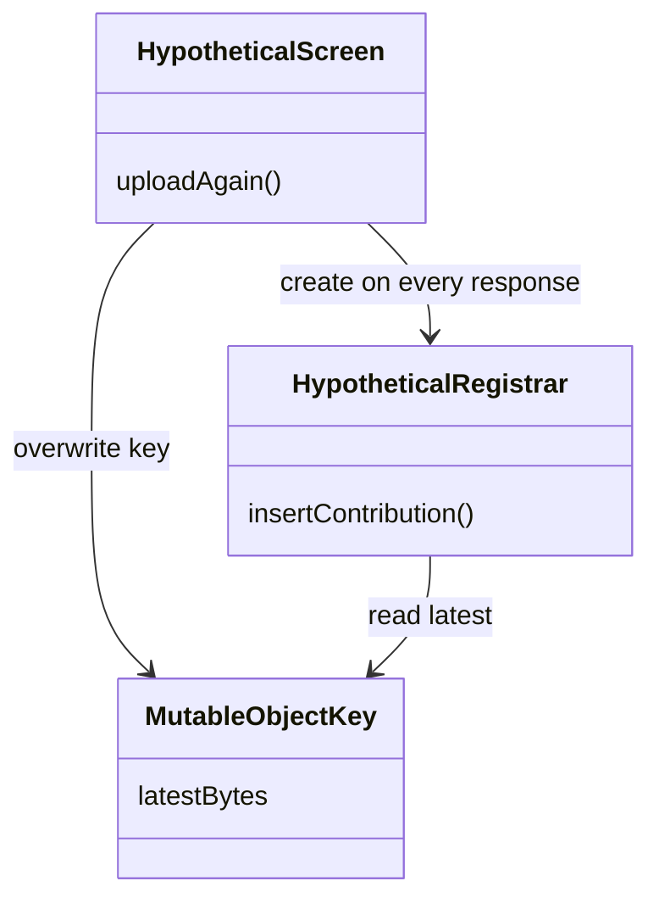

**CAP-B2 — conceptual rejected BEFORE sequence; NOT historical implemented architecture.**

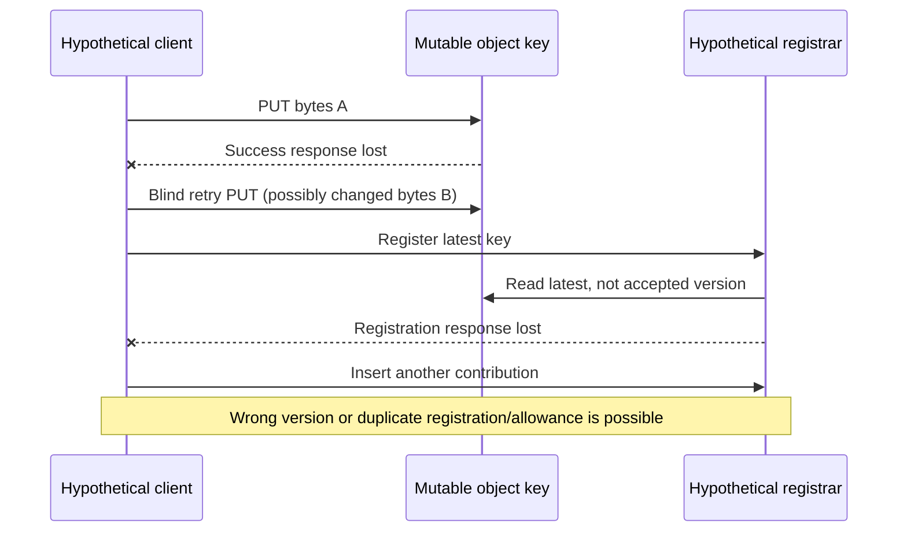

| Candidate approach                                                       | Assessment against this problem                                                                                                                                                                                                                |
| ------------------------------------------------------------------------ | ---------------------------------------------------------------------------------------------------------------------------------------------------------------------------------------------------------------------------------------------- |
| Blind retries / mutable latest key                                       | Rejected baseline: cannot establish which bytes were accepted or whether registration committed.                                                                                                                                               |
| Route all bytes through app-server staging                               | Actual disk/compatibility path; centralizes probing and ownership, but app server carries byte traffic and staged-file recovery.                                                                                                               |
| Direct PUT with only an in-memory version receipt                        | Avoids app-server transfer load, but loses uncertainty/receipt state on restart and cannot safely resolve a missing version header.                                                                                                            |
| Durable intent + checkpoint + exact version + transactional registration | Chosen actual direct path: separates byte transport from authorization/registration and provides bounded uncertainty recovery. Costs checksum reads, private scratch materialization, persisted recovery state and strict ambiguity rejection. |

**AFTER:** [CAP-D7](#cap-d7) is the actual server class model; [CAP-D5](#cap-d5) is its normal sequence and [CAP-D6](#cap-d6) its lost-response sequence. `requestUploadIntent` binds a normalized request hash to an environment/group/profile/key identity. `completeUploadIntent` compare-and-set pins the first selected version before storage I/O; a later transaction rechecks authority, cycle, quota and pin and commits registration once. Reconciliation requires a complete bounded inventory and verifies actual bytes, rather than selecting a version by recency or trusting HEAD alone. Expired-intent cleanup fences state before deleting unreferenced exact versions.

The architectural patterns are boundary/control/entity decomposition, ports/adapters, and a durable job pipeline. `PrivateS3MediaStore` is a concrete GoF Adapter-style implementation of `MediaStore`; injected transport functions also provide strategy-like variation without requiring a GoF Strategy class hierarchy. Intent/status string unions are state representations, **not** the GoF State pattern. Atomic DB registration plus version fencing is an idempotency/concurrency approach, not a named GoF pattern or a distributed transaction spanning S3 and SQLite.

## Transition and implementation choices

- **Boundary/control/entity refinement:** analysis capture/review boundaries become React screens; local controls become the actual still/recording/review/upload session classes. Transfer control becomes functional client/server modules. Draft and recipe concepts become `ActiveStillImage`, `RecordedClip`, `PendingClipMetadata` and `ClipUploadInput`, rather than invented entity classes.
- **Persistence identity mapping:** URI-free `ImageMetadata` is separate from active preview ownership. A submitted photo can resolve its managed file by ID; pending video metadata alone cannot restore an owned clip. Server `staged://` capabilities bind owner/key/generation. S3 stores encoded `MediaObjectRef` values including namespace, checksum, size and version in existing path fields. [Migration 026](../../server/migrations/sqlite-baseline.sql) enforces scoped idempotency and completed receipt shape.
- **Service/interface extraction:** `CameraPlatform`, `CaptureFileStore` and metadata ports isolate capture ownership from Expo/browser APIs. `createRealAccountVideoRuntimeClient` preserves `RuntimeClient` upload/process receipts while selecting staging or direct transfer; after direct completion it loads authoritative ledger metadata instead of inventing timestamps. `MediaStore` and `UploadIntentTransport` isolate exact-version I/O and signing from domain registration.
- **Runtime selection:** the group integration negotiates `/real/media/config?uploadProtocol=2`. Direct mode is advertised only with an S3 intent transport and the supported protocol; disk/older-client compatibility stays server mode. S3 SDK bindings are created lazily, share an environment scope, and close only owned clients. No configuration creation performs cloud I/O.
- **Recipe/materialization split:** trim/look metadata does not itself edit source bytes. Web photo grading and supported browser video grading occur before transfer; `processingModeFor` prevents reapplying a client-processed look. Other video paths upload originals for server processing. Photos use three seconds and `hasAudio: true` as a compatibility contract field; their generated MP4 has a silent audio track, not captured microphone audio.
- **Failure and resource policy:** video generations and abort signals suppress stale callbacks; `ClipUploadSession` reports milestone percentages (0/10/100), not measured network throughput. Retry budget and typed terminal rejection classification are separate. Photo submission currently marks caught failures retryable without that same three-attempt session budget. Source disposal waits for the relevant acceptance/processing path; disposal failure can be reported after server acceptance and must not trigger another PUT.
- **Processing durability:** jobs claim with a lease/generation, prepare verified output, then fence cleanup/publication. S3 materializes a private scratch file for FFmpeg, persists a processed version, verifies it, deletes the exact incoming version, and commits `ready`. A prepared output survives cleanup/commit failure for recovery; no network I/O is held inside an intent DB transaction. Disk uses filesystem staging/output and corresponding publication fences.
- **Bounded recovery:** intents expire within 15 minutes and at cycle/quota-window boundaries; reconciliation refuses more than eight versions or a truncated inventory. Unknown PUT state does not grant another PUT. Checkpoints exclude credentials, signed URLs and source URIs. They can recover a completed/pinned transfer without rereading source, but do not promise an offline upload queue or multipart byte resume.

## Sources and limits

The source revision above was supplied by the coordinator as verified against `origin/dev`. This document's evidence is static inspection of the linked source, migration and test definitions at that worktree baseline. No app changes, GitHub operations, deployment, device checks, test suites or runtime media transfers were performed for this document. The test table identifies checks to consult/run; it is not a passing-results record.

Diagrams omit HTTP helper calls, audit details, lock retry loops and lower-level error mapping while preserving the authorization, persistence and ownership boundaries. Photo probe validation is stricter than generic intent request validation; receipt completion and UI success must be read separately. In particular, the photo callback can return queued/processing status, while `CameraCaptureScreen.submitPhoto` proceeds to local success cleanup and sets its success panel flag for any non-throwing return; the authoritative status projection still maps only `ready` to sealed. This is an observed implementation limit, not evidence that every displayed success is sealed. Browser codec/crypto/CORS support, actual S3 configuration and crash timing remain runtime-dependent; source/test definitions alone do not establish operational behavior.

## UC-6 — Correct an own contribution

Added for #558, canonical [UC-CORRECT-CONTRIBUTION](../../doc/planning/current-product-baseline.md#uc-correct-contribution), inspected at `39ba152af0da152ff8e0efe08be861270752129e` (15 October 2026). Earlier capture models above retain their stated revision.

A member confirms deletion of an own contribution in its original, current seven-day allowance window while the cycle is collecting. One transaction consumes that window's single deletion permission, restores one count and the contribution's reserved seconds, tombstones the contribution and deletes its job logically. The member may then recapture through [UC-1–5](#scope-and-use-cases); deletion alone does not create a replacement or grant playback.

The server accepts jobs in `pending`, `failed` or `ready`, rejects `processing`, and rejects missing/foreign/already-deleted contributions, missing jobs, previous-window contributions, closed cycles or exhausted deletion permission. The window is measured from cycle start, not the calendar week. A replacement, when explicitly supplied by the caller, is linked only within the same member/cycle/window; it is never inferred from the next upload.

**CAP-A6 — analysis class view.** This adds correction responsibilities to shared [CAP-A1](#cap-a1); capture/preview concepts are reused.

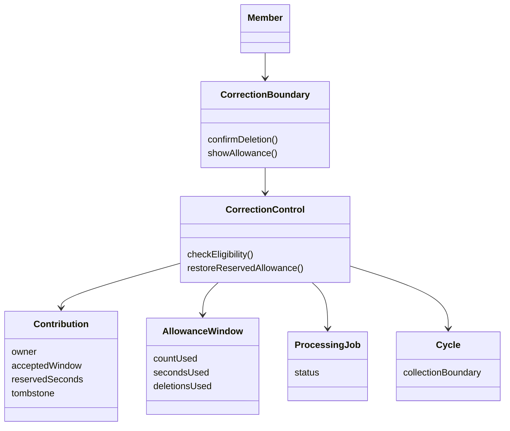

**CAP-A7 — analysis sequence, normal and major denial flows.**

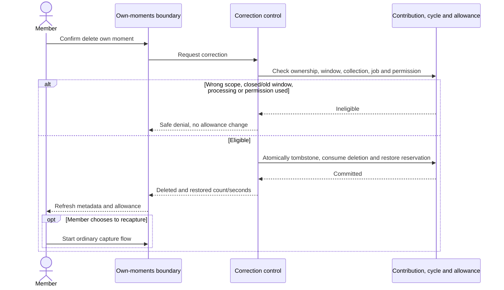

**CAP-D8 — design class view.** Boxes labelled `module` describe functional code, not new runtime classes. Actual upload/processing classes remain in [CAP-D1](#cap-d1) and [CAP-D7](#cap-d7).

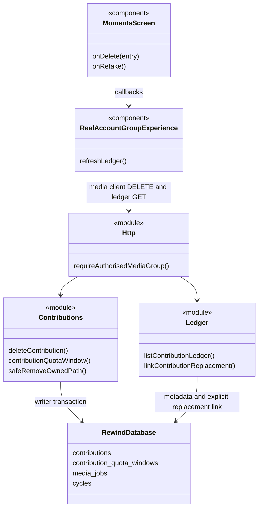

**CAP-D9 — design sequence, transaction and relevant failure paths.**

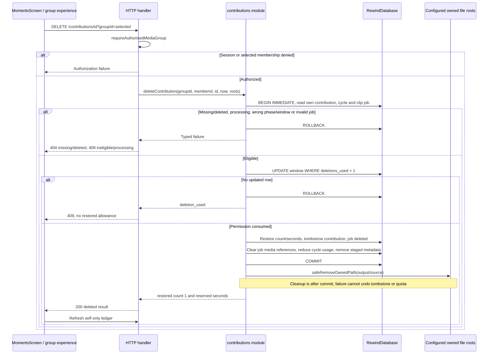

Unexpected database errors roll back and propagate; acquiring the writer transaction has bounded SQLite busy retries. Post-commit cleanup errors can propagate after logical success, so a failed response is not proof that deletion did not commit. Refresh authoritative ledger state before interpreting an ambiguous response. `safeRemoveOwnedPath` only removes descendants of configured server roots; this function is not evidence of deleting remote S3 versions.

### Correction transition and source mapping

**Design choice:** client-only permission checks would race concurrent deletion, worker claims and cycle closure. Separate quota and tombstone commits could restore twice or leave a playable job after restoring quota. The implemented writer transaction refines analysis eligibility into one scoped SQL read, a guarded `deletions_used < 1` update and atomic row mutations. File removal follows the authoritative database commit; this is a transaction/tombstone strategy, not a GoF State implementation. UI metadata is advisory; HTTP and transaction checks remain authoritative.

| Responsibility                                                                           | Source and existing check location                                                                                                                                                   |
| ---------------------------------------------------------------------------------------- | ------------------------------------------------------------------------------------------------------------------------------------------------------------------------------------ |
| Confirm/delete/refresh/retake                                                            | [MomentsScreen](../../src/real/Moments.tsx), [RealAccountGroupExperience](../../src/groups/RealAccountGroupExperience.tsx); no dedicated MomentsScreen test was found in `tests/`    |
| Session and selected membership, HTTP failures                                           | [HTTP contribution route](../../server/src/routes/contribution-routes.ts), `requireAuthorisedMediaGroup`; [real-account-video tests](../../server/tests/real-account-video.test.mjs) |
| Original window, once-only permission, processing guard, tombstone and exact restoration | [deleteContribution / contributionQuotaWindow](../../server/src/contributions/index.ts); [contribution policy tests](../../server/tests/contribution-policy.test.mjs)                |
| Self-only projection and optional explicit replacement identity                          | [listContributionLedger / linkContributionReplacement](../../server/src/contributions/ledger.ts); [ledger tests](../../server/tests/contribution-ledger.test.mjs)                    |

**Observed limits:** `MomentsScreen` offers deletion for failed entries and says it does not use the weekly delete; `deleteContribution` applies the same single-deletion consumption to `failed`, `pending` and `ready`. Its main “Retake now” callback opens capture without an explicit deleted ID, so this route must not be claimed to mark the next upload as `replaced`; the ledger helper and upload paths support an explicitly supplied replacement ID. These are source/UI distinctions, not changes introduced by the models. Owner safety removal is a separate [UC-MANAGE-SAFETY](safety.md#safety-scope) with no quota restoration. This addition uses static source/test inspection only; no runtime, device or deployment result is asserted.
