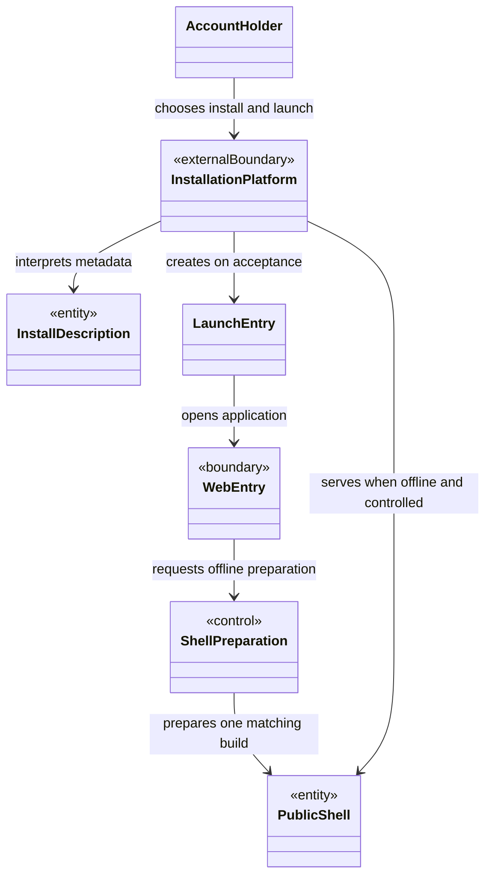
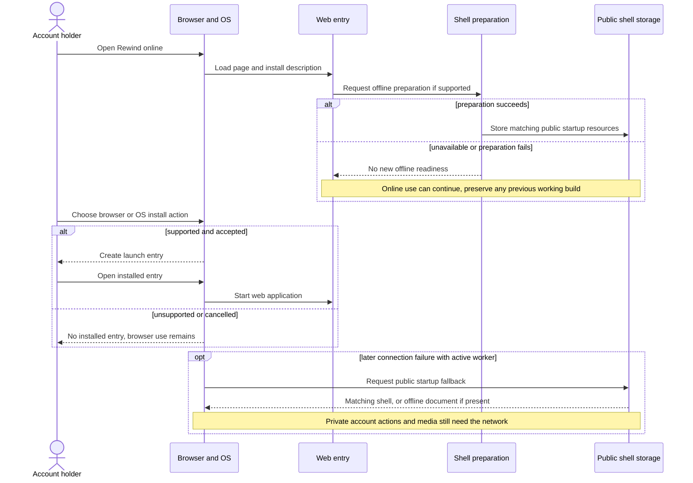
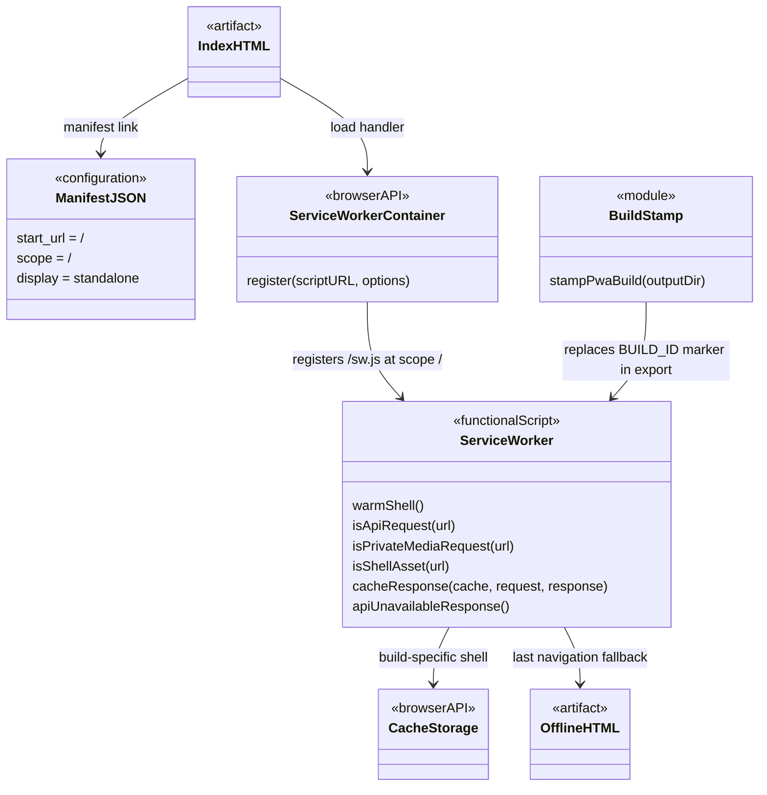
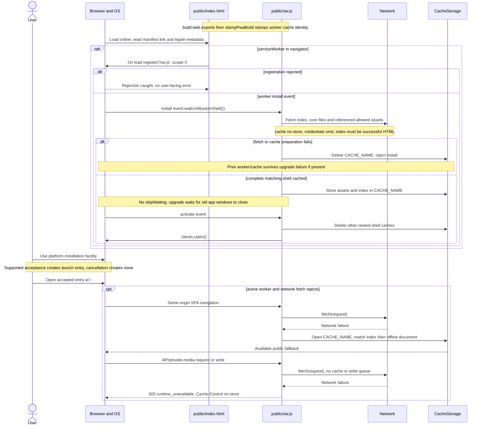

# Client installation and bounded offline startup

## UC-INSTALL-PWA — scope and contract

Issue #558; source: `dev` `39ba152af0da152ff8e0efe08be861270752129e` (15 October 2026).
The [canonical contract](../../doc/planning/current-product-baseline.md#uc-install-pwa)
defines browser/OS installation, standalone launch and bounded offline fallback.
Inspection uses the revision above, distinct from the baseline's recorded revision.

Primary actor: account holder; supporting actor: browser/OS. Installation itself
does not require authentication. Preconditions: reachable HTTPS web app, browser/OS
support and a user choosing its installation or Add to Home Screen facility.
Rewind supplies metadata and worker code; the platform owns installation UI,
eligibility, acceptance, shortcut persistence and launch presentation.

| Course                                      | Behaviour and outcome                                                                                                                                                                                                                                                                                                                                             |
| ------------------------------------------- | ----------------------------------------------------------------------------------------------------------------------------------------------------------------------------------------------------------------------------------------------------------------------------------------------------------------------------------------------------------------- |
| Normal                                      | 1. User opens Rewind online. 2. Browser reads install metadata; the page attempts worker registration after load. 3. User chooses and accepts browser/OS installation. 4. Platform creates an entry and opens `/` with the declared standalone presentation where supported. Worker preparation is a separate lifecycle, not an app-controlled installation gate. |
| Installation unavailable or cancelled       | No installation success is asserted; the online browser route remains available. There is no app-controlled install prompt or installation-completion record in the inspected path.                                                                                                                                                                               |
| Worker unsupported or registration rejected | Registration is skipped or rejection caught silently. Online use can continue; offline startup is not established. No dedicated registration-error banner is implemented here.                                                                                                                                                                                    |
| Shell preparation or upgrade fails          | Failed preparation deletes the new build cache and rejects worker installation. An existing worker/cache remains available; a first visit has no prior fallback guarantee.                                                                                                                                                                                        |
| Connection lost after preparation           | A controlled same-origin SPA navigation tries the network, then the installed public shell, then `offline.html`. API/private-media requests and writes cannot become successful offline operations.                                                                                                                                                               |

Success means a platform-created launch entry, not an authenticated session,
notification subscription or synchronized media. iOS delivery is the PWA; compiled
native iOS and App Store delivery are outside this use case. iPhone reminders
separately require Home Screen use and push permission; installation alone does
not enable them ([push capability checks](../../src/reminders/push-platform.ts)).

## Analysis class view — responsibilities

These concepts are not application classes. `PublicShell` contains public startup
resources. `InstallationPlatform` is external; `ShellPreparation` is web runtime control.

## Analysis sequence — normal course and major failures

## Design class view — actual artifacts and APIs

The artifact nodes below denote files, configuration or functional scripts, not
runtime domain classes. Function names inside `ServiceWorker` and `BuildStamp`
are actual source symbols; `ServiceWorkerContainer` and `CacheStorage` are browser
APIs. There is no Rewind installation controller/entity in this path. Expo exports
the web shell; build stamping supplies its cache identity.

## Design sequence — preparation, installation and offline failure

## Transition strategies, choices and source map

| Analysis responsibility            | Actual design and illustrative alternative                                                                                                                                                                                                                    |
| ---------------------------------- | ------------------------------------------------------------------------------------------------------------------------------------------------------------------------------------------------------------------------------------------------------------- |
| Offer installation                 | Declarative manifest plus Apple metadata; browser/OS owns consent and entry creation. Alternative: app-owned prompt/controller. The inspected page has only worker registration, so a prompt controller must not be invented in the design.                   |
| Preserve startup availability      | `warmShell` prepares a build-specific cache; content hashing changes worker identity. Alternative: one global cache mixing shell versions. Matching-build fallback and failed-upgrade cleanup bound that risk.                                                |
| Protect active work during upgrade | No `skipWaiting`; activation removes older Rewind shell caches and claims clients. Alternative: force immediate activation, risking replacement during capture/upload. This is lifecycle coordination, not a claim of lossless upload recovery.               |
| Bound offline responsibility       | API/media/write guards precede SPA fallback; shell resources alone are cache candidates. Alternative: cache every response or queue account mutations. The current boundary avoids representing stale private responses or unsubmitted media as synchronized. |

These alternatives explain the observed design; they are not historical prototypes,
recorded team decisions or GoF pattern claims. Analysis controls map to event
handlers/functions; entities map to artifacts and platform storage, not new SQL rows.

| Source location                                                                                                               | Exact responsibility or specification location                                                                                                                            |
| ----------------------------------------------------------------------------------------------------------------------------- | ------------------------------------------------------------------------------------------------------------------------------------------------------------------------- |
| [Manifest](../../public/manifest.json), [Expo config](../../app.json)                                                         | Root start/scope, standalone display, portrait orientation and icons. The retained “local-first” description does not establish offline private-data support.             |
| [HTML entry](../../public/index.html)                                                                                         | Manifest/Apple links and guarded, load-time worker registration with silent catch.                                                                                        |
| [Worker](../../public/sw.js)                                                                                                  | `warmShell`, install/activate/fetch handlers and the request/cache helpers shown above. Push handlers are adjacent responsibilities, outside installation consent.        |
| [Build stamping](../../scripts/stamp-pwa-build.mjs), [package scripts](../../package.json)                                    | `stampPwaBuild` hashes public build inputs into a 24-hex identity; `build:web` exports then stamps.                                                                       |
| [Offline document](../../public/offline.html)                                                                                 | Connection unavailable; server-backed actions unavailable; captured media not synchronized offline.                                                                       |
| [PWA tests](../../tests/pwa.test.mjs)                                                                                         | Metadata/registration; private request and write exclusion; legal documents; incomplete upgrade preservation; credential-free asset misses; deterministic build stamping. |
| [Routing browser specs](../../tests/responsive/production-web-routing.spec.ts), [export checker](../../scripts/check-pwa.mjs) | Export metadata, offline API 503, root/deep-route shell startup and artifact assertions. These are check locations, not executed results.                                 |

Limits: navigation fallback follows rejected network fetches, not every HTTP error.
Legal pages bypass SPA fallback. Shell matching excludes query-bearing asset URLs
and cross-origin URLs; range requests bypass shell caching. On runtime asset misses,
`cacheResponse` caches only successful GET responses without `private` or `no-store`.
API/private-media guards cover same-origin paths;
other external traffic is not granted offline support. Without an active worker
and retained cached resources, offline startup is not guaranteed. No offline account
store, private-media cache or background submission queue is established here.

Static inspection only: no application tests, export, installation, hosted HTTPS,
iPhone launch or cache-eviction journey ran. The parent owns integration/rendering/review.
Human design ownership remains unconfirmed.
