# Chat, prompts and web reminders

## Scope and use cases

Developer reference for issue #538, inspected at source revision `40ebeb5673d103b4b6950d095192aae744980769` (2026-10-15). Covers real-account group chat, cycle prompt selection and media responses, and web reminders. Analysis diagrams describe domain responsibilities; design diagrams identify implemented modules, functions and types. Diagram IDs are stable cross-reference targets.

Common precondition: a signed-in account has group membership. HTTP derives authority from the session, not caller-supplied account/member IDs; selected-group restrictions differ by route and are checked server-side. Owner permission is additionally required to change a prompt. Native push adapters remain retained code; the default native push platform returns unsupported. The product path is browser/PWA web push, with an installed Home Screen app required on iPhone/iPad.

| ID / actor                                       | Normal course and outcome                                                                                                                                                                                    | Major exceptions / alternatives                                                                                                                                                                                                                                                    |
| ------------------------------------------------ | ------------------------------------------------------------------------------------------------------------------------------------------------------------------------------------------------------------ | ---------------------------------------------------------------------------------------------------------------------------------------------------------------------------------------------------------------------------------------------------------------------------------- |
| **UC-01 Read group chat** / member               | 1. Open Chat. 2. Read latest history and its watermark. 3. Subscribe after that watermark. 4. Load older pages or receive new messages. Off-tab unread counts other members' new messages.                   | Reconnect replays after the last event; duplicate messages merge by ID. Denied access clears the timeline and stops reconnecting. Offline history can be retried; unread state resets on reload rather than persisting a read marker.                                              |
| **UC-02 Send text or reply** / member            | 1. Compose text, optionally select an original message. 2. Send with a stable draft ID. 3. Persist message and event together. 4. Display the acknowledged/live event once.                                  | Blank/over-2,000-character text, inaccessible parent or nested reply is rejected. Timeout/network failure leaves an explicit retry row; retry preserves message ID and reply target. A changed request under an existing ID conflicts; denied access is terminal.                  |
| **UC-03 React** / member                         | 1. Select a visible message. 2. Toggle ✨. 3. Persist the reaction. 4. Apply aggregate counts from HTTP/live update.                                                                                         | Other emoji and inaccessible messages fail. Older revisions cannot overwrite newer counts. Reconnect fetches counts for loaded messages; reactions neither create unread messages nor advance message cursors.                                                                     |
| **UC-04 Select cycle prompt** / owner            | 1. Open group settings. 2. Select a built-in suggestion or enter custom text and IANA timezone. 3. Save. 4. See updated current prompt; later cycles inherit it.                                             | Non-owner, invalid/empty/over-160-character prompt, invalid zone, or ended/non-collecting cycle fails. No deadline editing. Stale settings responses are ignored after context change. Group creation also accepts an initial prompt.                                              |
| **UC-05 Respond to prompt** / member             | 1. Read the current cycle prompt on Home. 2. Open photo/video capture. 3. Capture or choose supported media, review, then submit. 4. Observe queued/processing and sealed or failed contribution status.     | Permission, invalid media, closed cycle, exhausted allowance and context changes prevent completion. Retained upload identity supports retry. This is a contribution to the cycle, not a text-answer record or chat reply.                                                         |
| **UC-06 Set reminder preference** / member       | 1. Load own group preference and next Sunday 19:00 in group timezone. 2. Enable, disable, snooze, or clear snooze. 3. Persist and display returned preference.                                               | Default is disabled. Snooze must be a future instant within 31 days. Unauthorized/offline saves fail truthfully. Saving a preference does not register a device or prove delivery.                                                                                                 |
| **UC-07 Register/remove web reminders** / member | 1. Check browser capability/config without prompting. 2. Explicitly enable this device. 3. Subscribe and register its destination. 4. Disable/revoke by confirming server disable and unsubscribing locally. | Unsupported/denied/unconfigured states stay explicit. Lost registration reply triggers device-filtered recovery. Unconfirmed removal stays `cleanup-pending`; a normal group switch waits for removal. Logout starts immediately while cleanup is attempted.                       |
| **UC-08 Dispatch/retry weekly reminder** / timer | 1. Scan eligible preferences. 2. Queue one job per account/group/local Sunday. 3. Lease and revalidate. 4. Send generic payload. 5. Persist accepted/retry/failed/cancelled outcome.                         | Disabled/snoozed preference, expired/revoked session, changed selection/destination generation or over-24-hour age cancels/skips. Transient failures retry at backoff, at most three sends. Invalid destination disables it; stale lease results cannot overwrite a reclaimed job. |
| **UC-09 Open reminder** / member                 | 1. Tap notification. 2. Parse opaque group/reminder IDs. 3. Reload server-selected group. 4. Open Home only when current context matches.                                                                    | Malformed/duplicate intents are dropped. Different group shows a message rather than selecting payload context. Delayed responses after account/group changes are ignored; offline reload reports failure.                                                                         |

## Analysis model

**A-CLASS — domain concepts.** These are analysis entities, not proposed runtime classes. `Prompt` is a value owned by a cycle; `Response` denotes an existing media contribution. `Membership` connects account identity to group participation.

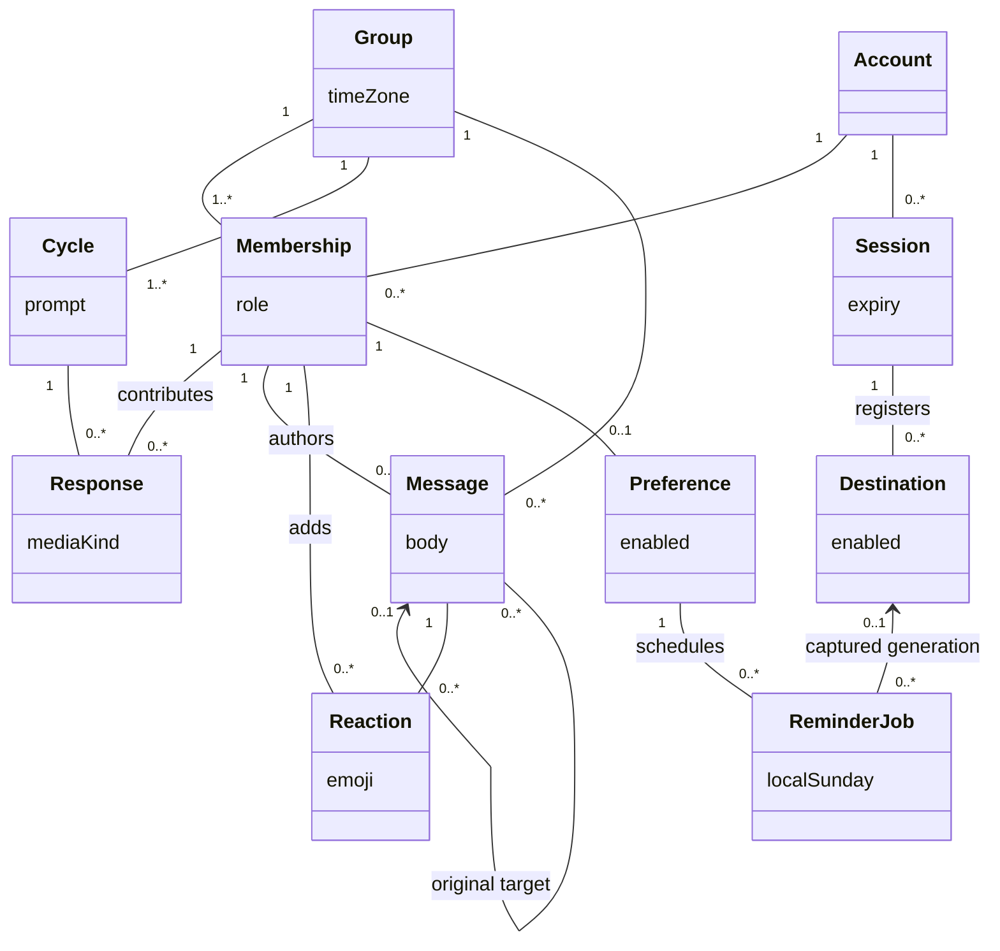

**A-CHAT — UC-01–03.** Boundary/control/entity decomposition; “Chat control” is a responsibility, not a source class.

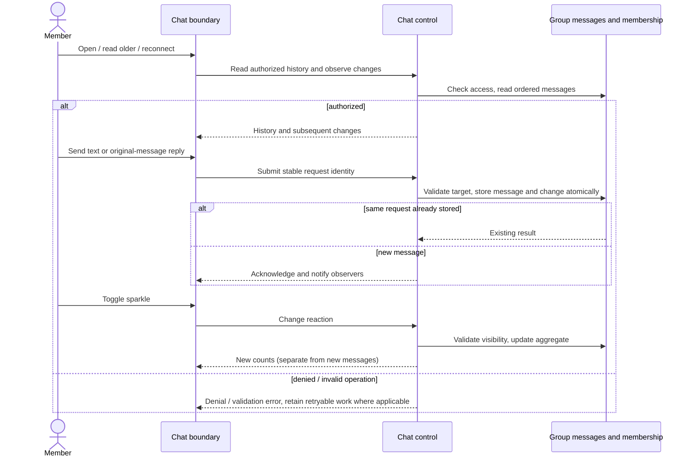

**A-PROMPT — UC-04–05.** Prompt editing and responding are separate interactions with the same cycle.

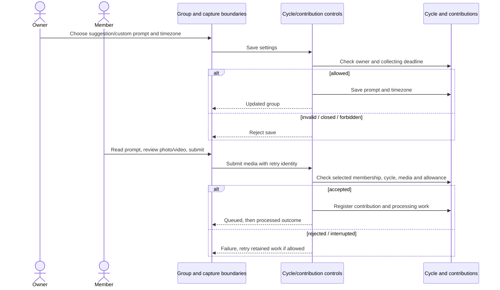

**A-REMINDER — UC-06–08.** Preference, device association and delivery intent have independent lifecycles.

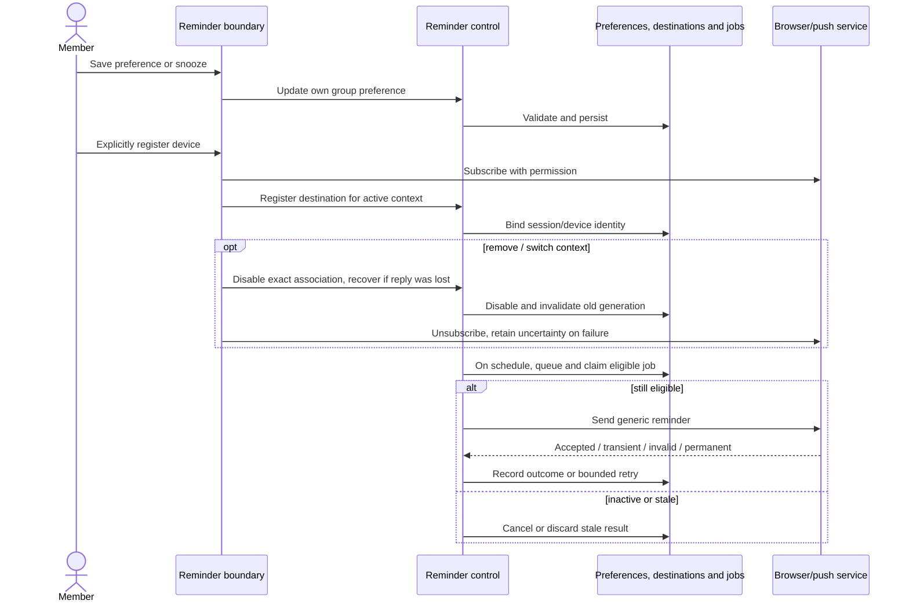

**A-OPEN — UC-09.** Notification content is a navigation hint, never authority.

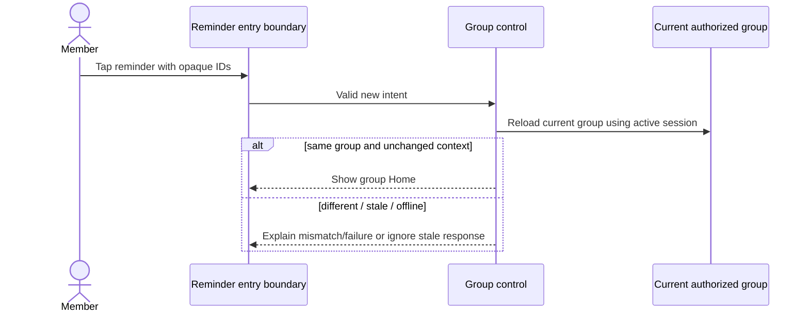

## Design model and flow mapping

**D-CHAT-CLASS — implemented chat structure.** `<<module>>` denotes exported functions grouped for readability; `<<type>>` denotes a TypeScript data contract. Only `RealtimeChatClient`, `RealtimeHub` and `ChatUnreadOwner` below are runtime classes. React components are functional boundaries.

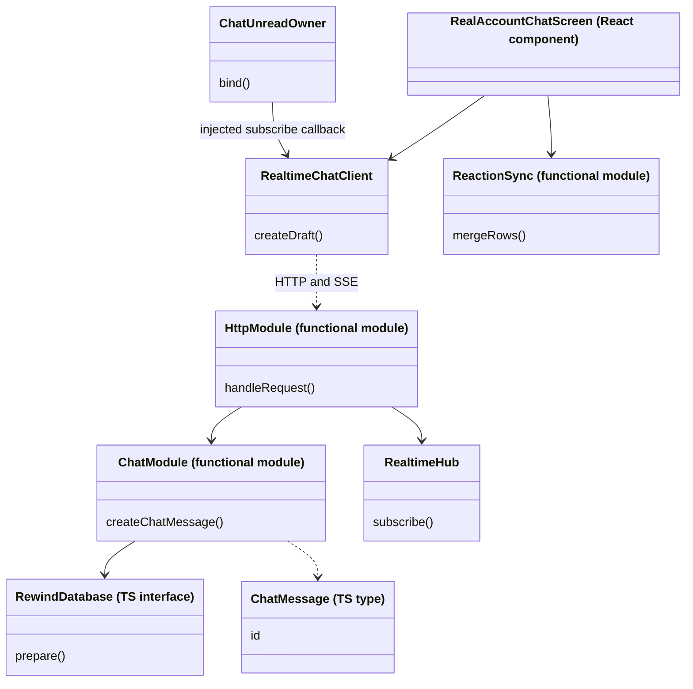

**D-CHAT-READ — UC-01 and reaction reconciliation in UC-03.** The screen's effect reads a page before subscribing. The HTTP stream buffers hub traffic while replaying the persisted event log through a fixed watermark, then flushes later events. The unread owner separately subscribes with `metadataOnly` and `startFromLatest`.

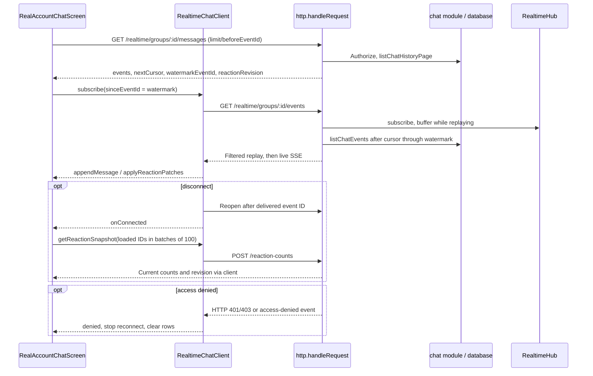

**D-CHAT-WRITE — UC-02–03.** HTTP rechecks identity after awaiting the body. Viewer safety filtering applies to history, replay and live updates; reply validation also rejects unavailable parents. Reaction notifications are process-local and are repaired by snapshots after reconnect.

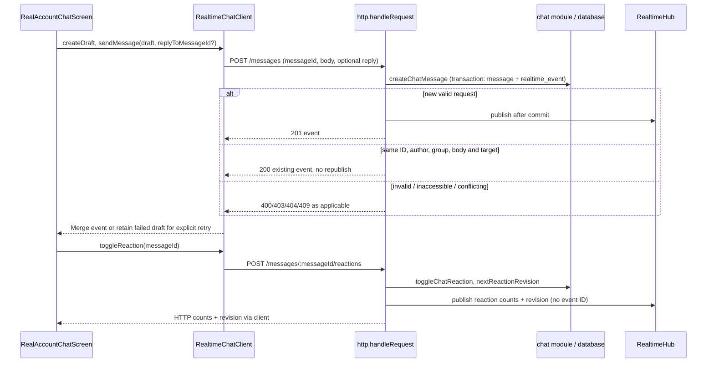

**D-PROMPT — UC-04–06.** Functional design: `RealGroupSettings` owns local drafts; `groups/settings.ts` owns transactional mutations; `schedule.ts` computes the next instant. `cycles.prompt` is text, not a prompt-table foreign key. `real_group_metadata.time_zone` is separate. The lifecycle copies `cycle.prompt` into the next cycle.

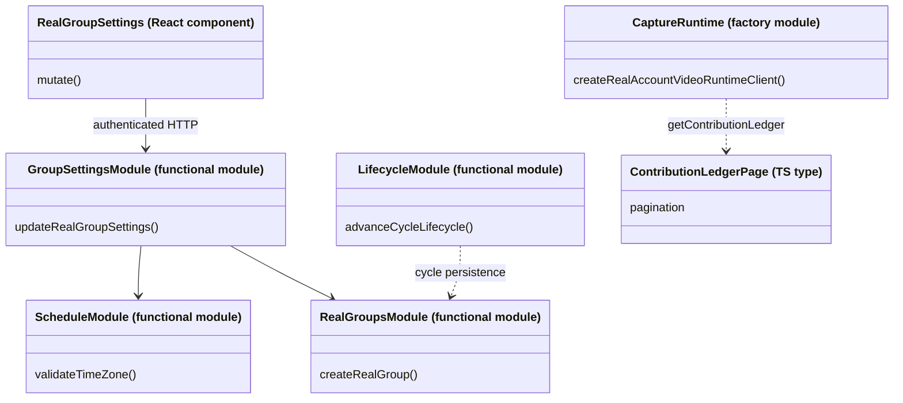

**D-SETTINGS-FLOW — UC-04 and UC-06.** Paths are under `/real/groups/:id`; mutation bodies have allowlisted fields. UI context versions discard late results.

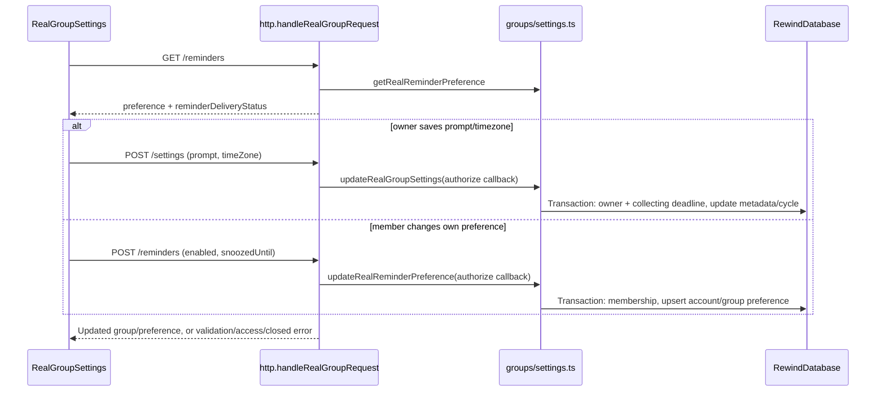

**D-RESPONSE — UC-05.** Media internals are included only to show how a prompt response is realized. There is no prompt ID in the submission: group/current-cycle membership supplies the association. Diagram shows the staged path; configured direct transfer uses upload intents and completion instead.

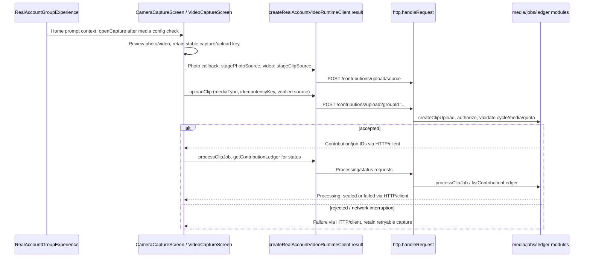

**D-REMINDER-CLASS / AFTER — actual implementation for UC-07–09.** Factory results implement interfaces; the diagram does not introduce service classes. Internal `DestinationRow`/`JobRow` map SQL rows. `ReminderProvider.receipt` is retained for Expo compatibility; web push has only `send` and no device-delivery receipt.

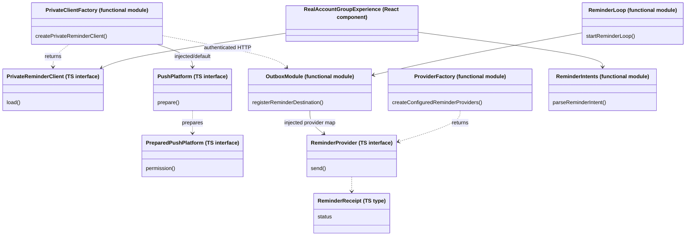

**D-REGISTER — UC-07.** The 10-second client request deadline includes JSON consumption. Load coalesces concurrent work without permission prompts. Explicit opt-in invokes browser subscribe before an awaited network operation, preserving the gesture.

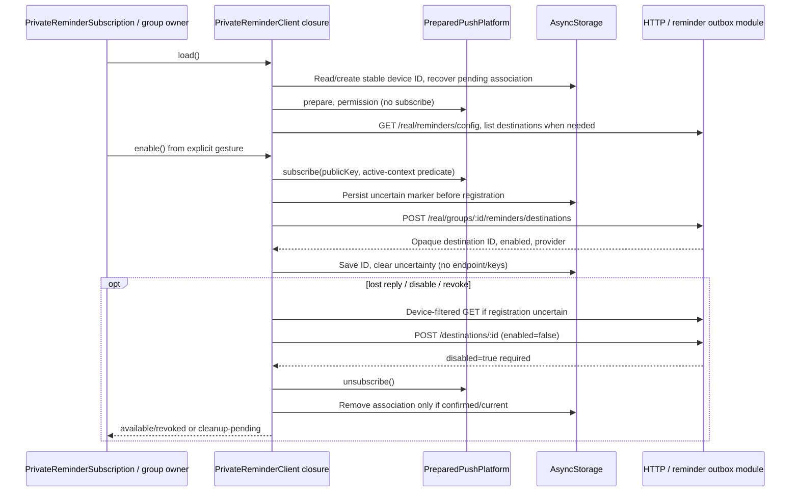

**D-DISPATCH / AFTER — UC-08.** Scan/claim/finalize are short transactions; the provider await runs outside them. `eligible` runs at claim and finalization. With no configured providers, a tick returns unconfigured. The loop runs each minute, bounds scans to ten pages and dispatches at most ten claimed jobs per tick.

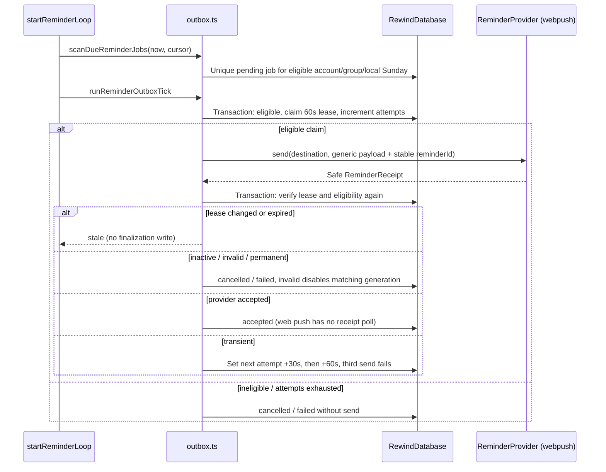

**D-OPEN — UC-09.** `subscribeToReminderIntents` parses cold-entry query parameters or messages from the controlling service worker, deduplicating a bounded set of 64 reminder IDs. It removes consumed query parameters. The group owner's effect performs authorization refresh.

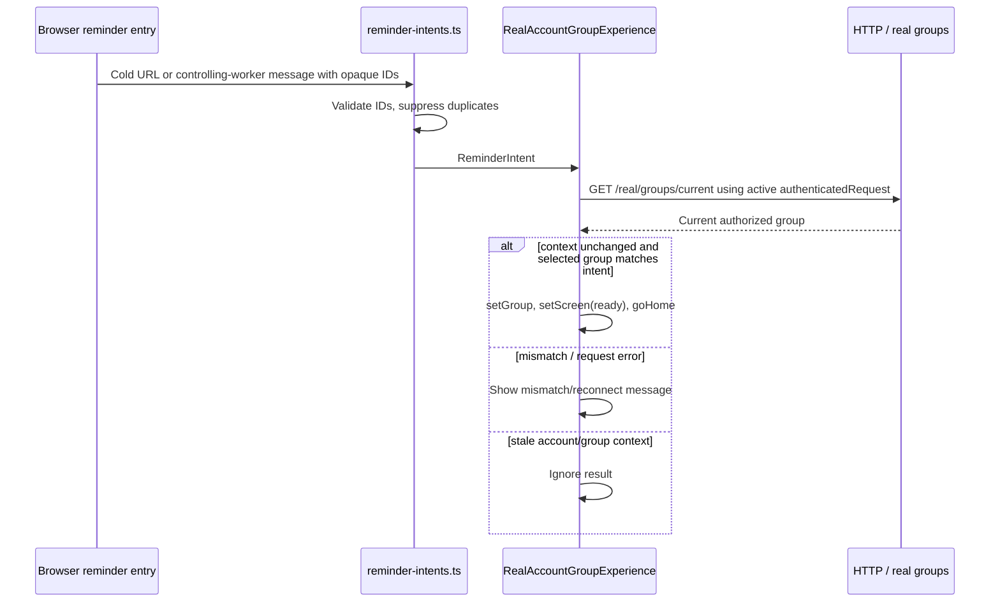

**Traceability.** Links are relative to this document; symbols identify exact implementation entry points. Tests below are existing references, **not execution results**. Analysis class relationships in A-CLASS apply to every row.

| UC    | Analysis → design diagrams                                                                   | Source file / symbol                                                                                                                                                                                                                                                                                                                                                                                                                                                                                                                                                                | Relevant existing tests                                                                                                                                                                                                                                                                        |
| ----- | -------------------------------------------------------------------------------------------- | ----------------------------------------------------------------------------------------------------------------------------------------------------------------------------------------------------------------------------------------------------------------------------------------------------------------------------------------------------------------------------------------------------------------------------------------------------------------------------------------------------------------------------------------------------------------------------------- | ---------------------------------------------------------------------------------------------------------------------------------------------------------------------------------------------------------------------------------------------------------------------------------------------- |
| UC-01 | [A-CHAT](#a-chat) → [D-CHAT-CLASS](#d-chat-class), [D-CHAT-READ](#d-chat-read)               | [RealAccountChatScreen](../../src/chat/RealAccountChatScreen.tsx); [RealtimeChatClient.subscribe](../../src/chat/realtime-client.ts); [listChatHistoryPage/listChatEvents](../../server/src/chat/index.ts); [handleRequest / requireAuthorisedChatGroup](../../server/src/http.ts); [ChatUnreadOwner](../../src/chat/unread-owner.ts), [useRealChatUnread](../../src/chat/real-chat-client.ts)                                                                                                                                                                                      | [real-account-chat](../../tests/real-account-chat.test.tsx), [realtime-client](../../tests/realtime-client.test.ts), [chat-unread-store](../../tests/chat-unread-store.test.ts), [real-chat](../../server/tests/real-chat.test.mjs)                                                            |
| UC-02 | [A-CHAT](#a-chat) → [D-CHAT-WRITE](#d-chat-write)                                            | [RealtimeChatClient.createDraft/sendMessage](../../src/chat/realtime-client.ts); [RealAccountChatScreen.send/resend](../../src/chat/RealAccountChatScreen.tsx); [createChatMessage](../../server/src/chat/index.ts); [RealtimeHub.publish](../../server/src/realtime/index.ts)                                                                                                                                                                                                                                                                                                      | [realtime-client](../../tests/realtime-client.test.ts), [real-account-chat](../../tests/real-account-chat.test.tsx), [realtime-chat](../../server/tests/realtime-chat.test.mjs), [chat-replies-reactions](../../server/tests/chat-replies-reactions.test.mjs)                                  |
| UC-03 | [A-CHAT](#a-chat) → [D-CHAT-WRITE](#d-chat-write), [D-CHAT-READ](#d-chat-read)               | [toggleChatReaction/listChatReactionSnapshot/nextReactionRevision](../../server/src/chat/index.ts); [applyReactionPatches/mergeRows](../../src/chat/reaction-sync.ts); [encodeSseReaction](../../server/src/realtime/index.ts)                                                                                                                                                                                                                                                                                                                                                      | [reaction-sync](../../tests/reaction-sync.test.ts), [real-account-chat](../../tests/real-account-chat.test.tsx), [chat-replies-reactions](../../server/tests/chat-replies-reactions.test.mjs)                                                                                                  |
| UC-04 | [A-PROMPT](#a-prompt) → [D-PROMPT](#d-prompt), [D-SETTINGS-FLOW](#d-settings-flow)           | [BUILT_IN_PROMPTS](../../src/domain/groups.ts); [RealGroupSettings.mutate](../../src/reminders/RealGroupSettings.tsx); [updateRealGroupSettings](../../server/src/groups/settings.ts); [createRealGroup](../../server/src/groups/real.ts); [advanceCycleLifecycle](../../server/src/cycles/lifecycle.ts)                                                                                                                                                                                                                                                                            | [real-group-settings UI](../../tests/real-group-settings.test.tsx), [real-group-settings server](../../server/tests/real-group-settings.test.mjs)                                                                                                                                              |
| UC-05 | [A-PROMPT](#a-prompt) → [D-RESPONSE](#d-response), [D-PROMPT](#d-prompt)                     | [Home prompt](../../src/real/Home.tsx); [RealAccountGroupExperience.openCapture/onSubmitPhoto](../../src/groups/RealAccountGroupExperience.tsx); [CameraCaptureScreen.submitPhoto](../../src/capture/CameraCaptureScreen.tsx); [VideoCaptureScreen.upload/retryUpload](../../src/capture/VideoCaptureScreen.tsx); [createRealAccountVideoRuntimeClient](../../src/capture/real-account-video-runtime.ts); [createClipUpload](../../server/src/media/index.ts); [processClipJob](../../server/src/jobs/index.ts); [listContributionLedger](../../server/src/contributions/ledger.ts) | [real-account-photo](../../server/tests/real-account-photo.test.mjs), [real-account-video](../../server/tests/real-account-video.test.mjs), [CameraCaptureScreen](../../tests/CameraCaptureScreen.test.tsx), [VideoCaptureScreen](../../tests/VideoCaptureScreen.test.tsx)                     |
| UC-06 | [A-REMINDER](#a-reminder) → [D-SETTINGS-FLOW](#d-settings-flow)                              | [getRealReminderPreference/updateRealReminderPreference](../../server/src/groups/settings.ts); [nextWeeklyReminderAt](../../server/src/reminders/schedule.ts); [reminderDeliveryStatus](../../server/src/reminders/outbox.ts)                                                                                                                                                                                                                                                                                                                                                       | [real-group-settings server](../../server/tests/real-group-settings.test.mjs), [real-group-settings UI](../../tests/real-group-settings.test.tsx), [real-group-reminders](../../tests/real-group-reminders.test.tsx)                                                                           |
| UC-07 | [A-REMINDER](#a-reminder) → [D-REMINDER-CLASS](#d-reminder-class), [D-REGISTER](#d-register) | [createPrivateReminderClient/load/enable/cleanup/recoverUncertainDestination](../../src/reminders/private-reminder-client.ts); [createWebPushPlatform/defaultPushPlatform](../../src/reminders/push-platform.ts); [registerReminderDestination/disableReminderDestination](../../server/src/reminders/outbox.ts); [PrivateReminderSubscription](../../src/reminders/PrivateReminderSubscription.tsx)                                                                                                                                                                                | [private-reminder-client](../../tests/private-reminder-client.test.ts), [private-reminder-subscription](../../tests/private-reminder-subscription.test.tsx), [real-group-reminders](../../tests/real-group-reminders.test.tsx), [reminder-outbox](../../server/tests/reminder-outbox.test.mjs) |
| UC-08 | [A-REMINDER](#a-reminder) → [D-REMINDER-CLASS](#d-reminder-class), [D-DISPATCH](#d-dispatch) | [startReminderLoop](../../server/src/reminders/loop.ts); [scanDueReminderJobs/runReminderOutboxTick/eligible](../../server/src/reminders/outbox.ts); [createConfiguredReminderProviders/createWebPushReminderProvider](../../server/src/reminders/providers.ts); [validateReminderVapidConfig](../../server/src/reminders/config.ts)                                                                                                                                                                                                                                                | [reminder-outbox](../../server/tests/reminder-outbox.test.mjs), [reminder-providers](../../server/tests/reminder-providers.test.mjs)                                                                                                                                                           |
| UC-09 | [A-OPEN](#a-open) → [D-OPEN](#d-open)                                                        | [parseReminderIntent/reminderIntentFromUrl/subscribeToReminderIntents](../../src/reminders/reminder-intents.ts); [RealAccountGroupExperience reminder effect](../../src/groups/RealAccountGroupExperience.tsx); [getCurrentRealGroup](../../server/src/groups/real.ts)                                                                                                                                                                                                                                                                                                              | [reminder-intents](../../tests/reminder-intents.test.ts), [real-group-reminders](../../tests/real-group-reminders.test.tsx)                                                                                                                                                                    |

## Design problem and alternatives

**Problem: reliable reminders across network failure and changing identity.** An enabled preference alone cannot identify a safe destination. A member can switch groups, revoke a session, lose a registration response, or disable notifications while a provider request is in flight. Repeated timer scans must not create fresh weekly jobs, and provider traffic must not hold a database transaction open.

**B-CLASS / BEFORE — conceptual rejected baseline, NOT historical implemented architecture.** Hypothetical classes intentionally expose the coupling being evaluated.

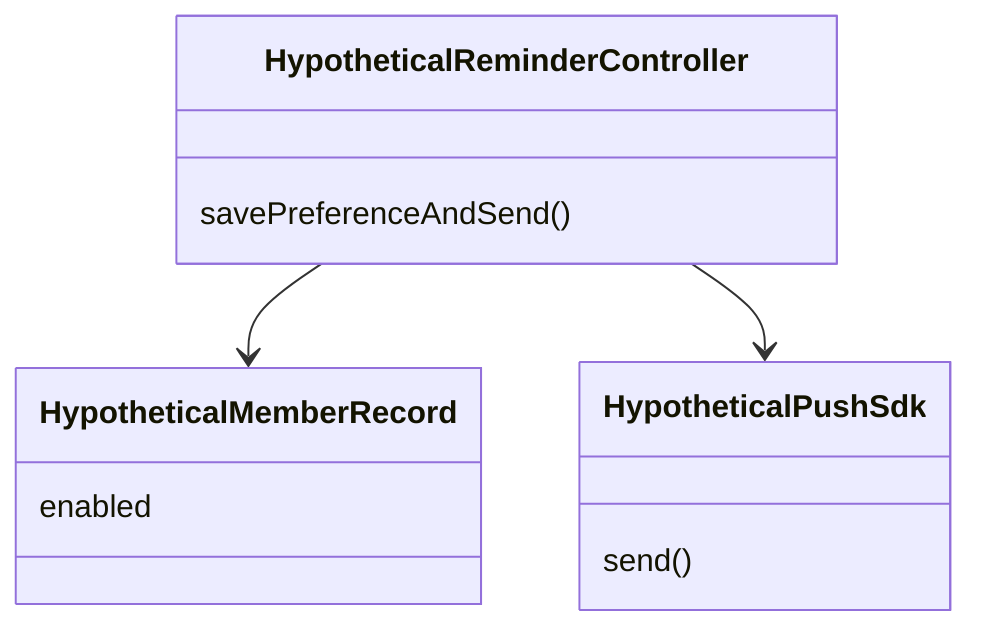

**B-SEQUENCE / BEFORE — same hypothetical baseline, NOT a claim about an earlier release.**

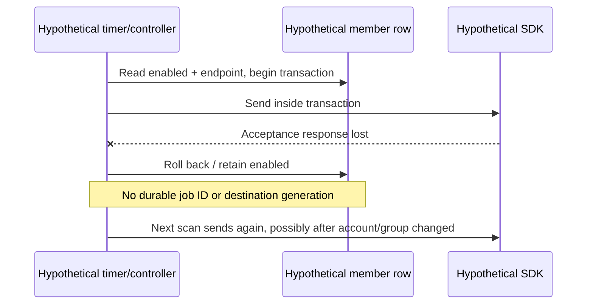

| Candidate approach                                                     | Assessment for this code                                                                                                                                                                                                                                                                                                     |
| ---------------------------------------------------------------------- | ---------------------------------------------------------------------------------------------------------------------------------------------------------------------------------------------------------------------------------------------------------------------------------------------------------------------------- |
| Direct send on save or scan, retry from memory                         | Smallest code, but cannot recover durable intent after restart, distinguish lost acceptance, or safely fence changed associations. Rejected baseline above.                                                                                                                                                                  |
| External broker plus separate delivery service                         | Could isolate workers and scale fan-out; adds infrastructure and operational coordination. Not required for this scope; no such service is asserted here.                                                                                                                                                                    |
| Persisted outbox with leases, generation checks and injected providers | **Chosen actual solution:** existing SQL uniqueness/transactions encode intent and claims; the loop recovers due work after restart. Provider-specific I/O stays behind a narrow interface. AFTER: [D-REMINDER-CLASS](#d-reminder-class), [D-DISPATCH](#d-dispatch), with compensating cleanup in [D-REGISTER](#d-register). |

This is a persisted-outbox architectural approach with service/interface extraction and dependency injection. The web provider is an **Adapter** in the GoF sense: it translates push transport results to `ReminderReceipt`; injected platform/provider implementations also permit Strategy-like substitution. These are interpretations of function/interface boundaries, not runtime pattern classes. `RealtimeHub` supplies Observer-style in-process fan-out. String-valued job/snapshot states are explicit data and conditional transitions, **not GoF State objects**.

## Transition and implementation choices

- **Boundary/control/entity decomposition applied:** analysis chat boundary becomes `RealAccountChatScreen`; chat controls become functions in `server/src/chat/index.ts` behind `handleRequest`; entities become message/reaction/event rows and DTOs. Reminder boundaries split into `RealGroupSettings` (preference) and `PrivateReminderSubscription` (device). Keeping controls as modules fits the existing functional server rather than inventing entity methods.
- **Identity mapping applied:** accounts map to group-specific member profiles through `real_group_memberships`; messages use `memberId`, while preferences use `(group_id, account_id)`. Destinations bind an account/device digest and exact session hash. Unique `(provider,destination_hash)` prevents duplicate endpoint ownership; public status returns opaque IDs rather than private destination JSON. See [groups/real.ts](../../server/src/groups/real.ts), [025 preference schema](../../server/migrations/025-real-group-reminders.sql), [027 outbox schema](../../server/migrations/027-reminder-outbox.sql).
- **Value/persistence refinement applied:** suggested prompts are constants; custom prompts use the same bounded text field. Saving prompt/timezone changes the collecting cycle and group metadata atomically; the next cycle copies that prompt. Contributions reference the cycle, so prompt text is not snapshotted separately for each response. This is simpler than a prompt catalogue/answer aggregate, but editing a current prompt changes the context shown for existing contributions in that cycle.
- **Service/interface extraction applied:** analysis push service becomes `PushPlatform`/`PreparedPushPlatform` at the browser boundary and `ReminderProvider` at the server boundary. Factories return objects; injected storage, clock, request and provider dependencies support focused tests. No network broker or domain-service class is needed.
- **Ordering and failure refinement applied:** chat persists message and replay event in one transaction, then publishes. Integer event IDs support reconnect; client message IDs support send deduplication. Reactions carry a separate revision, are absent from the persisted replay log, and reconcile loaded rows after reconnect. Hub fan-out is process-local; shared multi-process live broadcasting is not supplied by this module.
- **Scheduling/delivery tradeoff:** Sunday 19:00 is computed in the group's IANA zone with actual offset/DST handling. Scan catches up only within 24 hours, skips preference/membership changes after the scheduled instant, and chooses one latest eligible destination rather than all devices. Unique `(group_id,account_id,local_sunday)` gives one stored intent per weekly slot. Leases and generation checks fence stale writes; they cannot retract an already-sent notification. Provider sends are at least once after crash ambiguity; stable web topic supports coalescing without promising exactly-once device delivery.
- **Provider limits:** web push uses validated VAPID, a five-second deadline, bounded 64-KiB response, no redirects, generic payload and 900-second TTL. HTTP 404/410 marks a destination invalid; 429/5xx is transient; other rejection is permanent. Web acceptance means provider acceptance only. Optional Expo ticket/receipt handling remains compatibility code (15-minute first poll, five-minute further polls, at most three receipt attempts), outside the active web-only product flow.
- **Compensation/context fencing applied:** private-client epochs and active-context predicates prevent stale registration/cleanup from replacing newer metadata. Device-filtered recovery handles ambiguous registration using the original device identity; uncertainty survives recreation. Group selection waits for confirmed cleanup; logout begins immediately, relying also on session revocation to invalidate delivery. Preference persistence and device registration remain independently truthful outcomes.

## Sources and limits

Source revision above was confirmed locally with `git rev-parse HEAD`; the coordinator supplied the `origin/dev` provenance. Inspection was limited to the required root agreement/skill and relevant `src/`, `server/src/`, migrations and test references. No GitHub operations, commits/staging, application changes, frozen report material, archived workspace, deployment or device evidence are part of this document.

Verification for this documentation change: static source inspection; local checks passed for six section headings, nine UC definitions/mapping rows, 98 file/anchor links, 17 Mermaid fences, balanced sequence branches and whitespace. Mermaid diagrams were not rendered or checked with a Mermaid parser. Existing tests linked above describe intended checks; none were run for this document. No runtime delivery, permissions, browser installation or device behavior was exercised. The browser service worker's notification display/click implementation was not inspected; D-OPEN starts at the verified intent-consumption boundary. Direct-transfer media processing and authentication internals are integration boundaries, not exhaustive models here. Preserved Expo adapters/configuration do not establish that native push is enabled. Diagrams describe this revision, not future guarantees or historical implementation stages.
