# Cycle, compiler, reveal and Archive lifecycle

## Scope and use cases

Developer reference for issue #538, based on static inspection of source revision `40ebeb5673d103b4b6950d095192aae744980769`. Paths below are relative to this document. Domain diagrams describe responsibilities; design diagrams name actual modules, functions and types. Mermaid blocks are editable; their `A-*`, `D-*` and `B-*` identifiers are stable cross-reference labels.

Scope starts with an accepted contribution and an existing group cycle. Capture/intake, sign-in internals and media export UX are outside this model. The system clock/scheduler is an actor: lifecycle progress does not require an open client. Members consume releases within their selected group.

| Use case                                    | Normal flow and outcome                                                                                                                                                                              | Major alternatives/exceptions                                                                                                                                                                                                  |
| ------------------------------------------- | ---------------------------------------------------------------------------------------------------------------------------------------------------------------------------------------------------- | ------------------------------------------------------------------------------------------------------------------------------------------------------------------------------------------------------------------------------ |
| **UC-01 Advance a cycle**                   | At `endsAt`, close collecting cycle, ensure its film job, create one boundary-anchored successor and move the group's current pointer atomically. Next capture proceeds while the old film develops. | Before boundary: no transition. Replay repairs/reuses successor/job without rewinding a newer pointer. Missing cycle or invalid persisted time/state fails without partial rollover.                                           |
| **UC-02 Claim or recover compiler work**    | Scheduler selects durable work; claim owns a generation and lease. An abandoned claim can be reclaimed after expiry without consuming another intentional attempt.                                   | Accepted clips still processing: wait without spending a film attempt. Live claim: busy. Ready: no-op. Failed film gets at most three intentional attempts; exhausted failure stays delayed.                                   |
| **UC-03 Generate a group film**             | Freeze settled processed inputs, preserve chronological order, verify retained bytes, concatenate/normalize, probe output, then commit the exact verified film as ready.                             | A single current clip may receive one labelled same-group archived filler. Zero inputs, unavailable accepted clips, corruption or FFmpeg failure cannot publish. Removal or ownership change during work defeats finalization. |
| **UC-04 Publish and finish premiere**       | Verify ready output, publish once at/after cycle end, retain premiere for 24 hours from publication, then archive with verified output still available.                                              | Pending/failed/missing/changed output blocks publication or archival. Early publication fails. Repeated publication preserves its timestamp; repeated archival is idempotent.                                                  |
| **UC-05 Inspect reveal and access Archive** | Authorized member requests premiere/Archive, receives only eligible media capabilities, and plays group film or downloads their own released clips.                                                  | Unpublished media has no playable URL; exhausted film is delayed. Session/group changes deny access. Missing/resized output is withheld; changed bytes fail streaming integrity. Invalid page cursor fails explicitly.         |

Persisted and derived states must stay distinct:

| Dimension           | Values / rule                                                                                                                                                        |
| ------------------- | -------------------------------------------------------------------------------------------------------------------------------------------------------------------- |
| Cycle `status`      | `collecting → revealing → archived`; successor is a separate collecting row. Lifecycle keeps `lock_state = locked`, including archived cycles.                       |
| Cycle release       | `unpublished → published`, with `release_published_at`; publication is separate from job readiness.                                                                  |
| Film job            | `pending → processing → ready` or `failed`; failed may retry below cap; stale processing may be reclaimed with a new generation. `ready` is terminal for processing. |
| Lifecycle action    | `waiting_for_boundary`, `revealing`, `waiting_for_release`, `premiere`, `archived`, `already_archived`; these are return values, not extra cycle statuses.           |
| Premiere HTTP view  | `locked`, `processing`, `delayed`, `ready`. Client `Premiere` also permits `failed`; the inspected server classifier does not emit it.                               |
| Archive eligibility | Published release plus ready output; the query does **not** wait for cycle status `archived`. Availability, current identity and capability checks apply separately. |

## Analysis model

### A-C1 — Domain class model

These are analysis concepts, not proposed runtime classes. `Release` is publication metadata on a cycle; `Film` is the result of a compilation job.

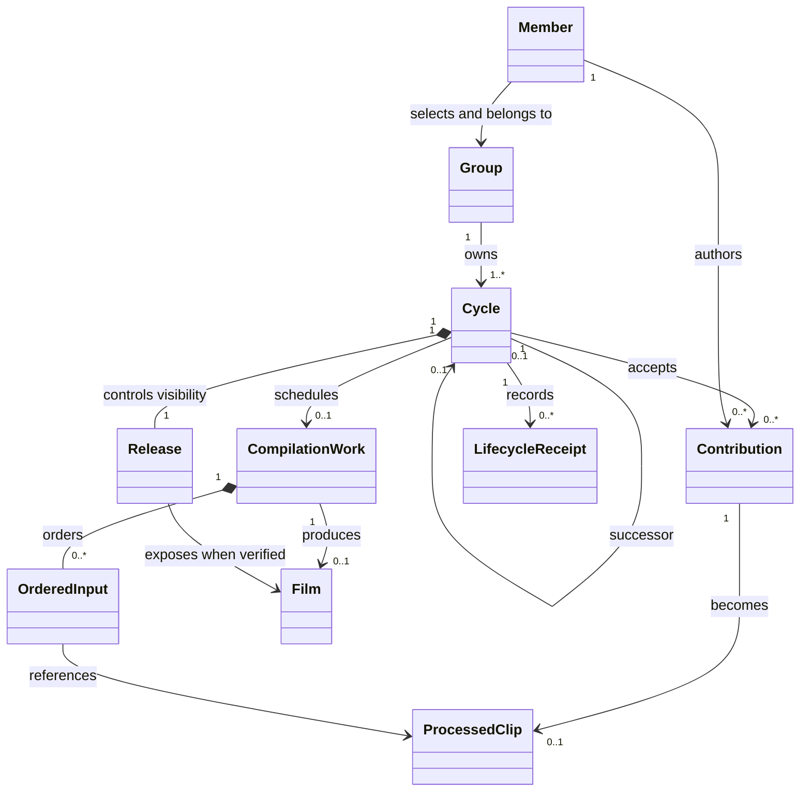

### A-S1 — Advance and continue collecting (UC-01)

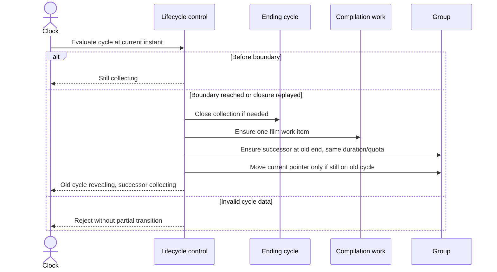

### A-S2 — Recover work and generate film (UC-02, UC-03)

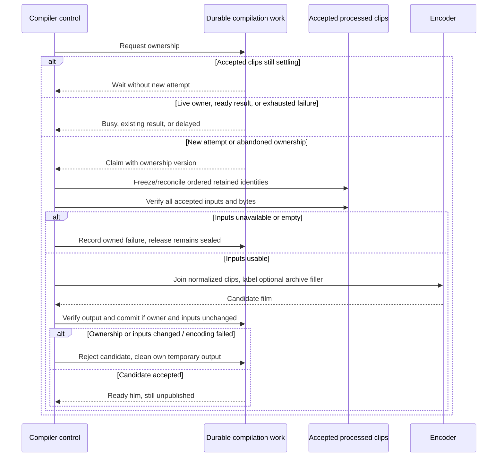

### A-S3 — Publish, premiere and archive (UC-04)

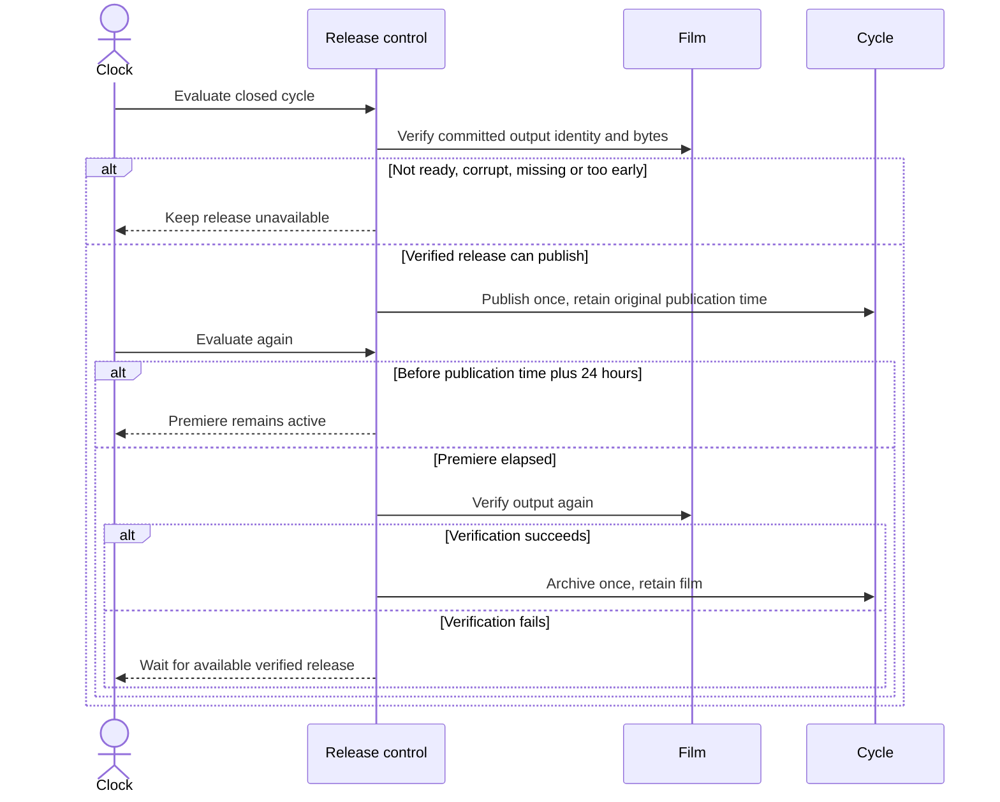

### A-S4 — Reveal and Archive eligibility (UC-05)

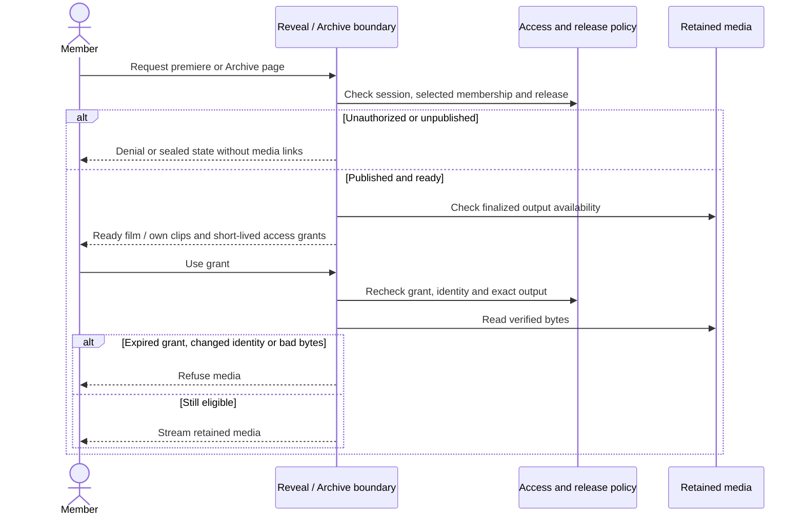

## Design model and flow mapping

### D-C1 — Actual module/type model (AFTER)

`functional_module` boxes group functions in files; they are not instantiated classes. `data_type` boxes represent TypeScript records. Only `MediaCapabilities` below is a runtime class. The database type abstracts the supplied connection; this diagram does not imply an ORM.

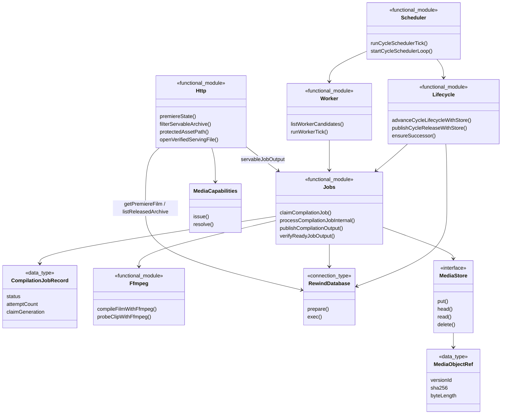

### D-S1 — Atomic rollover (UC-01)

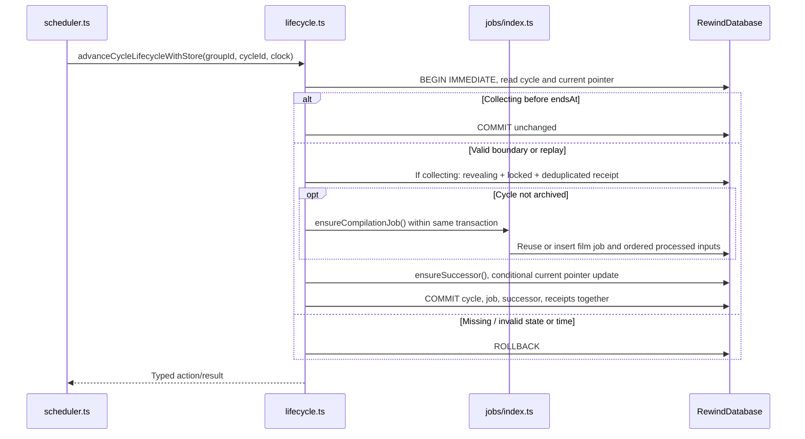

### D-S2 — Durable claim and film generation (UC-02, UC-03; AFTER)

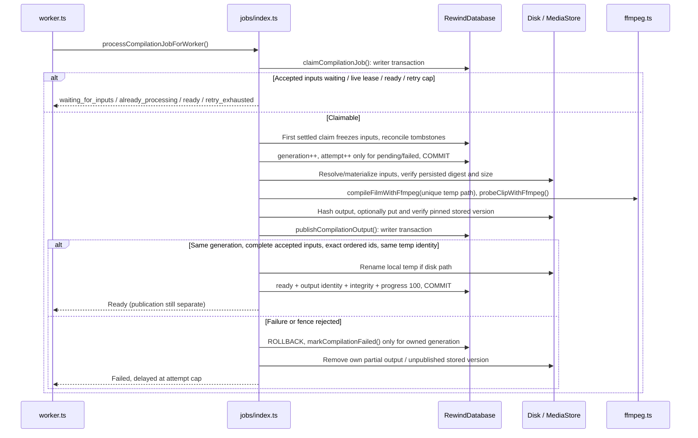

Input verification/FFmpeg failures also enter the owned-failure cleanup path. Stale reclaim increments generation but keeps attempt count. `updateCompilationJobProgress()` provides a generation-fenced, monotonic heartbeat API; the inspected film processor does not run a periodic heartbeat timer. A long-running claim can therefore be reclaimed; finalization fences remain essential.

### D-S3 — Store-aware release and archival (UC-04)

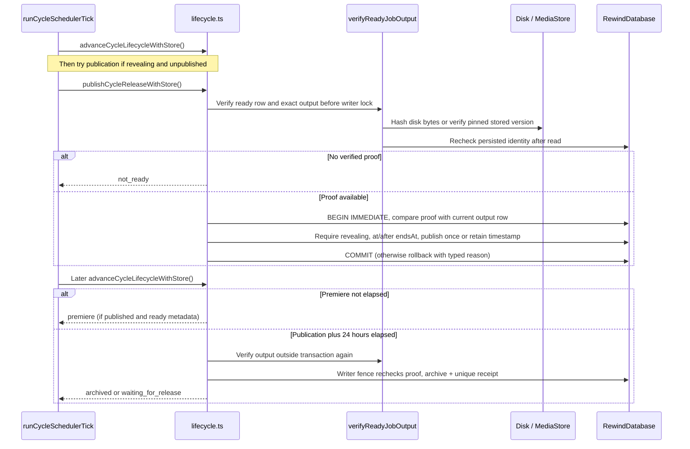

The first closing tick attempts publication before running its worker. Newly compiled output is normally published on a later tick. Scans are bounded (default 16, maximum 100), cursor-based, and interleave one claimed media job through round-robin real groups. Correctness comes from persisted transitions/claims, not the in-memory cursor. The CLI starts/stops the scheduler with the runtime.

### D-S4 — Read and serve eligible media (UC-05)

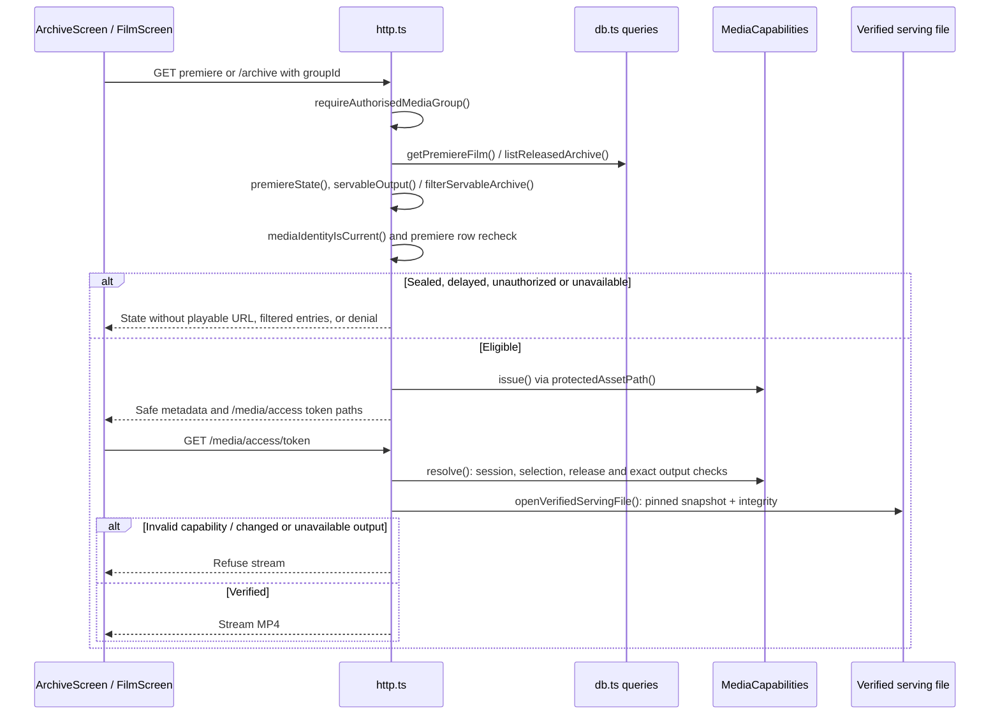

Listing checks finalized metadata and existence/size, not a full hash per item. Streaming and release perform byte verification. Archive returns published ready films and the requesting member's ready clips; HTTP strips storage paths and issues capabilities. `MediaCapabilities` grants last two minutes and are process-local; restart requires reacquisition. `getRealGroup()`'s release summaries are display metadata: unpublished failed jobs are `delayed` there even before the premiere endpoint's three-attempt threshold. They are not media authorization.

### Traceability — use cases to implementation and existing tests

Line anchors identify symbols at the inspected revision. Test links identify existing coverage to consult; **none of these tests was run for this document**.

| UC    | Analysis → design diagrams                                  | Exact relative source / symbols                                                                                                                                                                                                                                                                                                                                                                                                                                                               | Existing relevant tests                                                                                                                                                                                                                                                                                                                                 |
| ----- | ----------------------------------------------------------- | --------------------------------------------------------------------------------------------------------------------------------------------------------------------------------------------------------------------------------------------------------------------------------------------------------------------------------------------------------------------------------------------------------------------------------------------------------------------------------------------- | ------------------------------------------------------------------------------------------------------------------------------------------------------------------------------------------------------------------------------------------------------------------------------------------------------------------------------------------------------- |
| UC-01 | [A-C1](#a-c1), [A-S1](#a-s1) → [D-C1](#d-c1), [D-S1](#d-s1) | [lifecycle.ts: `advanceCycleLifecycle`](../../server/src/cycles/lifecycle.ts#L419), [`advanceCycleLifecycleWithStore`](../../server/src/cycles/lifecycle.ts#L435), [`ensureSuccessor`](../../server/src/cycles/lifecycle.ts#L276); [scheduler.ts: `runCycleSchedulerTick`](../../server/src/cycles/scheduler.ts#L45); [engine.ts: `cyclePhase`](../../server/src/cycles/engine.ts#L65), [`advanceCycleWindow`](../../server/src/cycles/engine.ts#L80)                                         | [cycles: closure, legacy repair, concurrent lifecycle](../../server/tests/cycles.test.mjs#L91); [scheduler: absent clients](../../server/tests/cycle-scheduler.test.mjs#L102)                                                                                                                                                                           |
| UC-02 | [A-C1](#a-c1), [A-S2](#a-s2) → [D-C1](#d-c1), [D-S2](#d-s2) | [jobs/index.ts: `claimCompilationJob`](../../server/src/jobs/index.ts#L599), [`updateCompilationJobProgress`](../../server/src/jobs/index.ts#L674); [worker.ts: `listWorkerCandidates`](../../server/src/jobs/worker.ts#L153), [`runWorkerTick`](../../server/src/jobs/worker.ts#L266)                                                                                                                                                                                                        | [compilation-jobs: restart and progress](../../server/tests/compilation-jobs.test.mjs#L119); [durable-worker: terminal film](../../server/tests/durable-worker.test.mjs#L402), [stale film generation](../../server/tests/durable-worker.test.mjs#L436); [private-media-jobs: wait across restart](../../server/tests/private-media-jobs.test.mjs#L310) |
| UC-03 | [A-C1](#a-c1), [A-S2](#a-s2) → [D-C1](#d-c1), [D-S2](#d-s2) | [jobs/index.ts: `processCompilationJobInternal`](../../server/src/jobs/index.ts#L980), [`publishCompilationOutput`](../../server/src/jobs/index.ts#L899), [`eligibleCompilationInputs`](../../server/src/jobs/index.ts#L380); [ffmpeg.ts: `compileFilmWithFfmpeg`](../../server/src/ffmpeg.ts#L469)                                                                                                                                                                                           | [film-compilation: order/audio](../../server/tests/film-compilation.test.mjs#L249), [archive filler](../../server/tests/film-compilation.test.mjs#L434), [partial failure](../../server/tests/film-compilation.test.mjs#L531); [private-media-jobs: missing/exhausted/corrupt accepted inputs](../../server/tests/private-media-jobs.test.mjs#L358)     |
| UC-04 | [A-C1](#a-c1), [A-S3](#a-s3) → [D-C1](#d-c1), [D-S3](#d-s3) | [lifecycle.ts: `publishCycleReleaseWithStore`](../../server/src/cycles/lifecycle.ts#L426), [`advanceCycleLifecycleWithStore`](../../server/src/cycles/lifecycle.ts#L435), [`hasReadyCompilationOutput`](../../server/src/cycles/lifecycle.ts#L175); [jobs/index.ts: `verifyReadyJobOutput`](../../server/src/jobs/index.ts#L1934); [cli.ts: `startCycleSchedulerLoop` call](../../server/src/cycles/scheduler.ts#L113)                                                                        | [cycles: 24-hour publication clock](../../server/tests/cycles.test.mjs#L91), [invalid output](../../server/tests/cycles.test.mjs#L174); [real-archive: pinned publication](../../server/tests/real-archive.test.mjs#L325), [changed during read](../../server/tests/real-archive.test.mjs#L395)                                                         |
| UC-05 | [A-C1](#a-c1), [A-S4](#a-s4) → [D-C1](#d-c1), [D-S4](#d-s4) | [db.ts: `listReleasedArchive`](../../server/src/db.ts#L651), [`getPremiereFilm`](../../server/src/db.ts#L749); [media-access.ts: `premiereState`](../../server/src/routes/media-access.ts#L162), [`filterServableArchive`](../../server/src/routes/media-access.ts#L300); [capabilities.ts: `MediaCapabilities.resolve`](../../server/src/archive/capabilities.ts#L43); [Archive.tsx: `ArchiveScreen`](../../src/real/Archive.tsx#L18); [Film.tsx: `FilmScreen`](../../src/real/Film.tsx#L53) | [real-archive: release and selected membership](../../server/tests/real-archive.test.mjs#L196), [expiry/corruption](../../server/tests/real-archive.test.mjs#L281); [film-screen: per-viewer segments](../../tests/film-screen.test.tsx#L59)                                                                                                            |

## Design problem and alternatives

**Problem:** rollover must enable new collection even when encoding fails or a process dies. Duplicate runtimes and replay must not create multiple successors/jobs, publish an obsolete worker's output, or expose a partial film. Database transactions cannot roll back FFmpeg or object-store side effects.

### B-C1 — BEFORE: conceptual rejected baseline

This is an illustrative alternative, **not historical implemented architecture**. The fictional classes deliberately collapse lifecycle and compilation into one synchronous request.

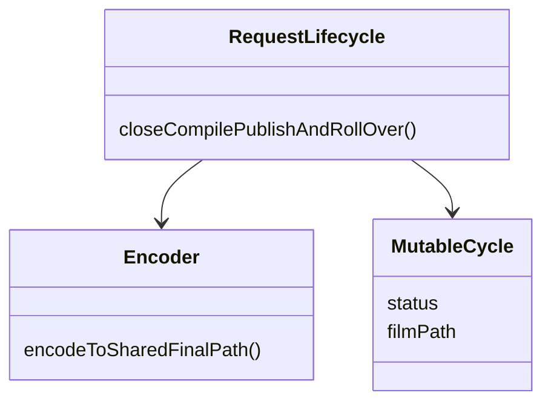

### B-S1 — BEFORE: conceptual failure sequence

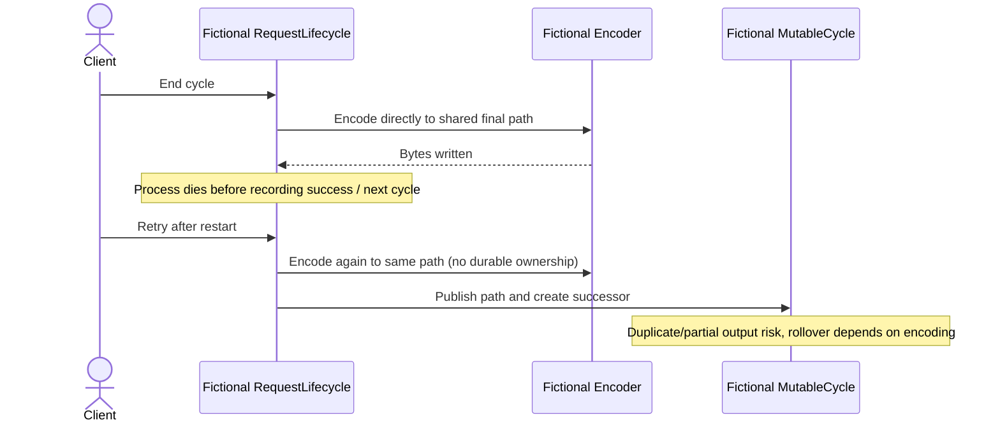

| Candidate                                                                             | Assessment                                                                                                                                                                                                               |
| ------------------------------------------------------------------------------------- | ------------------------------------------------------------------------------------------------------------------------------------------------------------------------------------------------------------------------ |
| Request-bound synchronous compiler + process mutex                                    | Simple locally; loses ownership on restart and coordinates neither multiple processes nor storage side effects. Rejected baseline above.                                                                                 |
| External broker + distributed workflow/saga                                           | Could scale work and express compensation, but adds broker/coordination operations. Not required by the inspected local durable runtime; not claimed as implemented.                                                     |
| **Chosen: transactional rollover + database-backed work + fenced output publication** | Actual [D-C1 AFTER](#d-c1), [D-S1](#d-s1), [D-S2 AFTER](#d-s2), [D-S3](#d-s3). Durable identity prevents duplicate work items; leases permit recovery; generations exclude stale writers; integrity proof gates release. |

This is a durable work-queue / transaction-boundary architecture with optimistic generation checks around expensive work. Lifecycle receipts are deduplicated records, **not an event bus or transactional outbox dispatcher**. `MediaStore` supplies dependency inversion and interchangeable storage implementations; no GoF pattern is needed to explain the lifecycle. String unions and conditional transition functions do **not** implement GoF State: there are no polymorphic state objects receiving delegated behavior.

## Transition and implementation choices

- **Boundary/control/entity decomposition:** analysis reveal/Archive boundaries map to HTTP handlers and `ArchiveScreen`/`FilmScreen`; lifecycle and compiler controls map to functional modules; cycles/contributions/work map to persisted rows and read types. Entity behavior is expressed by functions, rather than invented entity classes.
- **Persistence identity mapping:** `Group.currentCycleIdentity` becomes `groups.current_cycle_id`; successor identity becomes `cycles.previous_cycle_id` with a unique partial index. [Migration 009](../../server/migrations/sqlite-baseline.sql) gives unique `(cycle_id, transition)` receipts. [`compilationJobId`](../../server/src/jobs/index.ts#L213) deterministically hashes group/cycle; [`applyCompilationJobsMigration`](../../server/src/db.ts#L1204) also enforces one film per cycle. Ordered inputs persist clip/contribution identities and position, not raw source paths.
- **Refine analysis ownership into concurrency controls:** writer transactions serialize state changes; `claim_generation` is a fencing token; `processing_started_at` is a renewable 15-minute lease. Pending/failed claims increment attempts; stale processing recovery does not. The default film cap is three; clip worker retry policy is distinct and allows request retries after automatic exhaustion.
- **Extract storage/encoding interfaces:** compiler functions receive FFmpeg binary/options and optional `MediaStore`/environment. [MediaStore and MediaObjectRef](../../server/src/media/store.ts#L1) carry explicit group/environment/version/integrity identity. Disk runs use processed paths; hosted storage uses pinned S3 refs. The retained `local` object-store adapter is not a recommendation to extend that backend.
- **Separate slow work from commit:** input materialization, FFmpeg, probing, hashing and stored verification happen outside short writer transactions. Local publication checks temp-file identity and renames while holding its fence; stored publication commits an encoded version reference. These protect durable visibility, not exactly-once execution of FFmpeg or a distributed database/storage transaction.
- **Preserve acceptance completeness:** initial job creation snapshots currently ready clips; processing waits for accepted inputs to settle and freezes the complete selection on the first claim. Reconciliation removes invalid/tombstoned references; completeness checks prevent silently omitting a retained accepted contribution. No accepted usable inputs means failure, not an empty published release.
- **Map domain ordering into media processing:** current inputs sort by contribution creation/id and clip id. Exactly one current clip may append one latest eligible archived clip from the same group; absent filler does not force failure. FFmpeg visibly labels filler, letterboxes into 720×1280, normalizes audio and emits H.264/AAC MP4 at 30 fps; probing precedes ready publication.
- **Keep timing separate from visibility:** successor starts at the old boundary and copies duration/prompt/quota, resetting usage. `advanceCycleWindow()` shifts a window for controlled clock advancement; it is not the persistent rollover routine. A late scheduler may require further passes to catch up. Premiere duration uses publication time, while Archive query visibility begins with publication immediately.
- **Tradeoffs and limits:** serial scheduler passes can be delayed by a long FFmpeg job; bounded scans are not a throughput guarantee. Stale leases can cause overlapping computations, but only the current generation may finalize. Cleanup is best effort for some unpublished stored objects; a crash between storage writes and database commit can leave unreferenced bytes. Published metadata does not guarantee continuing availability: serving must recheck bytes and identity.

## Sources and limits

The [traceability table](#traceability) is the primary source index. Additional read models: [Cycle / CycleStatus](../../src/domain/cycles.ts#L1), [Premiere / FilmSegment](../../src/domain/premiere.ts#L1), [getRealGroup release summaries](../../server/src/groups/real.ts#L128), and [servableJobOutput](../../server/src/jobs/index.ts#L1904). Lifecycle's internal `StoredCycle` includes release/successor metadata absent from the client `Cycle` interface. Legacy reveal education helpers do not replace server publication/access gates.

Inspection used only current source/tests and the root working agreement plus shipping skill. The supplied issue brief defines this document's scope; no GitHub operation was performed. No application code, schema or runtime behavior was changed. Test names/assertions were inspected as references; no application tests, server, FFmpeg execution, deployment or device verification was run. Static documentation checks are reported separately by the authoring agent.

The model explains the inspected local SQL transaction/worker paths and store-aware release APIs. It does not establish production performance, multi-host database equivalence, recovery from every possible crash point, or a guarantee that a ready/published asset cannot later disappear. Sequence diagrams omit audit/logging and low-level transport details except where they affect eligibility or durable ownership. Revalidate source anchors and state guards when implementation changes.
