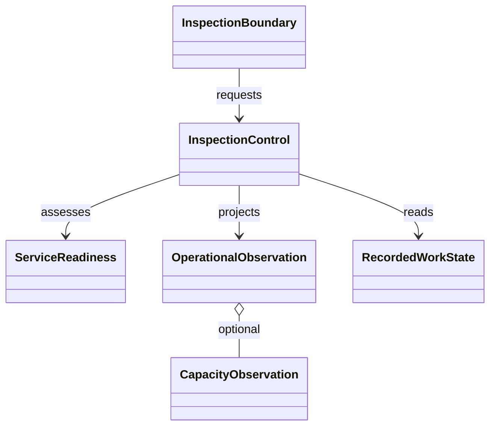
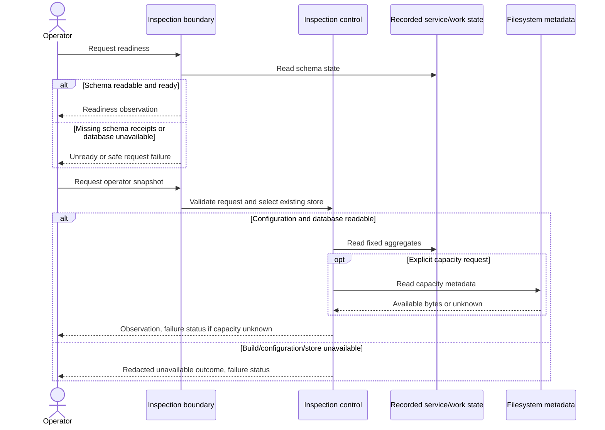
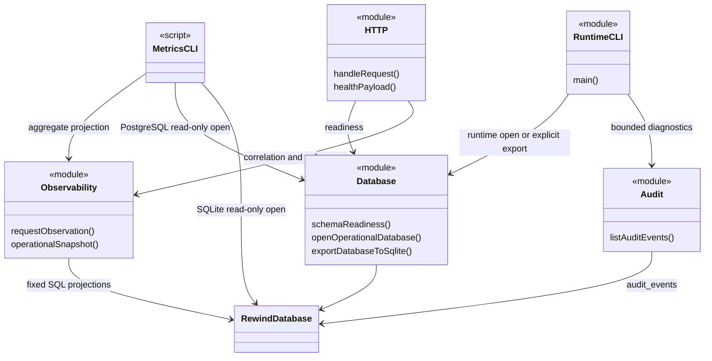
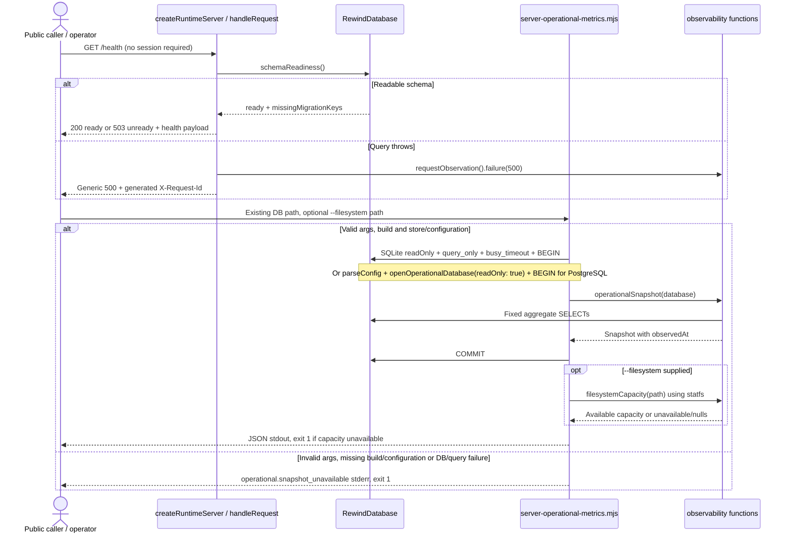

# Operations inspection models

Source revision: `39ba152af0da152ff8e0efe08be861270752129e` (`dev`, 15 October
2026). Static source inspection only; tests below are specification locations,
not passing results. The [canonical contract](../../doc/planning/current-product-baseline.md#uc-inspect-operations)
and [operational signals](../../doc/planning/operations/operational-signals.md)
define UC-INSPECT-OPERATIONS. No deployment, database, provider or media was probed.

## UC-INSPECT-OPERATIONS

**Actor and goal:** a platform operator diagnoses readiness, job failures,
reminders and cycle transitions without routinely viewing private media.
Public health callers also participate; `/health` and `/version` require no
application session or operator role. CLI authority comes from operator-controlled
execution, filesystem access and configured database credentials, not a new app role.

**Normal flow:** (1) read service health; (2) inspect generated failure correlation
and, when appropriate, bounded audit diagnostics; (3) run the aggregate snapshot
against the selected existing database; (4) optionally request filesystem capacity;
(5) interpret the observations and choose a separate recovery procedure.
Success supplies observations without implying that a worker or provider is healthy.

| Branch                                                                                    | Outcome / boundary                                                                                                                        |
| ----------------------------------------------------------------------------------------- | ----------------------------------------------------------------------------------------------------------------------------------------- |
| Schema not ready                                                                          | Health returns 503 and missing migration keys; ready schema returns 200.                                                                  |
| Database query throws                                                                     | HTTP wrapper returns generic 500 if headers are unsent and logs safe failure correlation; if already streaming, it destroys the response. |
| Missing build, invalid arguments/configuration, unavailable or incompatible metrics store | Snapshot emits `operational.snapshot_unavailable` on stderr and exits 1, omitting raw error/path.                                         |
| Optional capacity probe fails                                                             | Database aggregates remain on stdout; capacity is unavailable with null bytes, exit 1. Unknown space is not zero.                         |
| Runtime fails before listening                                                            | There may be no health response; startup failure is not readiness.                                                                        |

## Analysis class view

Recorded work comprises job attempts, reminder states and cycle transition receipts.

## Analysis sequence — normal and major exceptions

## Design class view — actual functions, records and boundaries

`<<module>>` nodes group functions, not runtime classes. `RewindDatabase` is typed
as `DatabaseSync`, with the same surface supplied by the PostgreSQL adapter.

## Design sequence — health and aggregate CLI

The [HTTP payload](../../server/src/http.ts) includes service/version, database
engine, schema receipts, FFmpeg configuration presence and local/LAN addresses.
`ffmpegConfigured` is not an executable probe. Health does not contact S3, Cognito
or push providers. [requestObservation](../../server/src/observability/index.ts)
generates correlation IDs and bounds duration; `api.failure` excludes request data,
exception messages and stacks. Opt-in `api.request` timing also emits method and
an allowlisted route template, never the raw URL/query.

## Analysis-to-design transition and alternatives

| Analysis responsibility  | Actual allocation / design choice                                                                                                                                                                                 |
| ------------------------ | ----------------------------------------------------------------------------------------------------------------------------------------------------------------------------------------------------------------- |
| Readiness boundary       | `healthPayload` + `schemaReadiness`; public bounded runtime metadata, separate from cross-group CLI data.                                                                                                         |
| Limit disclosure         | Fixed SQL projections in `operationalSnapshot`; failure-log projection in `requestObservation`. Avoid loading private rows and then trying to redact arbitrary content.                                           |
| Stable work evidence     | Read `media_jobs`, `audit_events`, `reminder_outbox`, `cycles`, `real_group_metadata` and `cycle_lifecycle_events`; no new monitoring database.                                                                   |
| Observe capacity         | Explicit [filesystemCapacity](../../server/src/observability/filesystem-capacity.ts) dependency; `statfs` metadata only, bigint-safe `bsize * blocks` / `bsize * bavail`; no directory enumeration or media open. |
| Inspect detailed history | `diagnostics` → `openRuntimeDatabase` → `listAuditEvents` → `printDiagnostics`; bounded 1–500 events, default 100. This path can migrate and backfill integrity through runtime opening.                          |

Alternatives include public raw job/audit endpoints or a full monitoring pipeline.
The implemented aggregate CLI keeps cross-group inspection at the operator boundary
with a smaller disclosure surface. This is responsibility separation/data projection,
not a GoF pattern claim or a recorded historical selection.

**Read and write boundaries.** The [metrics script](../../scripts/server-operational-metrics.mjs)
prints JSON; saving stdout creates an operator-selected artifact outside the script.
SQLite uses an existing read-only database, `query_only`, a 1-second busy timeout
and a read transaction. With database URL configuration it uses
`parseConfig` / `openOperationalDatabase({readOnly: true})`; the
[PostgreSQL worker](../../server/src/postgres/sync-worker.ts) sets default
transactions read-only. The metrics path does not explicitly request PostgreSQL
repeatable-read isolation. Its later capacity observation is separate in time.

The distinct [database-export CLI](../../server/src/cli.ts) calls
[exportDatabaseToSqlite](../../server/src/db.ts) / [exportPostgresToSqlite](../../server/src/postgres/export.ts).
It reads PostgreSQL in a checked repeatable-read, read-only transaction but writes
a fresh staged SQLite file and `.export.json` report. It rejects the live SQLite
destination, existing files, wrong environment, incompatible schema and detected
runtime writer sessions by default; it reconciles counts/content hashes, rechecks
source state, then links without overwriting and cleans staging. Writer detection
uses application names, not universal prevention of concurrent writers.
`--allow-live-writers` skips that check and produces an export unsuitable for install.
The export contains private database rows: it is not a redacted metrics artifact
or a media backup. Installation/import/repair are separate mutations outside this UC.

**Privacy limits.** [Audit recording](../../server/src/audit/index.ts) allowlists
event/result types and local identifier namespaces, retaining only synthetic actor
references; diagnostic reads return stored identifiers, not aggregate anonymization.
The general runtime CLI catch prints error messages, unlike the metrics script's
fixed unavailable event. Do not treat all CLI output as equally redacted.

## Source checks and static limits

| Specification location                                                                      | Contract covered; no execution claimed                                                                                          |
| ------------------------------------------------------------------------------------------- | ------------------------------------------------------------------------------------------------------------------------------- |
| [runtime.test.mjs](../../server/tests/runtime.test.mjs)                                     | Health readiness and stale migration receipt → 503; invalid configuration.                                                      |
| [operational-observability.test.mjs](../../server/tests/operational-observability.test.mjs) | Safe actual HTTP failure, persisted failure aggregates, unchanged SQLite bytes, missing build/store, audited attempt durations. |
| [filesystem-capacity.test.mjs](../../server/tests/filesystem-capacity.test.mjs)             | Safe arithmetic/probe failure, CLI argument rejection and preserved database output.                                            |
| [request-timing.test.mjs](../../server/tests/request-timing.test.mjs)                       | Optional sanitized route timing.                                                                                                |
| [postgres-export.test.mjs](../../server/tests/postgres-export.test.mjs)                     | Read-only source, destination/environment/schema guards, reconciliation and writer races; PostgreSQL-dependent fixtures.        |

Configuration: [config.ts](../../server/src/config.ts). Counts cover retained state,
including legacy rows; only real groups enter scheduler overdue counts. Durations
and storage/transition events use 24 hours; missing audit pairs yield zero.
Counts/receipts do not prove heartbeat, delivery or current storage integrity.
No runtime/test/hosted result, privacy audit, paging thresholds, CloudWatch
dashboard/alarms or human design attribution is established here.
