# Authorized film playback and downloads

## Scope and use cases

Issue #538; source revision `40ebeb5673d103b4b6950d095192aae744980769`. This is a developer model of the inspected implementation. Analysis diagrams describe responsibilities;
design diagrams identify actual modules, functions, types and classes. Diagram IDs and explicit anchors are stable reuse targets.

“Signed access” here means an authorized capability: the implementation issues an opaque random token backed by server memory, **not** a cryptographic URL signature. A “download
ticket” is the `purpose: 'download'` grant behind `/media/access/:token`. No separate download-ticket API or S3-presigned GET transport was found in the inspected playback path. S3
reads pass through the server. Authenticated direct download routes also exist; see UC-05.

Actors: an accepted member of the account's selected group; browser/PWA media and download facilities; the cycle lifecycle and private media storage. Compilation, account login and
moderation mutations are upstream dependencies.

| UC                                                           | Normal course and result                                                                                                                                                                                                                                                                                   | Major exceptions                                                                                                                                                                                                                                                         |
| ------------------------------------------------------------ | ---------------------------------------------------------------------------------------------------------------------------------------------------------------------------------------------------------------------------------------------------------------------------------------------------------- | ------------------------------------------------------------------------------------------------------------------------------------------------------------------------------------------------------------------------------------------------------------------------ |
| **UC-01 Discover an available release**                      | 1. Member opens Archive or a cycle. 2. Server resolves session and selected membership. 3. It lists published films and only the member's released clips, or returns premiere state. 4. Servable items receive fresh capabilities.                                                                         | Missing/expired session: 401; wrong selected group or membership: 403. Unpublished media stays sealed. Premiere is locked, processing or delayed; unknown cycle: 404. Invalid cursor: 400; request capacity may reject. Missing/resized output is omitted or delayed.    |
| **UC-02 Watch or seek a film**                               | 1. Film screen requests the cycle's premiere metadata, including for older cycles. 2. It loads the ready playback URL into its video view. 3. Media GET/HEAD requests redeem the capability, with optional byte range. 4. Verified bytes play; pause, seek, replay and close control the same view.        | Stale/revoked grant, output change or expiry: 404. Invalid range: 416. Snapshot too large/busy: 413/429. Autoplay denial leaves Play available; decode/network failure exposes retry. Closing cancels queued playback.                                                   |
| **UC-03 Save a group film**                                  | 1. Member selects Save film. 2. One queued operation chooses a destination. 3. Client finds the film by stable ID in fresh Archive pages. 4. It downloads the new capability and exports the file.                                                                                                         | Duplicate tap is guarded/coalesced. Destination cancellation transfers nothing. Removed media, HTTP/network/export failure is retryable; unsupported export is reported separately. Browser completion is a handoff, not proof of disk persistence.                      |
| **UC-04 Save own moments for a cycle**                       | 1. Client walks clip pages and deduplicates matching cycle entries. 2. Member selects Save your own moments. 3. One destination is chosen. 4. Each unsaved clip is freshly authorized and exported sequentially.                                                                                           | Failed discovery page produces failure, not a partial ready list. Context changes discard discovery results. Cancellation/failure stops the remaining exports and reports partial progress; retry excludes clips already saved in this screen context.                   |
| **UC-05 Retrieve bytes through direct authenticated routes** | 1. Caller sends GET/HEAD to `/films/:id/play`, `/films/:id/download` or `/clips/:id/download`, with `groupId` and real session. 2. Server derives identity and checks release/clip ownership. 3. It verifies output, rechecks authorization and streams bytes; download routes add attachment disposition. | Caller-supplied `memberId` cannot grant access. Unreleased/foreign/other member's clip: safe 404 after group authorization. Missing session: 401; forbidden group: 403; integrity, range and capacity failures follow UC-02. These routes do not mint a separate ticket. |

Timing has three distinct meanings. The lifecycle closes capture at `endsAt`, publishes only a ready verified compilation at or after that boundary, and archives after **24 hours
from publication**. Archive queries already admit published media during premiere and continue after archiving. HTTP serving gates on persisted publication/readiness, rather than
independently comparing the current time to `endsAt`. Each capability instead expires after **2 minutes**.

## Analysis model

### AC-01 — Domain and responsibility model

These are analysis concepts, not proposed application classes. `AccessGrant` represents temporary permission; it does not own media or replace membership. Membership identifies the
account/group/profile and acceptance; Cycle owns release timing; Film identifies a compiled output; PersonalClip retains author and contribution identity; AccessGrant binds an
asset, purpose, issuing session and expiry.

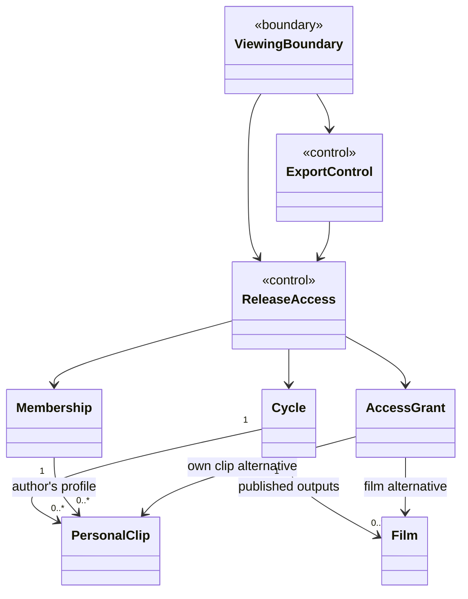

### AS-01 — Release timing and discovery (UC-01)

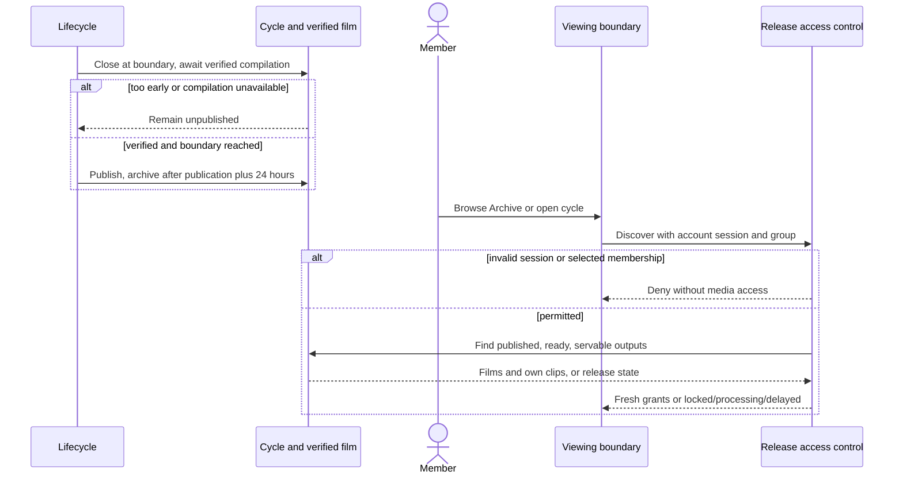

### AS-02 — Authorized byte delivery (UC-02, UC-05)

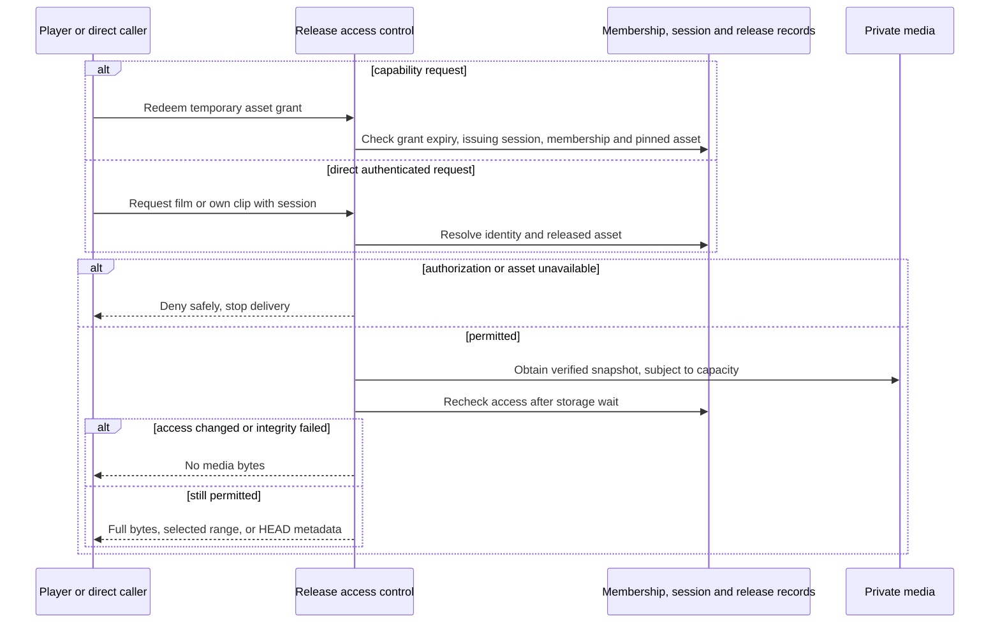

### AS-03 — Single and batch export (UC-03, UC-04)

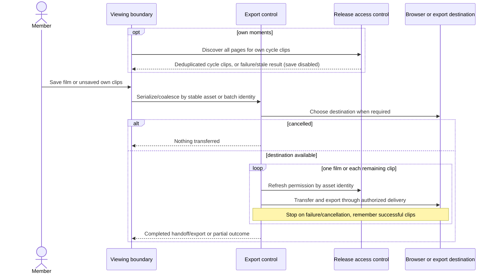

## Design model and flow mapping

### DC-01 — Actual design dependencies (AFTER class model)

`Http`, `Db`, `ArchiveDownload`, `Integrity` and `StoreServing` are **functional modules**, not runtime classes. `FilmPlayback` denotes the closure returned by
`createFilmPlayback`; screens are function components and `MediaCapability` is an interface. `<<interface>>` marks additional TypeScript contracts. Only `MediaCapabilities` and
`MediaServingBudget` below are application classes. Dependencies omit unrelated concerns. Functions appear in the sequences and source map.

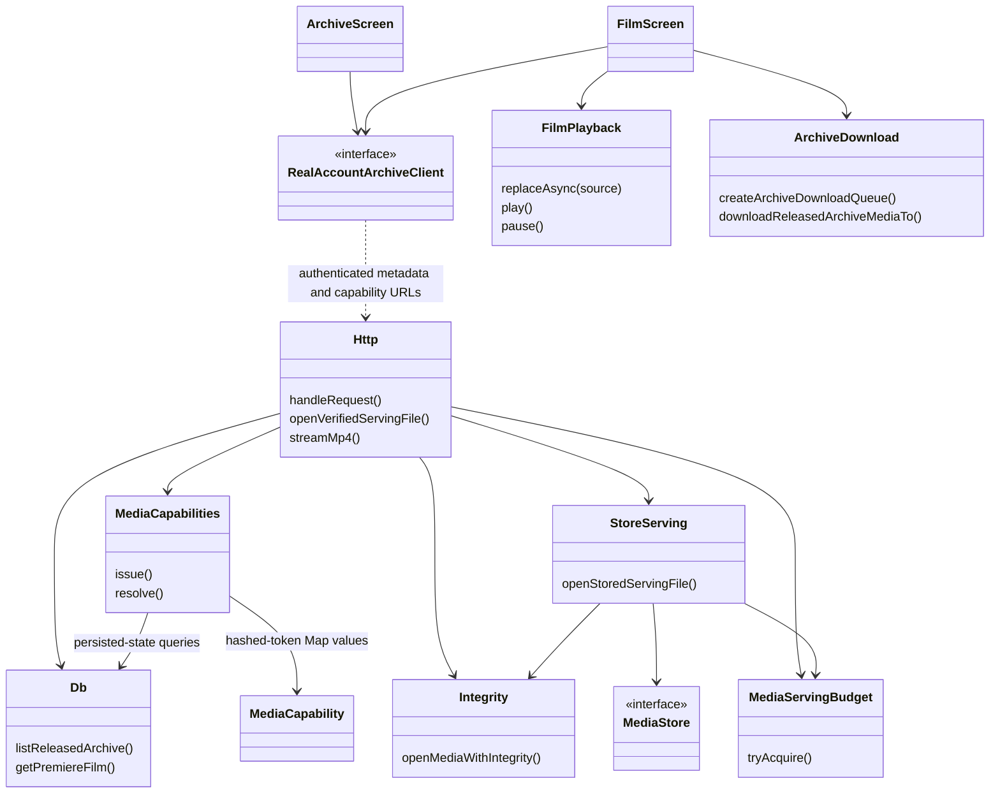

`createRealAccountArchiveClient` supplies the client interface. `RealArchiveFilm`/`RealArchiveClip` carry stable IDs plus temporary URLs; `MediaCapability` pins session hash,
account/group/profile, job/kind/purpose, output path, digest, byte length and expiry. `MediaObjectRef` additionally pins storage environment, group, store and object version. Local
disk uses an owned processed path; stored references use `openStoredServingFile` and `MediaStore`.

### DS-01 — Metadata and publication gate (UC-01)

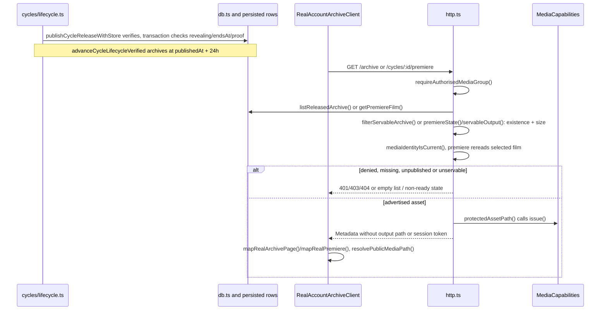

### DS-02 — Shared serving gate (UC-02, UC-03, UC-04, UC-05; AFTER sequence)

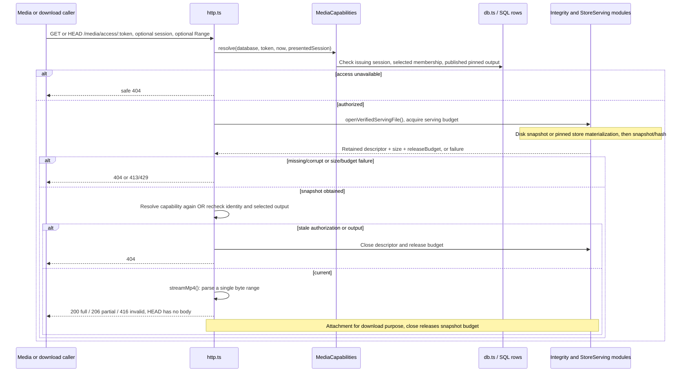

Capability resolution needs no presented session for a media element, but the issuing session must remain valid. If a session is presented, its hash must match; malformed supplied
credentials are rejected. The route also checks transport/origin. The grant is reusable until expiry, not a single-use ticket.

`streamMp4` supports `bytes=start-end`, `bytes=start-` and `bytes=-suffix`; it clamps an oversized end to file size. Malformed, empty, multiple or unsatisfiable ranges return 416
with `Content-Range: bytes */size`. Successful responses specify `video/mp4`, byte length, `Accept-Ranges` and `Cache-Control: no-store`; download disposition uses
`rewind-group-film.mp4` or `rewind-my-clip.mp4`. HEAD performs authorization/verification too.

### DS-03 — Browser playback lifecycle (UC-02)

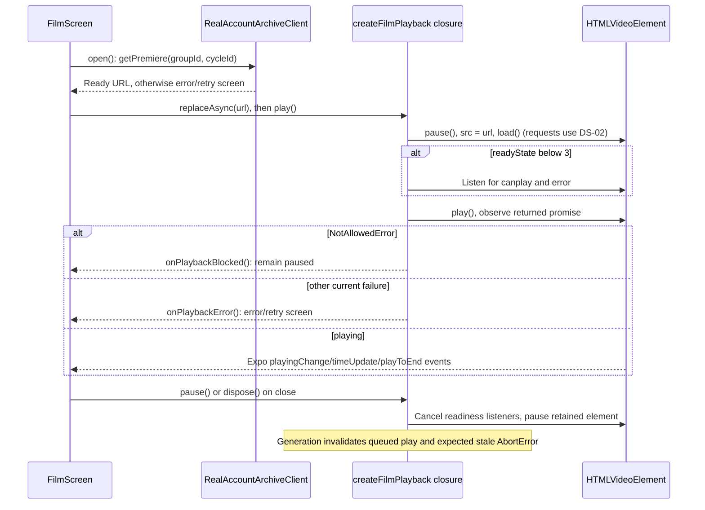

Film uses `useVideoPlayer(null)` and one `VideoView`; web source assignment avoids Expo reloading a declarative URL. Native compatibility delegates to the Expo player.
`filmSegments` supplies per-viewer hidden flags; `segmentAt` and time updates seek past hidden moments. This UI skipping does not redact the downloaded compiled MP4 or establish
byte-level segment access control.

### DS-04 — Fresh authorization and export (UC-03, UC-04)

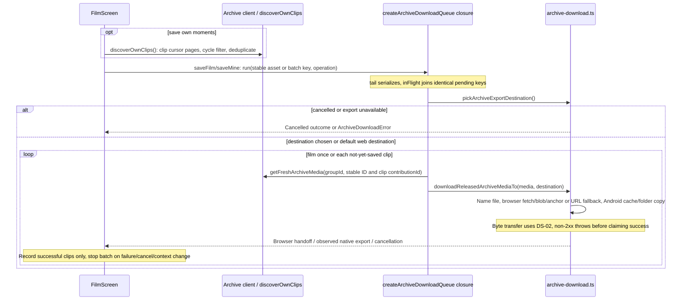

### Traceability

Paths are relative to this document; symbols identify exact source locations. Test names below are **existing references, not execution results**.

| UC    | Analysis → design                                                   | Source file / symbol links                                                                                                                                                                                                                                                                                                                                                                                                                                                                                                       | Relevant existing tests                                                                                                                                                                                                                                                                                                                                                                                             |
| ----- | ------------------------------------------------------------------- | -------------------------------------------------------------------------------------------------------------------------------------------------------------------------------------------------------------------------------------------------------------------------------------------------------------------------------------------------------------------------------------------------------------------------------------------------------------------------------------------------------------------------------- | ------------------------------------------------------------------------------------------------------------------------------------------------------------------------------------------------------------------------------------------------------------------------------------------------------------------------------------------------------------------------------------------------------------------- |
| UC-01 | [AC-01](#ac-01), [AS-01](#as-01) → [DC-01](#dc-01), [DS-01](#ds-01) | [lifecycle.ts · publishCycleReleaseVerified](../../server/src/cycles/lifecycle.ts#L216), [advanceCycleLifecycleVerified](../../server/src/cycles/lifecycle.ts#L312); [db.ts · listReleasedArchive](../../server/src/db.ts#L2057), [getPremiereFilm](../../server/src/db.ts#L2195); [http.ts · requireAuthorisedMediaGroup](../../server/src/http.ts#L297), [premiereState](../../server/src/http.ts#L465), [filterServableArchive](../../server/src/http.ts#L603); [Archive.tsx · ArchiveScreen](../../src/real/Archive.tsx#L18) | [cycles.test.mjs](../../server/tests/cycles.test.mjs): “closure creates one immediate boundary-anchored successor…”; [real-archive.test.mjs](../../server/tests/real-archive.test.mjs): “real Archive seals media until release…” and “private stored film publication…”                                                                                                                                            |
| UC-02 | [AS-02](#as-02) → [DC-01](#dc-01), [DS-02](#ds-02), [DS-03](#ds-03) | [Film.tsx · FilmScreen](../../src/real/Film.tsx#L52), [open](../../src/real/Film.tsx#L127), [segmentAt](../../src/real/Film.tsx#L34); [film-playback.ts · createFilmPlayback](../../src/real/film-playback.ts#L9); [capabilities.ts · MediaCapabilities.resolve](../../server/src/archive/capabilities.ts#L43); [http.ts · openVerifiedServingFile](../../server/src/http.ts#L502), [streamMp4](../../server/src/http.ts#L629); [safety.ts · filmSegments](../../server/src/groups/safety.ts#L170)                               | [film-playback.test.ts](../../tests/film-playback.test.ts): readiness, autoplay denial, cancellation; [film-screen.test.tsx](../../tests/film-screen.test.tsx): hidden moments and player events; [real-archive.test.mjs](../../server/tests/real-archive.test.mjs): HEAD/range, expiry, changed bytes; [film-playback.spec.ts](../../tests/responsive/film-playback.spec.ts): browser play/pause/seek/replay/close |
| UC-03 | [AS-03](#as-03) → [DS-04](#ds-04), [DS-02](#ds-02)                  | [Film.tsx · saveFilm](../../src/real/Film.tsx#L234); [real-account-client.ts · createRealAccountArchiveClient](../../src/auth/real-account-client.ts#L580), [getFreshArchiveMedia](../../src/auth/real-account-client.ts#L607); [archive-download.ts · createArchiveDownloadQueue](../../src/archive/archive-download.ts#L281), [downloadReleasedArchiveMediaTo](../../src/archive/archive-download.ts#L248); [archive.ts · getReleasedArchiveFilename](../../src/domain/archive.ts#L38)                                         | [archive-download.test.ts](../../tests/archive-download.test.ts): browser HTTP failure, queue coalescing, cleanup; [real-account-archive-client.test.ts](../../tests/real-account-archive-client.test.ts): removed asset and renewed capability; [film-screen.test.tsx](../../tests/film-screen.test.tsx): repeated tap, cancelled/unavailable/failed export                                                        |
| UC-04 | [AS-03](#as-03) → [DS-04](#ds-04), [DS-02](#ds-02)                  | [film-own-clips.ts · discoverOwnClips](../../src/real/film-own-clips.ts#L14); [Film.tsx · loadOwnClips](../../src/real/Film.tsx#L152), [saveMine](../../src/real/Film.tsx#L256); [archive-download.ts · pickArchiveExportDestination](../../src/archive/archive-download.ts#L60)                                                                                                                                                                                                                                                 | [film-screen.test.tsx](../../tests/film-screen.test.tsx): older cycle beyond 50 clips, repeated cursor, failed later page, stale context, partial save and retry; [archive-download.test.ts](../../tests/archive-download.test.ts): Android copy, collision, cancellation and temporary-folder cleanup                                                                                                              |
| UC-05 | [AS-02](#as-02) → [DS-02](#ds-02)                                   | [http.ts · handleRequest /media/access branch](../../server/src/http.ts); [store-serving.ts · openStoredServingFile](../../server/src/archive/store-serving.ts#L14); [integrity.ts · openMediaWithIntegrity](../../server/src/media/integrity.ts#L356)                                                                                                                                                                                                                                                                           | [runtime.test.mjs](../../server/tests/runtime.test.mjs): “released archive downloads are session-bound…”; [real-archive.test.mjs](../../server/tests/real-archive.test.mjs): foreign clip denial and pinned store delivery; [media-integrity.test.mjs](../../server/tests/media-integrity.test.mjs): retained snapshot after pathname replacement and mixed-snapshot rejection                                      |

## Design problem and alternatives

**Problem:** video elements, range requests and browser download handoffs need usable URLs without embedding account credentials. Permission may change while storage is being read,
and a filename may no longer identify the bytes originally authorized. A URL must not outlive release, membership or output validity.

### BEFORE-C — Conceptual rejected baseline, not historical architecture

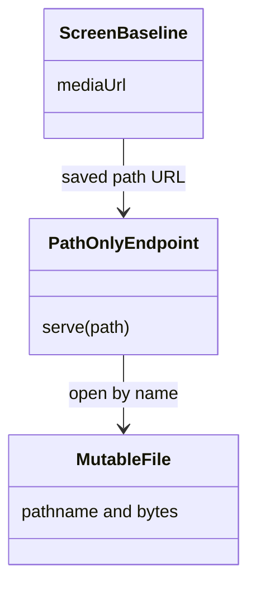

### BEFORE-S — Conceptual rejected baseline, not historical behavior

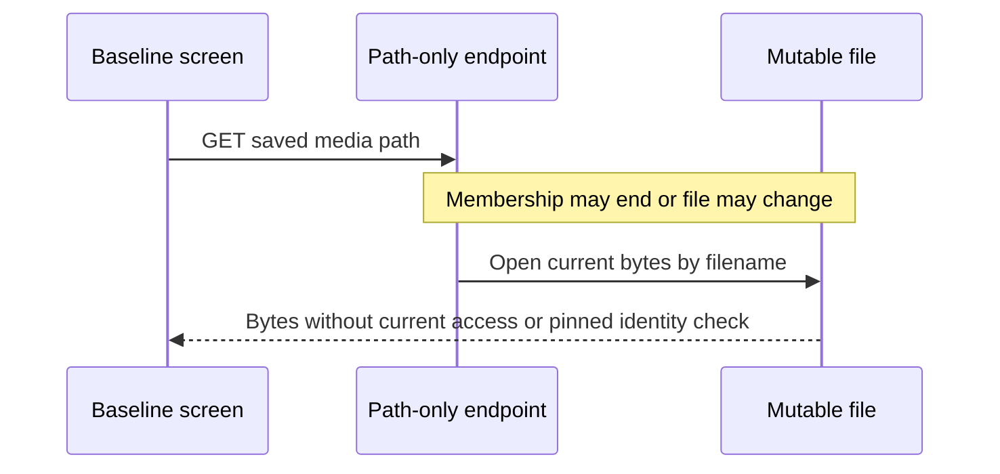

| Candidate approach                                  | Consequence                                                                                                                                                                                                            |
| --------------------------------------------------- | ---------------------------------------------------------------------------------------------------------------------------------------------------------------------------------------------------------------------- |
| Permanent/public path URL                           | Simple media integration; cannot enforce current membership or bind an immutable output. Rejected baseline above.                                                                                                      |
| Require app bearer headers on every media request   | Direct routes support authenticated callers, but browser video/navigation APIs do not provide a general custom-header hook. Putting bearer credentials in URLs expands disclosure.                                     |
| S3-presigned GET                                    | Offloads transfer; an already issued URL normally remains usable until expiry without consulting Rewind's current session/membership. Not the implemented playback transport.                                          |
| **Opaque server capability plus verified snapshot** | Actual solution: bind one session and output identity, recheck current records before and after storage awaits, stream a verified descriptor with byte ranges. Costs server bandwidth, hashing and temporary capacity. |

The **AFTER** class and sequence are [DC-01](#dc-01) and [DS-02](#ds-02). `MediaCapabilities` is a capability-based authorization mechanism, not a GoF pattern. Module separation
and boundary/control/entity decomposition describe architecture and analysis. `MediaStore` provides interface-based substitution of storage behavior; this is comparable to a
Strategy role, without claiming GoF class machinery or inventing storage classes. `createFilmPlayback` adapts Expo/DOM operations through a closure, an Adapter-like implementation
choice. Premiere string states are data and conditionals, **not** GoF State objects.

## Transition and implementation choices

| Applied transition strategy                         | Concrete mapping and consequence                                                                                                                                                                                                                                                                |
| --------------------------------------------------- | ----------------------------------------------------------------------------------------------------------------------------------------------------------------------------------------------------------------------------------------------------------------------------------------------- |
| Boundary/control/entity decomposition               | Viewing boundary → `ArchiveScreen`/`FilmScreen`; access control → `handleRequest` helpers and `MediaCapabilities`; entities → persisted cycles, contributions, jobs and membership rows. No new entity runtime classes are implied.                                                             |
| Persistence identity mapping                        | Account ID resolves to accepted membership `profile_id` in the selected group. Film ID is a film `media_jobs.id`; clip ID is its job ID **plus** `contributionId` for fresh-client matching. Digest/size/path bind grants to output identity, while `MediaObjectRef` binds store version/scope. |
| Interface and service extraction                    | `RealAccountArchiveClient` isolates authenticated metadata fetching and response validation; `MediaStore` isolates scoped private object access. `openStoredServingFile` materializes the exact reference and returns the same snapshot-serving shape as disk.                                  |
| Separate metadata from byte delivery                | `servableJobOutput` uses finalized metadata plus existence/size for discovery; `openMediaWithIntegrity` copies/hashes a snapshot for actual delivery. Same-size corruption can be advertised until byte verification catches and audits it.                                                     |
| Convert asynchronous lifetimes into explicit guards | Playback generations cancel queued readiness work; own-clip generations/context epochs reject stale discovery and stop later exports. Queue identity ignores changing URLs and serializes entire authorization/export operations. These are local controls, not durable jobs.                   |

Tradeoffs and limits:

- Grants use 32 random bytes, store hashed keys and issuing-session hashes, last 120,000 ms, and are held in a process-local map capped at 4,096 entries. Restart or oldest-entry
  eviction invalidates URLs; retry must obtain fresh metadata. Possession can redeem a grant without a session header while its issuing session/membership remains valid. Treat the
  URL as a temporary secret.
- Capability resolution queries membership/session selection directly. Direct routes use identity/session caches with a five-minute TTL; application-owned changes invalidate
  caches, while out-of-band SQL changes can lag. See [identity-cache.ts](../../server/src/auth/identity-cache.ts#L1).
- Serving reserves at most three concurrent snapshots and 96 MiB combined by default ([MediaServingBudget](../../server/src/media/serving-budget.ts#L9)). Whole-output verification
  occurs even for small ranges and HEAD. This trades repeated I/O and server transfer cost for pinned verified bytes. Abort/close releases the lease; a mid-stream error destroys
  the response, not a JSON retry.
- Capabilities require verified metadata. The lower-level integrity helper can label legacy rows `unverifiable` without blocking them; do not generalize its helper contract into a
  claim that every possible legacy direct request has mandatory digest metadata. Modern publication and stored serving require it.
- Discovery and fresh-asset searches stop after 100 pages; repeated/exhausted cursors stop traversal. This prevents infinite walks but is not a proof of an unlimited archive's
  completeness. Each export refreshes before transfer; there is no transparent expiry retry within a failed byte transfer.
- Web downloads fetch a Blob, click an object URL and revoke it; missing APIs fall back to opening the authorized URL. Neither proves a file reached disk. Android uses
  operation-owned cache, native folder copy and up to 25 collision names. Other native compatibility uses app cache; compiled iOS is out of scope.
- Batch progress and the already-saved clip set live in screen memory. They do not survive remount/restart. Context checks stop subsequent work; an already running transfer/export
  is not actively cancelled by those checks.

## Sources and limits

The source revision above was checked with local `git rev-parse HEAD`; the coordinator supplied its origin/dev verification. Inspection used narrowly scoped reads of the linked
source and existing tests. No GitHub operation, application change, commit or staging operation belongs to this document task.

Additional implementation dependencies: [jobs/index.ts · servableJobOutput](../../server/src/jobs/index.ts#L1906), [store.ts · MediaStore /
MediaObjectRef](../../server/src/media/store.ts#L9), [store-files.ts · materializeStoredMedia](../../server/src/media/store-files.ts#L15), and [real-account-client.ts ·
resolvePublicMediaPath](../../src/auth/real-account-client.ts#L427). The URL resolver permits the configured API origin/path and narrowly shaped capability path, rejecting
credentials, query strings, fragments and foreign absolute paths; plain HTTP is limited to allowed local development URLs.

All behavioral claims are static interpretations at this revision. Test files in the traceability table provide relevant assertions, not proof of a run. No application tests,
browser playback, deployment, account flow or physical device verification was run for this documentation-only assignment. A later direct-download ticket implementation would need
a new model and source map; none is inferred from the upload signing transport or reminder tickets.
