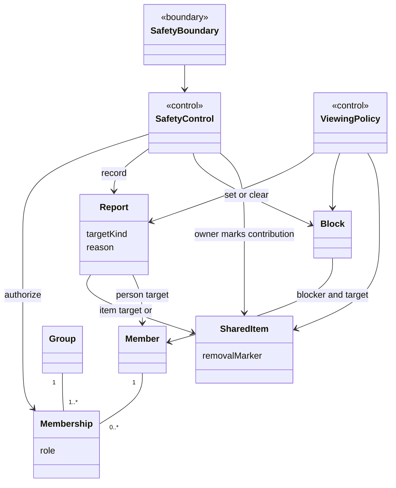
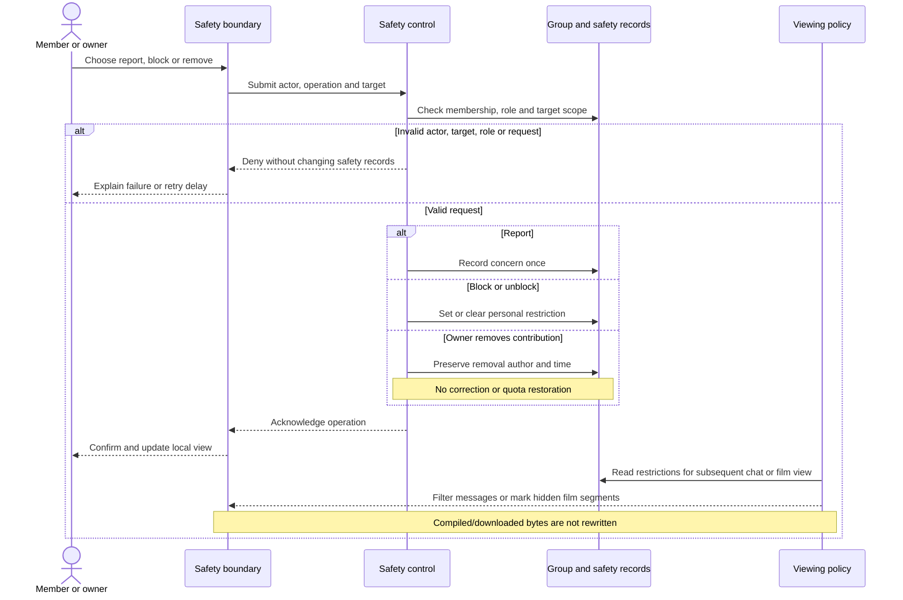
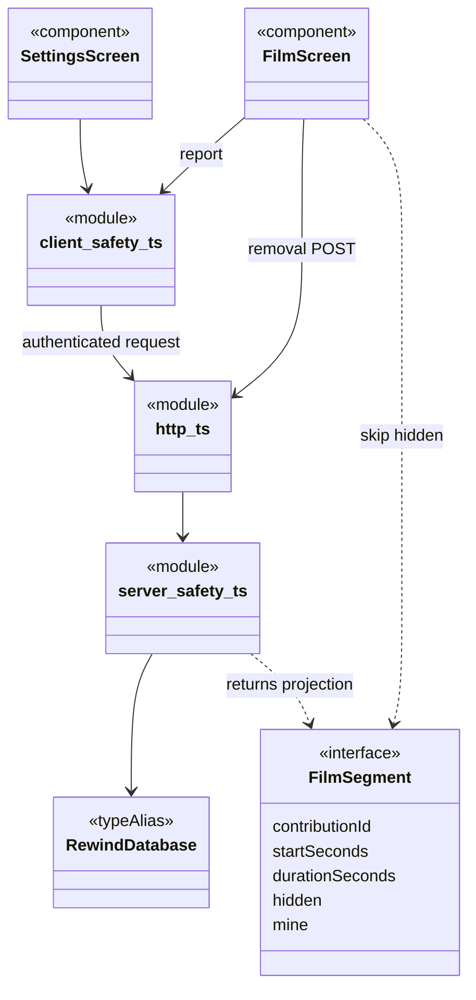
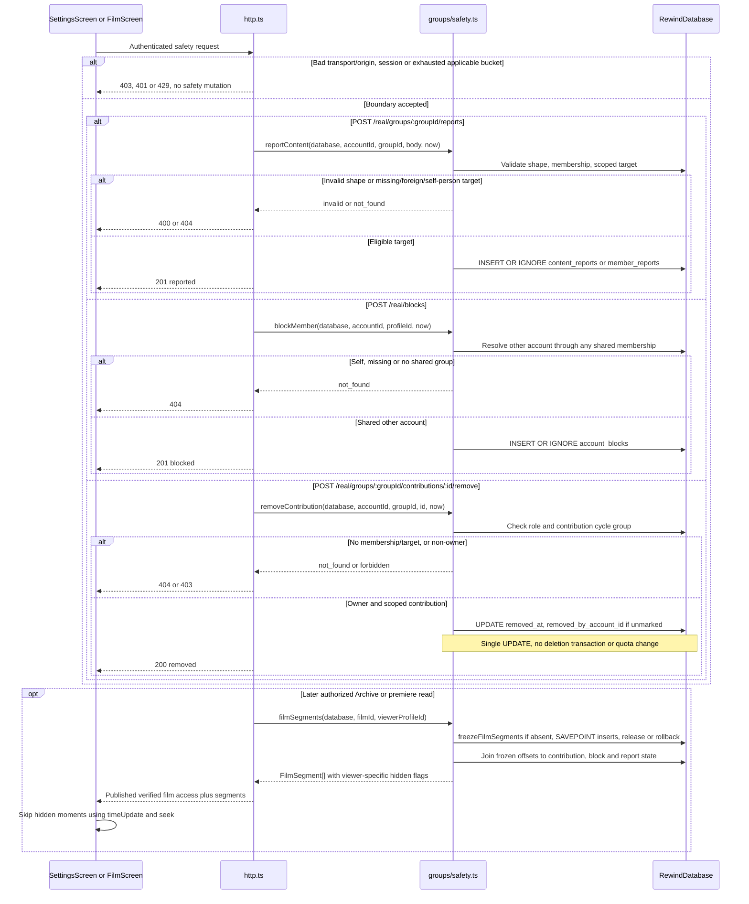

# Safety: report, block and owner removal

Source inspected: `dev` revision `39ba152af0da152ff8e0efe08be861270752129e`, 15 October 2026. Contract:
[UC-MANAGE-SAFETY](../../doc/planning/current-product-baseline.md#uc-manage-safety). Analysis names are conceptual
responsibilities; design modules below are functional code, not instantiated domain classes. Test links identify
specifications, not passing results.

## UC-MANAGE-SAFETY

**Actors/preconditions:** signed-in group member; owner specializes member for removal. Reports/removal authorize the group
in the URL against stored membership; these safety routes do not additionally require that group to be currently selected.
Blocking authorizes through any shared group and stores an account-level relation. Archive/media reads separately require
live selected membership and published assets.

**Normal flow:** member chooses a message, contribution or person and sends a report; Rewind validates the target and stores
one report per reporter/target. Message/contribution reports hide that item for the reporter. A person report alone records a
concern without hiding all that person's content. Member may separately block/unblock a person. Owner may confirm removal of
a group contribution, marking it hidden for all viewers and excluding it from eligible compilation inputs.

| Operation        | Validation, outcome and major exceptions                                                                                                                                                                                                                                                                                                                                                                                                                                                                                                                                                                 |
| ---------------- | -------------------------------------------------------------------------------------------------------------------------------------------------------------------------------------------------------------------------------------------------------------------------------------------------------------------------------------------------------------------------------------------------------------------------------------------------------------------------------------------------------------------------------------------------------------------------------------------------------- |
| Report           | Exactly one recognized nonempty string target: `messageId`, `contributionId` or `memberId` (profile ID). Any explicitly empty target is invalid; reason defaults to empty, must be a string of at most 500 characters and is trimmed on insert. Message must belong to group; contribution must belong through its cycle and have no `deleted_at`. Person must be another account in that group. Invalid shape → 400; missing membership/foreign or missing target/self-person → 404; success, including duplicate → 201. Own message/contribution reporting is not explicitly forbidden by the service. |
| Block            | Target profile must resolve to another account sharing at least one group. Self, nonexistent or no-shared-group target → 404, without insertion. A target outside the selected group can qualify through another shared group. Duplicate insertion is ignored; success → 201. Unblock deletes only the caller's relation, returns 200 even if absent, and does not undo reports.                                                                                                                                                                                                                         |
| Owner remove     | Membership absent → 404; member without owner role → 403; contribution outside that group or missing → 404. Success → 200; repeated removal preserves the first marker. Service does not require an undeleted contribution, collecting phase or another author; Film UI offers removal only on another person's visible segment.                                                                                                                                                                                                                                                                         |
| Request boundary | Transport/origin rejection → 403; invalid session → 401. Report/block/unblock share the account token bucket (capacity 20, replenished over ten minutes); exhaustion → 429 before mutation. Removal is not routed through that safety bucket.                                                                                                                                                                                                                                                                                                                                                            |

**Effects and limits:** blocking hides the target's messages/moments for the blocker; it does not expel a member or prevent
ordinary group messages. Replies and reactions require a visible target and no block in either direction. Hidden
quoted-message previews are stripped. Reporting is not a verdict or a demonstrated review workflow: UI text promising review
within 24 hours is not evidence of an operational SLA.

Owner removal is **not correction deletion**: it writes `removed_at` and `removed_by_account_id`, leaving `deleted_at`, quota
counters and the author's correction allowance untouched. Eligible self-correction instead runs `deleteContribution` in a
writer transaction: validate original current seven-day window/collecting phase/job state, decrement reserved count/seconds,
increment `deletions_used`, tombstone contribution/job and update cycle counters; commit before bounded local file cleanup.
Ineligibility and exceptions roll back. Removal does not invoke that transaction or restore quota.

Archive/premiere return frozen segment offsets with viewer-specific `hidden` flags. The Film client skips hidden segments;
removed/deleted/missing contributions hide for everyone. The compiled film bytes are unchanged. Film downloads are still
advertised with those segments, and capability checks do not enforce segment redaction; `removed_at` is also not a clip
capability predicate. Do not infer secure erasure, a sanitized download or revocation of previously downloaded copies.

## Analysis class view

## Analysis sequence: normal and major failure paths

## Design class view: actual symbols and persistence

`SettingsScreen`: [Settings.tsx](../../src/real/Settings.tsx); `FilmScreen`: [Film.tsx](../../src/real/Film.tsx). Module
aliases: [client safety](../../src/real/safety.ts) (`reportContent`, `blockMember`, `unblockMember`, `listBlocked`);
[HTTP](../../server/src/http.ts) (`handleRealGroupRequest`, `handleRequest`); [server
safety](../../server/src/groups/safety.ts) (sequence functions plus `visibleChatEvent`, `canInteractWithChatMessage`).
`RewindDatabase` aliases `DatabaseSync` (providing `prepare`/`exec`) in [db.ts](../../server/src/db.ts). Tables: `content_reports`, `member_reports`,
`account_blocks`, `contributions`, `film_segments`, joined to membership/profile/cycle/job/input rows. See
[028](../../server/migrations/028-content-safety.sql), [029](../../server/migrations/029-member-reports.sql), superseded for
report retention by [030](../../server/migrations/030-moderation-records.sql): target/group deletion can null references
while reporter/reason/time survive; deleting the reporter cascades their reports.

## Design sequence: normal and major failure paths

## Analysis-to-design transition and alternatives

| Refinement / design choice               | Actual mapping and tradeoff                                                                                                                                                                                                                                                                                                                                                                    |
| ---------------------------------------- | ---------------------------------------------------------------------------------------------------------------------------------------------------------------------------------------------------------------------------------------------------------------------------------------------------------------------------------------------------------------------------------------------- |
| Boundary/control/entity separation       | Conceptual SafetyBoundary becomes Settings/chat/Film components plus client request functions; SafetyControl becomes HTTP guards and functional safety exports. Reports/blocks are rows, not invented service/entity classes. Chat uses [RealAccountChatScreen](../../src/chat/RealAccountChatScreen.tsx) and server [chat functions](../../server/src/chat/index.ts).                         |
| Identity and scope refinement            | Conceptual person targets become profile IDs resolved to account IDs. Reports/removal retain group scope; blocks persist by account pair. This prevents a selected-group-only UI rule being mistaken for server authorization.                                                                                                                                                                 |
| Distinct lifecycle operations            | Owner marker and transactional self-correction remain separate. [deleteContribution](../../server/src/contributions/index.ts) owns quota restoration; [jobs input selection](../../server/src/jobs/index.ts) excludes removed contributions. A shared destructive delete would conflate safety authority with the author's bounded allowance.                                                  |
| Derived visibility and stable timing     | `filmSegments` derives visibility rather than mutating compiled output. `freezeFilmSegments` inserts all offsets under a savepoint, rolling back partial insertion on error; it also supports nesting during account purge. Reports/blocks/removal use individual SQL mutations, not that savepoint.                                                                                           |
| Alternatives, not implementation history | Client-only filtering would lack persisted cross-session policy. Re-encoding each viewer's film could redact bytes but adds processing/storage and invalidation work. Actual persisted restrictions plus read-time flags preserve one film and stable offsets, with the explicit raw-media limitation above. These are evaluated alternatives, not claims of earlier versions or GoF patterns. |
| Composed action failure                  | Settings/chat send the report before optional block as separate HTTP requests. A block/network failure can follow a committed report; retry deduplicates reporting. No combined all-or-nothing transaction is claimed.                                                                                                                                                                         |

Specification locations: [account safety](../../server/tests/account-safety.test.mjs) (validation, duplicates, chat/block,
retention), [rate limits](../../server/tests/safety-rate-limits.test.mjs), [real
Archive](../../server/tests/real-archive.test.mjs) (viewer flags, owner scope, unchanged counters/offsets), [correction
policy](../../server/tests/contribution-policy.test.mjs), [Settings safety](../../tests/real-settings-safety.test.tsx), [chat
UI](../../tests/real-account-chat.test.tsx), [Film UI](../../tests/film-screen.test.tsx).

Static-only limits: source and linked definitions were inspected; no tests, app, browser/device flows, deployment, external
moderation process or performance checks were executed. Rendering, independent review, application checks and CI belong to
the integrating batch. No human design ownership or operational compliance is inferred.
