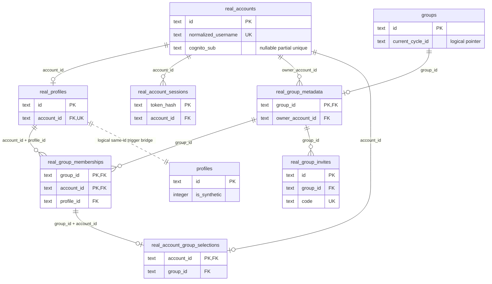
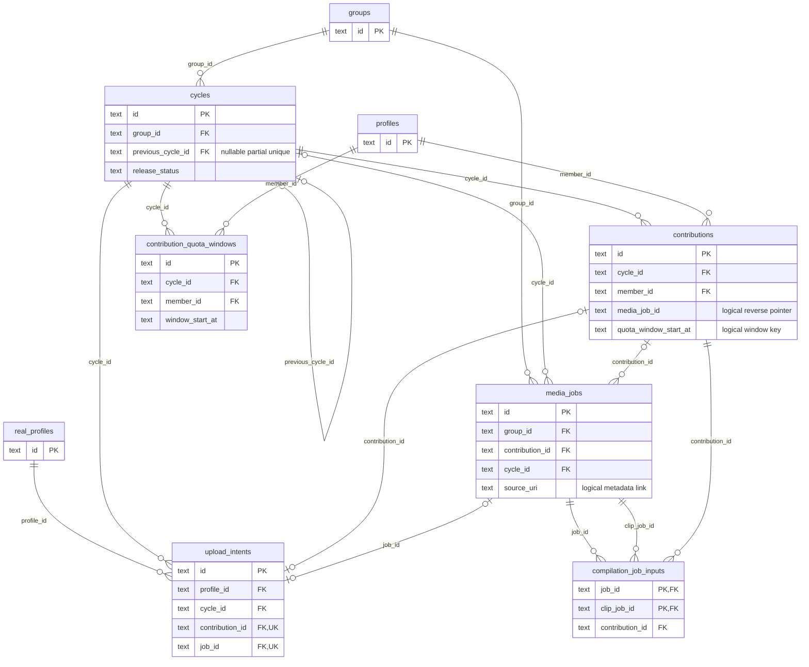
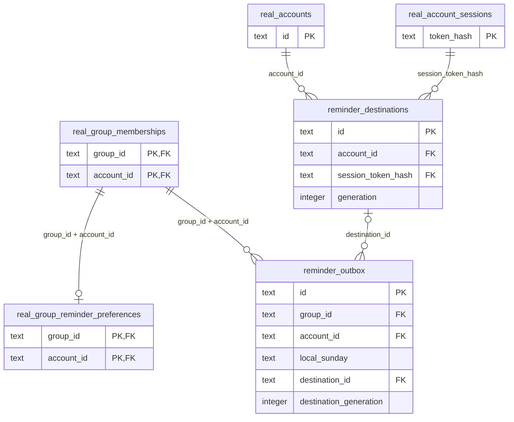

# Relational database design

Source revision: `40ebeb5673d103b4b6950d095192aae744980769` (`dev`, inspected
15 October 2026). This describes repository schema and application rules, not
proof of any environment's deployment or stored data.

[ADR-0003](../architecture/ADR-0003-postgresql.md) records the PostgreSQL
adapter, serialized writers and SQLite parity decision. The schema sources are
[PostgreSQL baseline 030](../../server/migrations/postgres/030-baseline.sql),
[Cognito migration 031](../../server/migrations/postgres/031-cognito-accounts.sql)
and the [SQLite baseline](../../server/migrations/sqlite-baseline.sql), which a
fresh database runs once (receipts and open logic in
[schema.ts](../../server/src/schema.ts); older databases are refused). PostgreSQL uses text with byte-order
collation, `BIGINT` for integral values and double precision for fractional
media durations/usage; timestamps here are ISO-8601 text. Its FKs are deferrable,
initially immediate. SQLite retains its own affinity and migration history.

## Editable ERD

The three views show selected keys and relationships; the dictionary below
covers the remaining tables and constraints. `PK` and `FK` mark actual database
keys. `||`, `o|` and `o{` mean exactly one, zero or one, and zero or many.
Edges labelled `logical` are application/trigger links, not SQL FKs; their
cardinality describes the intended runtime relationship (the profile bridge
edge is scoped to real actors; legacy profiles can also exist). Other edges describe
schema-permitted cardinality, which can be wider than product policy.

### Accounts and group authority

`real_profiles` has both `UNIQUE(account_id)` and `UNIQUE(account_id,id)`.
The membership FK is **composite**: `(account_id,profile_id)` references
`real_profiles(account_id,id)`. A selection's `(group_id,account_id)` references
an actual membership. Its account PK means at most one selected group per
account and at most one selection per membership; application authority also
matches the signed-in account.

[Migration 022](../../server/migrations/sqlite-baseline.sql) and
the PostgreSQL baseline insert/update/delete triggers mirror real profiles into
`profiles` with the same ID and `is_synthetic=0`. This is not an FK between
profile tables. Real-group authority comes from `real_group_memberships`, never
from legacy `memberships` or the presence of a media actor. The public member ID
is the real profile ID; it is distinct from the account ID.

### Cycles and media processing

`contributions.media_job_id` has no FK; `media_jobs.contribution_id` does have
one, with no uniqueness constraint. The application normally creates one clip
job per contribution; the ERD therefore permits more than that policy.
`media_jobs.source_uri`, `staged_sources.source_uri` and
`media_metadata.source_uri` are joined logically, with no source-URI FK.
Likewise, contribution/intent window-start fields do not reference the quota
window's composite unique key. `groups.current_cycle_id` is nullable text,
without an FK or uniqueness constraint; application reads also check group ID.

### Reminder delivery

The two destination FKs independently check existence; they do not prove that
the session belongs to that account. Runtime authorization checks that binding.
The copied destination generation prevents an old queued send from using a
replaced registration. Schema support for `expo` remains for compatibility;
the current product uses web push only. Provider acceptance is not proof of
visible device delivery.

## Compact data dictionary

`U(...)` denotes a unique constraint/index in addition to the stated PK.
Nullable unique values permit multiple nulls. IDs are text unless noted.

| Table(s)                                              | Primary key; important uniqueness                                                        | Stored purpose and reference rules                                                                                                                                                                                                                                                                     |
| ----------------------------------------------------- | ---------------------------------------------------------------------------------------- | ------------------------------------------------------------------------------------------------------------------------------------------------------------------------------------------------------------------------------------------------------------------------------------------------------ |
| `real_accounts`                                       | `id`; U(normalized_username), U(password_salt), partial U(cognito_sub) when non-null     | Account identity and local/dev password verifier parameters. Cognito accounts hold an immutable pool `sub` and unusable random password values; no Cognito password is stored.                                                                                                                         |
| `real_profiles`                                       | `id`; U(account_id), U(account_id,id)                                                    | At most one profile per account; account FK cascades deletion. Profile creation may follow account creation.                                                                                                                                                                                           |
| `profiles`                                            | `id`                                                                                     | Shared media/chat actor and display label; real-profile triggers maintain the bridge. `is_synthetic` is retained schema compatibility.                                                                                                                                                                 |
| `groups`, `real_group_metadata`                       | `id`; `group_id` respectively                                                            | Shared group plus optional real-group extension. Extension group FK cascades; owner account FK does not cascade. Capacity is 2–10; metadata duration is constrained to 28 days; `time_zone` controls reminder scheduling. Actual cycle boundaries allow configured short local runs.                   |
| `real_group_memberships`                              | `(group_id,account_id)`                                                                  | Group FK and composite profile FK cascade; role is owner/member. SQL does not enforce exactly one owner, capacity or cross-group cycle consistency; application transactions do.                                                                                                                       |
| `real_account_group_selections`                       | `account_id`                                                                             | Account FK and composite membership FK cascade. Persists the selected group.                                                                                                                                                                                                                           |
| `real_account_sessions`                               | `token_hash`                                                                             | Account FK cascades. Creation, last seen, idle/absolute expiry and revocation; stores a token hash rather than the bearer token.                                                                                                                                                                       |
| `real_group_invites`                                  | `id`; U(code)                                                                            | Group and issuing-owner FKs cascade; accepting account FK does not. Active/accepted/expired state with creation, expiry and acceptance timestamps.                                                                                                                                                     |
| `cycles`                                              | `id`; partial U(previous_cycle_id)                                                       | Group FK cascades. Nullable predecessor FK sets null on deletion, allowing at most one successor. Stores prompt, boundaries, lifecycle, lock and independent release publication state. Cycle usage counters are aggregate compatibility data, not per-member allowance authority.                     |
| `cycle_control_events`                                | `id`                                                                                     | FKs to cycle, group and actor cascade; records prior/next boundaries and positive advance seconds.                                                                                                                                                                                                     |
| `cycle_lifecycle_events`                              | `id`; U(cycle_id,transition)                                                             | Cycle/group FKs cascade. Idempotent receipts for collecting-to-revealing, revealing-to-archived and successor creation.                                                                                                                                                                                |
| `contribution_quota_windows`                          | `id`; U(cycle_id,member_id,window_start_at)                                              | Cycle/profile FKs cascade. Window boundaries, capped count/seconds, consumption and one correction counter (`deletions_used` 0–1).                                                                                                                                                                     |
| `contributions`                                       | `id`                                                                                     | Cycle/profile FKs cascade. Duration, creation/window key, job pointer and tombstone. Replacement self-FK and moderator-account FK set null; `removed_at` is separate from author deletion.                                                                                                             |
| `upload_intents`                                      | `id`; U(environment,group_id,profile_id,idempotency_hash), U(contribution_id), U(job_id) | Real group/account/profile/cycle and nullable contribution/job FKs do not cascade. Request/target JSON, reserved seconds, open/pinned/completed/expired state, immutable pinned reference, expiry and bounded cleanup cursor. Completed state requires both receipt FKs; other states require neither. |
| `staged_sources`                                      | `source_id`; U(source_uri), U(idempotency_key_hash)                                      | Group/profile FKs cascade. Owner-bound staging capability, path/reference, size, status and claim generation/expiry; URI knowledge alone grants no access.                                                                                                                                             |
| `media_metadata`                                      | `source_uri`                                                                             | Verified probe metadata: MIME, byte length, duration, dimensions, media type and audio flag. No FKs. Photos use normalized still-frame metadata; SQL retains positive duration/audio constraints from the processing pipeline.                                                                         |
| `media_jobs`                                          | `id`; partial U(idempotency_key), partial U(cycle_id) for non-null film cycle            | Group/cycle FKs cascade; contribution FK sets null. Clip/film/download kind, photo/video type, queue state, claim generation, attempts/progress, source/trim/output references and output SHA-256/size/verification time.                                                                              |
| `compilation_job_inputs`                              | `(job_id,clip_job_id)`; U(job_id,contribution_id)                                        | Both job FKs and contribution FK cascade. Frozen ordered film inputs; `position` is nonnegative but not unique.                                                                                                                                                                                        |
| `film_segments`                                       | `(film_job_id,position)`                                                                 | Film-job FK cascades; nullable contribution FK sets null. Preserves segment timing when contribution rows disappear.                                                                                                                                                                                   |
| `real_group_reminder_preferences`                     | `(group_id,account_id)`                                                                  | Composite membership FK cascades. Opt-in, snooze and update time.                                                                                                                                                                                                                                      |
| `reminder_destinations`                               | `id`; U(account_id,device_key), U(provider,destination_hash)                             | Account/session FKs cascade. Destination JSON/hash, provider, enabled flag and generation.                                                                                                                                                                                                             |
| `reminder_outbox`                                     | `id`; U(group_id,account_id,local_sunday)                                                | Membership FK cascades; destination FK sets null. Schedule, destination generation, state, bounded attempts/receipt attempts (0–3), retry time and paired lease ID/expiry. Deduplicates a member's weekly send across devices.                                                                         |
| `messages`                                            | `id`                                                                                     | Group/profile FKs cascade; reply-to self-FK sets null. Body and creation time.                                                                                                                                                                                                                         |
| `reactions`                                           | `id`; U(message_id,member_id,emoji)                                                      | Message/profile FKs cascade. One identical reaction per member/message.                                                                                                                                                                                                                                |
| `realtime_events`                                     | integral identity `id`; U(message_id)                                                    | Group/message FKs cascade. Ordered persisted message event cursor; event type is constrained to message.                                                                                                                                                                                               |
| `account_blocks`                                      | `(blocker_account_id,blocked_account_id)`                                                | Both account FKs cascade; self-block forbidden.                                                                                                                                                                                                                                                        |
| `content_reports`                                     | `id`; U(reporter_account_id,message_id), U(reporter_account_id,contribution_id)          | Reporter FK cascades; group/message/contribution FKs set null. Reason capped at 500 characters; message and contribution cannot both be non-null. References may become null after deletion.                                                                                                           |
| `member_reports`                                      | `id`; U(reporter_account_id,group_id,reported_account_id)                                | Reporter FK cascades; group/reported-account FKs set null. No self-report; reason capped at 500 characters.                                                                                                                                                                                            |
| `auth_login_throttles`, `real_invite_guess_throttles` | `(scope,subject_hash)`                                                                   | Account/source-scoped hashed throttle keys, counters and window times; login throttle also records escalating cooldown. No account FK.                                                                                                                                                                 |
| `audit_events`                                        | `id`                                                                                     | Session/job/integrity/repair event type, result and time. Actor profile FK sets null; resource ID is logical.                                                                                                                                                                                          |
| `memberships`, `invites`, `sessions`                  | `(group_id,member_id)`; `id`; `id`                                                       | Legacy schema retained after Demo removal; not real-account authority. Group/profile FKs generally cascade; invitee FK sets null. Invites have partial U(code); sessions constrain `access_kind` to demo. Retention of these tables does not mean a Demo product route exists.                         |
| `schema_migrations`, `schema_migration_markers`       | integral `version`; `migration_key`                                                      | Applied migration bookkeeping. PostgreSQL baseline records versions 1–30; migration 031 adds Cognito identity.                                                                                                                                                                                         |
| `rewind_database_environment` (PostgreSQL only)       | boolean `singleton` constrained true                                                     | One environment binding and timestamp; startup rejects a mismatched runtime environment.                                                                                                                                                                                                               |

## Allowance, lifecycle and release

[Contribution policy](../../server/src/contributions/index.ts) uses seven-day
windows anchored to each cycle's `starts_at`, not calendar weeks. Each member
gets at most five contributions and 30 seconds per window; a contribution lasts
at most 15 seconds, and smaller configured limits apply. Photos consume one
contribution and three seconds. The window's stored end can extend beyond a
short cycle; eligibility still stops at the cycle end.

[Upload intents](../../server/src/media/upload-intents.ts) hold count/seconds
through unexpired open/pinned rows. Quota checks combine these holds with the
persisted consumed allowance; holds do not increment its counters. Completion
rechecks authority, cycle/window, pinned version and validated media under a
writer transaction, then increments the allowance and creates contribution,
clip job and completed receipt atomically. The own intent is excluded from the
held sum. Completed replay returns its receipt, including after rollover;
expiry releases an unfinished hold without a counter decrement. Uniqueness and
state guards make registration idempotent, rather than relying on the client.

At the collection boundary, [lifecycle](../../server/src/cycles/lifecycle.ts)
changes the old cycle to revealing, ensures its film job, creates one collecting
successor anchored to the old end and advances the group pointer in one writer
transaction. It does not wait for the film to finish. A ready job alone is not
publication: publication checks the exact verified film output and records
`release_status=published` plus `release_published_at`. The premiere lasts 24
hours from publication, then the cycle can archive after output verification.
Both revealing and archived cycles retain `lock_state=locked`; media policy
uses lifecycle/publication checks rather than interpreting that field as a
standalone permission. See the [cycle contract](cycle-control-contract.md).

## Deletion, retention and media bytes

- An eligible author correction in the current collecting window tombstones the
  contribution, marks its clip job deleted and restores its count/seconds once.
  Processing jobs cannot be corrected. The transaction increments the window's
  one-correction counter and clears source/output references; owned file cleanup
  follows commit. Replacement history remains linked by the contribution
  self-FK. A prior window's clip cannot refund the current window.
- [Owner removal](../../server/src/groups/safety.ts) sets `removed_at` and
  `removed_by_account_id`; it does not refund allowance or consume the author's
  correction. Compilation excludes deleted/removed contributions. Existing
  film segment timing supports hiding removed content without treating a
  moderation flag as proof that compiled bytes have been erased.
- [Account deletion](../../server/src/auth/deletion.ts) transfers owned groups
  to the longest-standing other member or deletes a sole-member group. It
  removes non-cascading upload-intent references and clears invite acceptor
  references before deleting the account. Profile deletion triggers removal of
  its media actor and dependent contributions/chat; own clip jobs are marked
  deleted with references cleared first. Existing group films are retained;
  frozen segment timing survives null contribution references. Byte removal
  after commit is best effort, not transactional erasure of every copy.
- [Processed-media retention](../../server/src/jobs/retention.ts) targets
  unreferenced local files at least 24 hours old, with bounded scanning and
  reference/inode checks under the writer fence before deletion. That threshold
  is not an expiry promise for archives or all database rows. Stored incoming
  cleanup requires expiry and protects durable job/staged references; intent
  cleanup expires unfinished rows first and walks bounded version inventories.

The relational store holds metadata, receipts, probe results and opaque media
references; it does **not** contain photo/video payloads. The configured
[runtime media adapter](../../server/src/media/runtime-store.ts) uses disk for
local product runs and S3 for hosted storage. Source generations, pinned object
versions and output checksums bind jobs to bytes outside SQL. A successful
metadata transaction neither proves those bytes exist nor backs them up;
publication/serving perform storage integrity checks. This design document does
not claim a live S3 lifecycle, backup rehearsal, retention SLA or deployed
PostgreSQL revision; those require environment-specific evidence.
